# AGV FOTA Gateway 설치·운영 가이드

AGV 펌웨어를 무선으로 올리는 서버입니다.
사내 PC 한 대에 설치하고, 브라우저로 씁니다.
브리지(ESP32-S3)와 메인보드(TMS320F2808) 펌웨어를 올리고, 호기를 골라 순서대로 배포합니다.

- 기준 버전: Gateway **v0.3.0** · 브리지 **v0.5.2**
- 설치 파일 하나에 .NET 런타임이 들어 있습니다. PC 에 .NET 을 따로 설치하지 않습니다.
- 전체 동작 원리는 [SYSTEM_FLOW.md](SYSTEM_FLOW.md) 를 봅니다. 저장소 `docs/` 와 설치 폴더에 이 문서와 함께 들어 있습니다.

## 목차

0. [이 문서로 할 수 있는 것](#0-이-문서로-할-수-있는-것)
1. [준비물](#1-준비물)
2. [서버 설치](#2-서버-설치)
3. [브리지 연결](#3-브리지-연결)
4. [펌웨어 올리기](#4-펌웨어-올리기)
5. [구역 등록](#5-구역-등록)
6. [배포 작업](#6-배포-작업)
7. [설정 appsettings.json](#7-설정-appsettingsjson)
8. [데이터와 백업](#8-데이터와-백업)
9. [서버 업데이트](#9-서버-업데이트)
10. [문제 해결](#10-문제-해결)
11. [제거](#11-제거)

---

## 0. 이 문서로 할 수 있는 것

처음 도입할 때는 아래 순서로 진행합니다.

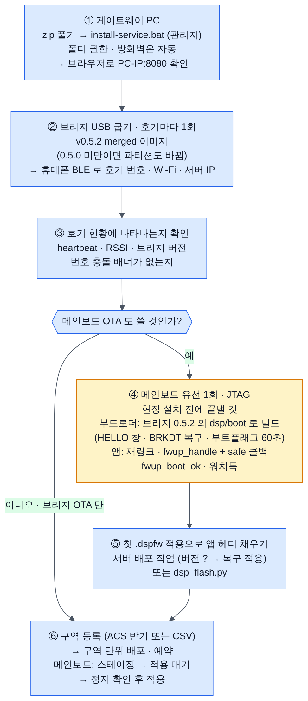

*서버를 먼저 세우고(권한·방화벽은 설치 스크립트가 처리), 브리지를 0.5.2 로 굽고, 필요하면 메인보드를 준비한 뒤, 구역 단위로 배포합니다. 메인보드는 스테이징 → 적용 대기 → 정지 확인 뒤 적용 순서입니다.*

| 단계 | 하는 일 | 보는 문서 |
|---|---|---|
| ① 서버 | PC 에 Gateway 설치 | 이 문서 [2장](#2-서버-설치) |
| ② 브리지 | 호기마다 USB 로 한 번 굽고 서버 IP 설정 | 브리지 저장소 [FLASH_GUIDE.md](https://github.com/Leepy0/AGV_Wifi_Bridge/blob/main/docs/FLASH_GUIDE.md) |
| ③ 연결 확인 | 호기 현황에 나타나는지, 번호 충돌 경고가 없는지 확인 | 이 문서 [3장](#3-브리지-연결) |
| ④ 메인보드 (선택) | 현장 설치 전에 부트로더와 재링크한 앱을 JTAG 으로 한 번 굽기 | 브리지 저장소 [dsp/README.md](https://github.com/Leepy0/AGV_Wifi_Bridge/blob/main/dsp/README.md) |
| ⑤ 첫 메인보드 이미지 | 첫 `.dspfw` 를 배포 작업으로 적용 (앱 헤더가 비어 부트로더가 기다리므로 일반 적용으로 됨. `no_bootloader` 면 복구 적용) | 이 문서 [4장](#4-펌웨어-올리기)·[6장](#6-배포-작업) |
| ⑥ 운용 | 구역 등록 → 구역 단위 배포·예약 | 이 문서 [5장](#5-구역-등록)·[6장](#6-배포-작업) |

> **메인보드 OTA 는 실기 검증 전입니다.** 서버 쪽은 가짜 브리지(0.5.2 흉내)로 종단 시험을 했습니다. 처음에는 벤치나 한 대로 먼저 시험하세요.

### v0.2.x 를 쓰다가 올라온 경우

0.3.0 에서 운용 방법이 바뀐 곳입니다. 해당 절을 한 번 읽어 둡니다.

| 바뀐 것 | 할 일 | 절 |
|---|---|---|
| 첫 서버 업데이트(v0.2.x → v0.3.0)는 옛 교체 배치가 돌아 서비스로 다시 뜨지 않을 수 있음 | 수동 업데이트, 또는 적용 뒤 서비스 상태 확인 | [9-1](#9-1-화면에서-업데이트) |
| 설치 폴더 권한·ACS 방화벽 규칙이 `install-service.bat` 에 추가됨 | 0.3.0 으로 올린 뒤 `install-service.bat` 을 한 번 다시 실행 | [2-4](#2-4-install-servicebat-이-하는-일) |
| 메인보드 작업은 기본이 "스테이징 후 확인하고 적용" | 스테이징이 끝나면 **적용 시작** 을 눌러야 굽기 시작 | [6-3](#6-3-적용-대기와-적용-시작) |
| 앱이 멈춘 메인보드는 작업에서 **복구 적용** 을 켜야 함 (자동으로 켜지지 않음) | 앱 버전 `?` 호기는 확인 후 복구 적용 작업으로 | [6-2](#6-2-작업-만들기) |
| 작업을 만들 때 확인창이 뜸. 마감 시각을 고를 수 있음 | 확인창의 대수·상태를 읽고 누름 | [6-2](#6-2-작업-만들기) |
| 메인보드 버전 8자 규칙을 업로드에서 강제 | `dsp_pack.py --ver` 를 1~8자로 | [4-1](#4-1-종류별-차이) |
| 브리지 원격 설정·OTA 확정은 서버가 자동 PING | 손으로 PING 할 필요 없음 | [3-1](#3-1-브리지에-서버-ip-넣기) |
| 같은 호기 번호 장치가 둘이면 화면에 경고하고 배포를 막음 | 한쪽 브리지 번호를 고침 | [3-4](#3-4-같은-호기-번호-충돌) |
| 브리지 0.5.2 와 짝을 맞춤 | 브리지도 0.5.2 로 올림 | [3-1](#3-1-브리지에-서버-ip-넣기) |
| 화면·API 는 IP·`localhost`·이 PC 이름으로 접속할 때만 열림 (그 밖의 이름은 403) | 사내 DNS 별칭으로 접속했다면 `Gateway.AllowedHostNames` 에 그 이름을 넣음 | [2-7](#2-7-다른-pc휴대폰에서-열기) |

---

## 1. 준비물

### PC

| 항목 | 조건 |
|---|---|
| 운영체제 | Windows 10 / 11, 64비트 (x64) |
| 권한 | 관리자 권한 (서비스 등록·방화벽 규칙·폴더 권한, 설정 파일 수정 때문) |
| IP | **고정 IP 권장**. 브리지마다 이 IP 를 서버 주소로 저장하기 때문 (DHCP 면 예약 주소로) |
| 네트워크 | 브리지가 붙는 Wi-Fi 망에서 이 PC 의 IP 로 닿아야 함 |
| 인터넷 | 서버 자동 업데이트를 쓸 때만. HTTPS 443 으로 `github.com` 등 ([9-2](#9-2-업데이트-출처와-저장소-공개)) |
| 전원 | 항상 켜 둠. 절전 모드는 끕니다 |

### 포트

| 방향 | 포트 | 용도 | 방화벽 규칙 |
|---|---|---|---|
| 들어옴 | TCP 8080 | 웹 화면, REST API, 브리지가 펌웨어 파일을 받아 가는 주소(`/fw/`) | `install-service.bat` 이 자동 추가 (`AGV FOTA Gateway HTTP`) |
| 들어옴 | UDP 50000 | 브리지 → 서버 (heartbeat, OTA 결과, 메인보드 프레임) | 자동 추가 (`AGV FOTA Gateway Bridge UDP`) |
| 들어옴 | UDP 50001 | 브리지 RFID 로그 수신 (선택) | 위 규칙에 포함 |
| 들어옴 | TCP 6000 | ACS 중계를 `Server` 모드로 쓸 때만 | ACS 중계가 켜져 있고 `Server` 모드면 자동 추가 (`AGV FOTA Gateway ACS TCP`) |
| 나감 | TCP 443 | `github.com` 등 — 서버 업데이트 | 보통 불필요 |
| 나감 | 설정값 | ACS 중계(`Client` 모드)·ACS REST | 보통 불필요 |

- 포트 번호는 `appsettings.json` 에서 읽습니다(`Urls`, `Gateway.UdpPort`·`RfidPort`, `Gateway.Acs.Port`). 바꾸면 `install-service.bat` 을 다시 실행하면 규칙도 바뀝니다.

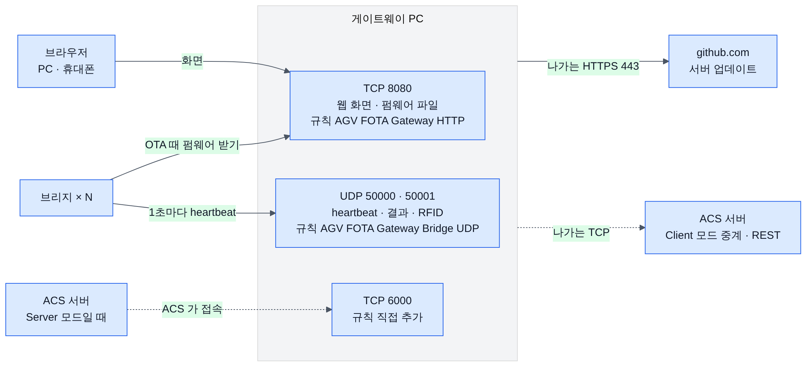

*들어오는 연결은 모두 설치 스크립트가 엽니다. TCP 6000 은 ACS 중계 `Server` 모드일 때만 만들고, 접속 IP 는 `AllowedRemotes` 로 제한합니다. 서버가 브리지로 보내는 UDP 는 브리지가 보낸 주소로 되돌려 보냅니다.*

---

## 2. 서버 설치

### 2-1. zip 받기

GitHub 저장소 **Releases** 에서 받습니다.

| 릴리스 | 파일 이름 | 용도 |
|---|---|---|
| 정식 `vX.Y.Z` (Latest) | `AgvFotaGateway_win-x64.zip` | 운영 설치. 자동 업데이트 대상 |
| 테스트 `dev` (Pre-release) | `AgvFotaGateway-dev_win-x64.zip` | main 브랜치 시험 빌드 |

- 정식 최신판 고정 주소: `https://github.com/Leepy0/AGV_FOTA_GATEWAY/releases/latest/download/AgvFotaGateway_win-x64.zip`
- 정식 릴리스에 함께 올라가는 `.sha256` 와 `AgvFotaGateway.json` 은 서버 자동 업데이트용입니다(`dev` 에는 `.sha256` 만). 설치할 때는 zip 만 받습니다.

### 2-2. 풀 위치

zip 안에는 `AgvFotaGateway` 폴더가 들어 있습니다.

1. zip 을 우클릭 → **속성** → 아래쪽에 **차단 해제** 가 있으면 체크하고 확인합니다.
2. zip 을 우클릭 → **모두 압축 풀기** → 대상 폴더를 `C:\` 로 지정합니다.
3. `C:\AgvFotaGateway\AgvFotaGateway.exe` 가 생겼는지 확인합니다.

> **`C:\Program Files` 아래는 피합니다.** 서비스가 `data` 폴더와 업데이트 파일을 쓰지 못할 수 있습니다. 설치 스크립트도 이 경우 경고를 띄웁니다.
> **드라이브 루트(`C:\` 바로 아래에 파일을 풀기)도 피합니다.** 설치 스크립트가 폴더 권한을 바꾸지 않고 경고만 합니다. 전용 폴더(`C:\AgvFotaGateway`)에 둡니다.

폴더 안 주요 파일:

| 파일 | 내용 |
|---|---|
| `AgvFotaGateway.exe` | 서버 (런타임 포함 단일 실행 파일) |
| `appsettings.json` | 설정 ([7장](#7-설정-appsettingsjson)) |
| `start.bat` | 콘솔로 실행 (시험용) |
| `install-service.bat` | Windows 서비스로 등록·갱신 (운영용) |
| `uninstall-service.bat` | 서비스 삭제 |
| `DEPLOY.md` · `SYSTEM_FLOW.md` | 이 문서 · 전체 동작 원리 |
| `images\` | 두 문서의 그림 |

그 밖의 파일(화면용 정적 파일 등)도 그대로 둡니다. `data\` 폴더는 처음 실행할 때 생깁니다.

### 2-3. 실행 방법 고르기

| | `start.bat` (시험) | `install-service.bat` (운영) |
|---|---|---|
| 실행 | 더블클릭. 서비스를 설치한 폴더에서는 우클릭 → **관리자 권한으로 실행** | 우클릭 → **관리자 권한으로 실행** |
| 동작 | 콘솔 창에서 실행. 브라우저로 `http://localhost:8080` 을 엶 | Windows 서비스 `AgvFotaGateway` 로 등록(이미 있으면 갱신)하고 시작 |
| 끄기 | 콘솔 창을 닫으면 서버도 꺼짐 | 계속 실행. PC 를 켜면 자동 시작 |
| 죽었을 때 | 다시 실행해야 함 | 자동 재시작 |
| 방화벽 | 규칙을 만들지 않음 → 다른 PC·브리지가 못 붙을 수 있음 | `appsettings.json` 의 포트로 허용 규칙 추가 |
| 쓰는 곳 | 첫 확인, 오류 메시지 보기 | 현장 운영 |

> 둘을 **동시에 실행하지 않습니다.** 포트 8080 과 UDP 50000 이 겹칩니다. 서비스가 돌고 있으면 `start.bat` 을 실행하기 전에 서비스를 멈춥니다.
> `install-service.bat` 을 한 번 실행한 폴더는 일반 사용자가 쓸 수 없습니다([2-4](#2-4-install-servicebat-이-하는-일)). 그 뒤 `start.bat` 을 일반 권한으로 실행하면 `data\` 에 쓰지 못해 오류가 납니다. 관리자 권한으로 실행하거나 서비스로만 운용합니다.

### 2-4. install-service.bat 이 하는 일

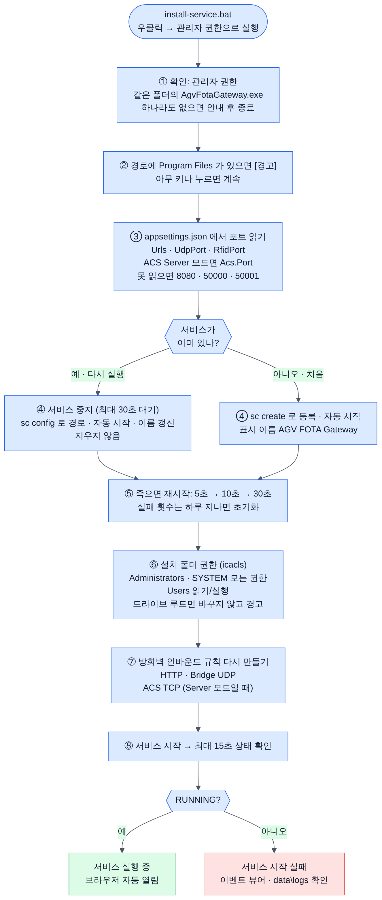

*권한 확인 → Program Files 경고 → `appsettings.json` 에서 포트 읽기 → 서비스가 있으면 멈추고 갱신, 없으면 새로 등록 → 재시작 정책 → 폴더 권한 → 방화벽 → 시작 뒤 최대 15초 확인.*

| 항목 | 값 |
|---|---|
| 서비스 이름 | `AgvFotaGateway` |
| 표시 이름 (서비스 관리자) | `AGV FOTA Gateway` |
| 시작 유형 | 자동 |
| 실패 시 | 5초 → 10초 → 30초 뒤 재시작. 실패 횟수는 하루(86400초) 지나면 초기화 |
| 포트 | `appsettings.json` 의 `Urls`(HTTP), `Gateway.UdpPort`·`RfidPort`(`0` 이면 뺌), ACS 중계가 켜져 있고 `Server` 모드면 `Gateway.Acs.Port`. 읽지 못하면 8080 / 50000·50001 |
| 방화벽 규칙 | `AGV FOTA Gateway HTTP` (TCP), `AGV FOTA Gateway Bridge UDP` (UDP), `AGV FOTA Gateway ACS TCP` (`Server` 모드일 때만) |
| 폴더 권한 | 설치 폴더 상속을 끊고 Administrators·SYSTEM 은 모든 권한, Users 는 읽기·실행만. 하위 파일·`data\` 도 같게 |
| 서비스 계정 | 지정하지 않음 (Windows 기본 LocalSystem) |

- **다시 실행해도 됩니다.** 서비스를 지우지 않고 멈춘 뒤(최대 30초 기다림) 설정만 갱신하고 다시 시작합니다. `data\` 와 `appsettings.json` 은 그대로입니다. 포트를 바꿨을 때, 서버를 0.3.0 으로 올린 뒤에도 다시 실행합니다.
- 끝에 `서비스 실행 중: http://localhost:8080` 이 나오고 브라우저가 열리면 성공입니다.
- `서비스 설정 갱신 실패 - services.msc, 이벤트 뷰어를 닫고 다시 실행하세요` 가 나오면 그 창들을 닫고 다시 실행합니다.
- `서비스 시작 실패 - 이벤트 뷰어 또는 data\logs 확인` 이 나오면 [10장](#10-문제-해결)을 봅니다.
- 폴더 권한 때문에 `appsettings.json` 을 고치거나 `data\` 를 지우려면 관리자 권한이 필요합니다([7-1](#7-1-고치는-순서)).

### 2-5. 첫 화면 확인

브라우저에서 `http://localhost:8080` 을 엽니다.

- 처음에는 호기 목록이 비어 있습니다.
- "아직 보이는 호기가 없습니다. 브리지의 `server` IP 가 이 PC 이고 UDP 50000 이 열려 있는지 확인하세요" 라는 안내가 보이면 정상입니다.
- 브리지가 붙으면 아래처럼 바뀝니다.

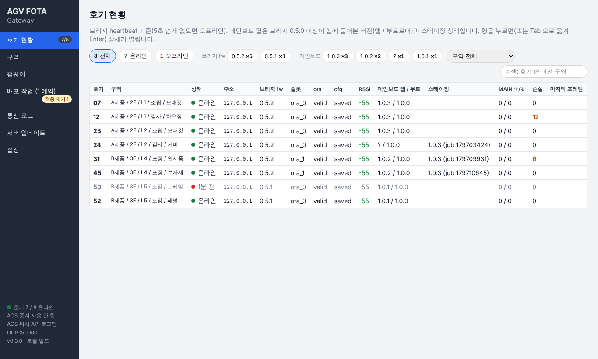

*가짜 브리지 8대 시연 화면입니다. 7대가 온라인이고 50호기는 heartbeat 가 끊겨 오프라인입니다. 24·31·45호기는 스테이징 열에 받아 둔 `1.0.3 (job …)` 이 보입니다. 실제로는 주소 열에 각 브리지의 IP 가 나옵니다.*

왼쪽 메뉴와 그 아래 요약:

| 표시 | 뜻 |
|---|---|
| 호기 현황 `7/8` | 온라인 대수 / 아는 호기 수 |
| 배포 작업 `⟳ 1` / `(1 예약)` | 실행 중인 작업 수 / 대기(예약) 작업 수 |
| 배포 작업 아래 `적용 대기 1` (노랑) | 스테이징을 마치고 **적용 시작** 승인을 기다리는 작업 ([6-3](#6-3-적용-대기와-적용-시작)) |
| 서버 업데이트 `●` | 새 서버 버전이 있음 |
| 호기 7 / 8 온라인 | 온라인 대수 / 아는 호기 수 |
| ACS 중계 | 사용 안 함 · 연결 · 끊김 |
| ACS 위치 API | 사용 안 함 · 로그만 · 발행 중 · 오류 |
| UDP :50000 | 브리지 수신 포트. 열지 못하면 ⚠ |
| v0.3.0 · 정식 배포 | 서버 버전 · 빌드 종류 |

### 2-6. 이 PC 주소 확인

메뉴 **설정** 을 엽니다. **서버** 칸의 `HTTP` 줄에 이 PC 주소가 나옵니다. 이 주소를 브리지의 서버 IP 로 씁니다.

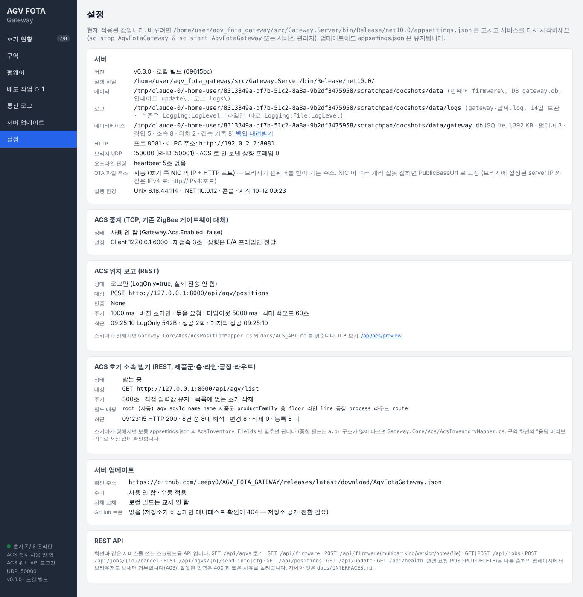

*설정 화면은 읽기 전용입니다. 시연 환경이라 경로가 리눅스 경로이고 포트가 8081 입니다. 실제 PC 에서는 `C:\AgvFotaGateway\...` 와 8080 이 보입니다.*

| 줄 | 확인할 것 |
|---|---|
| 버전 | 설치한 버전과 빌드 종류 |
| 실행 파일 · 데이터 · 로그 | 설치 폴더, `data`, `data\logs` 위치 |
| 데이터베이스 | `data\gateway.db` 크기와 표별 건수. **백업 내려받기** 링크 |
| HTTP | 포트와 이 PC 의 IPv4 주소 전부. NIC 이 여러 개면 브리지 망 쪽 주소를 고릅니다 |
| 브리지 UDP | `:50000 (RFID :50001)`. 문제가 있으면 ⚠ 와 사유. ACS 로 안 보낸 상향 프레임 수 (ETX·BCC 오류) |
| 오프라인 판정 | heartbeat 가 몇 초 없으면 오프라인인지 (기본 5초) |
| OTA 파일 주소 | 브리지가 펌웨어를 받아 갈 서버 주소. 기본은 "자동". `PublicBaseUrl` 이 IPv4 가 아니면 ⚠ 경고 ([7-2](#7-2-서버브리지-urls-gateway)) |
| 접속 이름 | 화면·API 에 접속할 수 있는 이름. IP 주소, `localhost`, 이 PC 이름, `Gateway.AllowedHostNames` ([2-7](#2-7-다른-pc휴대폰에서-열기)) |
| 실행 환경 | `서비스` 인지 `콘솔` 인지 |

### 2-7. 다른 PC·휴대폰에서 열기

같은 사내망의 PC·태블릿·휴대폰에서 `http://<이 PC IP>:8080` 을 엽니다. 로그인은 없습니다(사내망 전제).

- 주소에는 **IP** 나 **이 PC 이름**(`http://<PC 이름>:8080`)을 씁니다. 그 밖의 이름(사내 DNS 별칭 등)으로 열면 `접속 주소(Host) … 가 허용 목록에 없음 — Gateway.AllowedHostNames 에 추가` 와 함께 403 이 납니다. 그 이름을 쓰려면 `appsettings.json` 의 `Gateway.AllowedHostNames` 에 넣고 서비스를 재시작합니다([7-2](#7-2-서버브리지-urls-gateway)).

| 휴대폰 · 호기 현황 | 휴대폰 · 배포 작업 |
|---|---|
| 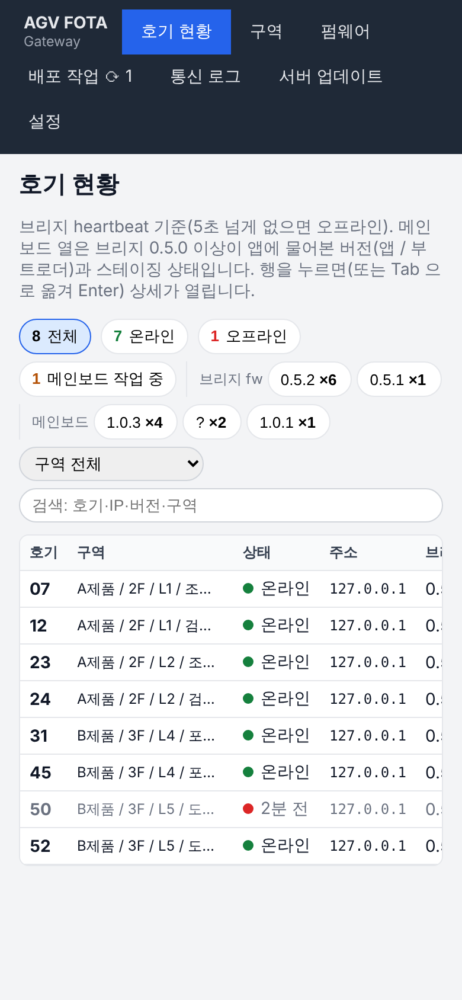 | 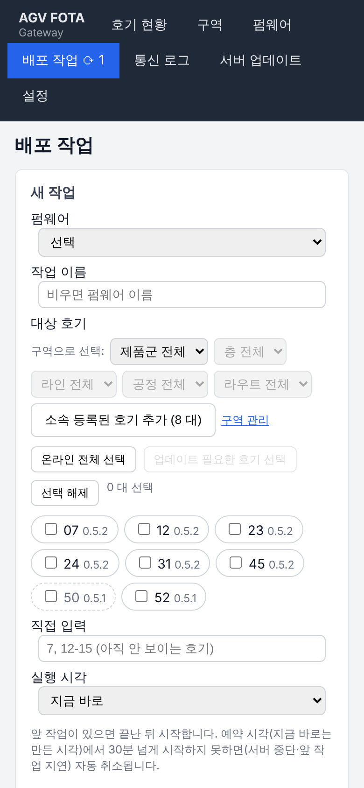 |

*폭이 좁으면 메뉴가 위로 올라가 줄바꿈되고, 새 작업 폼은 한 열이 됩니다. 호기 표는 옆으로 밀어서 봅니다.*

---

## 3. 브리지 연결

### 3-1. 브리지에 서버 IP 넣기

브리지는 **설정된 서버 IP 에서 온 패킷만** 받습니다. 그래서 Gateway 는 그 IP 의 PC 에서 돌아야 합니다. 브리지 0.5.2 는 펌웨어를 받아 갈 URL 의 호스트도 이 IP 와 같아야 받습니다(`url_host`).

| 방법 | 언제 | 명령 |
|---|---|---|
| 휴대폰 BLE (현장 권장) | 처음 설치, 현장 | 브리지 설정 모드에서 BLE 터미널 앱으로 `AGVBR-…` 에 연결 → `login agvsetup` → `set server <PC IP>` → `save` → `reboot` |
| USB 콘솔 | 벤치 | `bridge>` 에서 `set server <PC IP>` → `save` → `reboot` |
| 서버 원격 | 이미 이 서버에 붙은 호기 | **통신 로그** 화면 → 호기 번호 입력 → **설정 명령** 칸에 `set …` → **NN 호기에 CFG_CMD 전송** → 확인창 |

- 자세한 절차(앱 이름, 호기 번호·Wi-Fi·고정 IP 설정)는 브리지 저장소 [FLASH_GUIDE.md](https://github.com/Leepy0/AGV_Wifi_Bridge/blob/main/docs/FLASH_GUIDE.md) 의 "5. 호기 설정" 을 따릅니다.
- 브리지의 서버 포트(`server_port`, 기본 50000)는 Gateway 의 `Gateway.UdpPort` 와 같아야 합니다.
- 브리지는 **0.5.2** 로 맞춥니다. 0.3.0 서버와 짝입니다(명령 재전송 중복 처리, 최종 보고 3회, 메인보드 복구 적용, 굽는 동안 메인보드 UART 115200 전환, 굽는 중 재부팅 거부).
- 브리지 0.5.0 미만(0.3.x·0.4.x) → 0.5.x 는 파티션 표가 바뀝니다. OTA 로는 파티션 표를 못 바꾸므로 호기마다 USB 로 한 번 굽습니다. OTA 로 올리면 메인보드 열이 `⚠ 파티션 없음` 이 됩니다.
- BLE 에서 `login` 을 같은 연결에서 5번 연속 틀리면 브리지가 연결을 끊습니다. 다시 연결해 시도합니다.

> **원격 설정 확정은 서버가 합니다.** 원격으로 저장하고 재부팅한 브리지는 `cfg` 가 `trial` 입니다. 180초 안에 서버 패킷을 받지 못하면 이전 설정으로 돌아갑니다. 서버는 heartbeat 에서 `cfg=trial` 을 보면 그 호기에 5초에 한 번 **자동으로 PING** 을 보내 확정합니다. 통신 로그에 `[NN] 자동 PING (cfg=trial, ota=…) — 확정용` 이 보이고, `cfg` 가 `saved` 로 바뀌면 끝입니다. 서버가 꺼져 있거나 브리지가 서버에 닿지 못하면 180초 뒤 이전 설정으로 돌아갑니다.

> 같은 PC 에서 BridgeTest 같은 벤치 도구를 함께 띄우면 UDP 50000 이 겹칩니다.

### 3-2. 호기 현황에 나타나는지 확인

브리지가 heartbeat 를 보내면(기본 1초마다) **호기 현황** 에 한 줄이 생깁니다. 행을 누르면(또는 Tab 으로 옮겨 Enter) 상세가 열립니다.

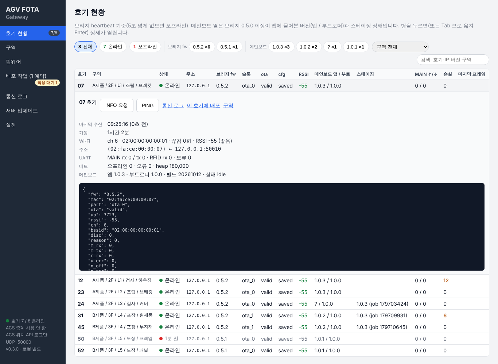

*07호기 상세. 위 버튼으로 INFO 요청·PING 을 보내고, 그 호기의 통신 로그·배포·구역으로 바로 갑니다. 주소 칸은 `IP (MAC) ← 송신 주소:포트` 입니다. 아래 검은 칸은 마지막 heartbeat 원문입니다.*

| 상세 버튼 | 하는 일 |
|---|---|
| INFO 요청 | 브리지에 상태를 바로 다시 보내라고 요청. 결과는 이 상세 칸에만 보이고 실패는 빨간 글씨 |
| PING | 서버 패킷 1개 전송. 보통은 서버가 자동으로 보내므로 누를 일이 거의 없음 |
| 통신 로그 | 이 호기로 거른 통신 로그 화면 (호기 칸이 채워짐) |
| 이 호기에 배포 | 이 호기를 대상으로 채운 배포 작업 화면 |
| 구역 | 이 호기의 구역 화면 |

### 3-3. 상태 읽는 법

| 열 | 값 | 뜻 · 조치 |
|---|---|---|
| 호기 | `52` + 빨간 `충돌` | 같은 번호 장치가 둘 ([3-4](#3-4-같은-호기-번호-충돌)) |
| 상태 | 온라인 / `N초 전` | heartbeat 가 5초 넘게 없으면 오프라인 |
| 브리지 fw | `0.5.2` | 브리지 펌웨어 버전 |
| 슬롯 | `ota_0` / `ota_1` | 지금 실행 중인 펌웨어 칸 |
| ota | `valid` | 정상 |
| | `pending` (노란 글씨) | OTA 뒤 재부팅했지만 아직 확정 안 됨. 서버가 자동 PING 으로 확정. 몇 초 넘게 남아 있으면 브리지가 서버에 닿는지 확인 |
| cfg | `saved` / `default` | 저장된 설정 / 저장된 설정 없음 |
| | `trial` | 원격 설정 확정 대기. 서버가 자동 PING 으로 확정 |
| | `(AP)` 붙음 | 무선 설정 모드가 켜져 있음 |
| RSSI | -60 이상 | 좋음 (초록) |
| | -60 ~ -70 | 보통 |
| | -70 ~ -80 | 약함 (노랑) |
| | -80 미만 | 매우 약함 (빨강). AP 위치 확인 |
| 메인보드 앱 / 부트 | `1.0.3 / 1.0.0` | 앱 버전 / 부트로더 버전 |
| | `-` | 브리지가 0.5.0 미만이라 메인보드 OTA 미지원 |
| | `? / …` | 메인보드 앱이 버전 응답을 안 함(구 앱, 앱 멈춤, 브리지 재부팅 직후 몇 초). 앱이 멈춘 호기면 배포 작업에서 **복구 적용** 을 켭니다 ([6-2](#6-2-작업-만들기)) |
| | `⚠ 파티션 없음` | 브리지에 `dspfw` 파티션이 없음. USB 전체 굽기 필요 |
| | `⟳ 프로그래밍` | 메인보드를 굽는 중 |
| 스테이징 | `1.0.3 (job …)` / `받는 중` | 브리지가 받아 둔 메인보드 이미지 |
| MAIN ↑/↓ | 숫자 | 메인보드 프레임 수 (호기→서버 / 서버→호기) |
| 손실 | 숫자 | 패킷 순번 누락 수. 늘어나면 무선 품질 확인. 브리지 재부팅·주소 변경 때는 새로 셈 |

위쪽 단추로 거릅니다: 전체 · 온라인 · 오프라인 · OTA 미확정 · 메인보드 작업 중, 브리지 버전별, 메인보드 버전별(온라인 호기 기준), 구역, 검색(호기·IP·버전·구역). 고른 단추의 호기가 없어지면 '전체' 로 돌아갑니다.

### 3-4. 같은 호기 번호 충돌

예비 브리지를 기본 번호 그대로 켜거나, 두 브리지에 같은 `agv` 번호를 넣으면 호기 현황 위에 빨간 띠가 뜹니다.

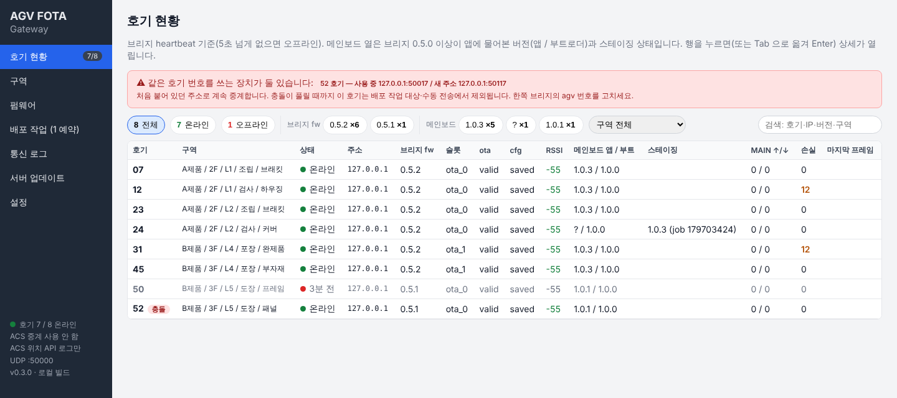

*52호기 번호를 쓰는 장치가 둘입니다. 사용 중 주소와 새 주소가 보이고, 표의 52호기 옆에 `충돌` 배지가 붙습니다.*

서버는 이렇게 처리합니다.

- **처음 붙어 있던(살아 있는) 주소로 계속 중계합니다.** 새 주소의 패킷은 모두 버립니다(상태 갱신, ACS 상향 중계, OTA 결과).
- ACS 지령(MAIN_DOWN)은 기존 장치로 계속 갑니다.
- 충돌이 풀릴 때까지 그 호기는 **배포 작업 대상과 수동 전송에서 빠집니다.** 작업에서는 `호기 번호 충돌 — 같은 번호의 장치가 둘` 로 실패합니다.
- 통신 로그와 서버 로그에 `[NN] 주소 충돌 old→new …` 가 10초에 한 번 남습니다.
- 마지막 충돌 패킷 뒤 10초(오프라인 판정 × 2)가 지나면 경고가 풀립니다.

할 일:

1. 새로 켠 브리지의 `agv` 번호를 고칩니다(BLE·USB `set agv <번호>` → `save` → `reboot`).
2. 브리지를 **교체** 하는 중이면 이전 브리지를 먼저 끈 뒤 새 브리지를 켭니다. 이전 장치가 오프라인이 되면 서버가 새 주소로 넘어가고 통신 로그에 `주소 변경` 이 남습니다.

---

## 4. 펌웨어 올리기

메뉴 **펌웨어** 에서 올립니다.

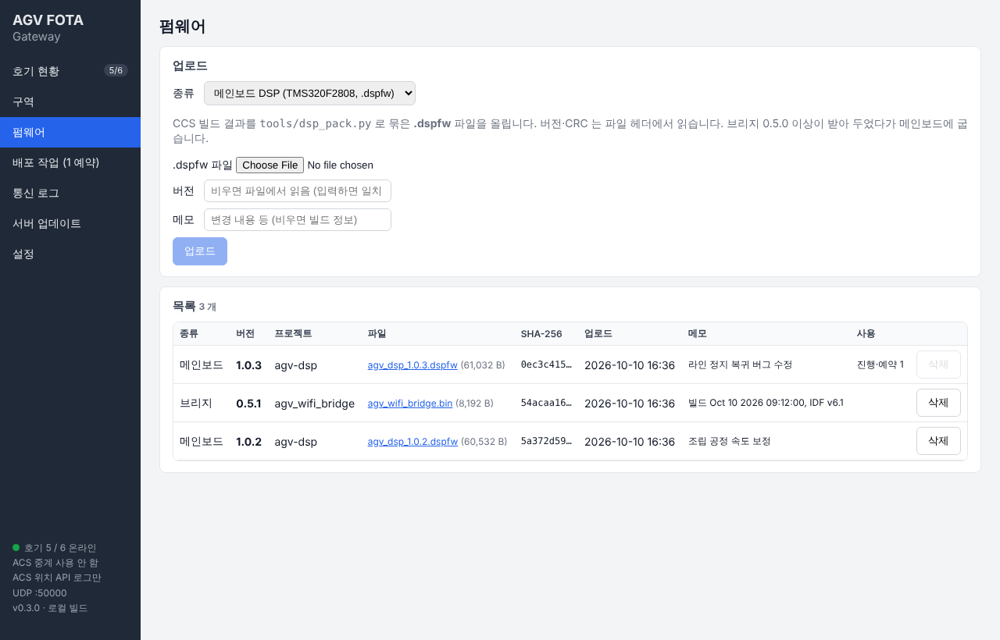

*메인보드 두 버전과 브리지 한 버전이 올라가 있습니다. 메인보드 1.0.3 은 끝나지 않은 작업 2건(그중 적용 대기 1)이 써서 삭제 단추가 꺼져 있습니다.*

### 4-1. 종류별 차이

| | 메인보드 (DSP) | 브리지 (ESP32-S3) |
|---|---|---|
| 종류 선택 | `메인보드 DSP (TMS320F2808, .dspfw)` | `브리지 ESP32-S3 (agv_wifi_bridge.bin)` |
| 파일 | `.dspfw` 한 개 | `agv_wifi_bridge.bin` 한 개 (앱 이미지만) |
| 만드는 법 | CCS 빌드 결과를 `tools/dsp_pack.py pack app.hex -o app_1.2.3.dspfw --ver 1.2.3` 로 묶음 | 브리지 빌드 zip `agv_wifi_bridge_<버전>.zip` 안에 있음 |
| 버전 | 파일 헤더에서 읽음. **1~8자, 영문·숫자·`._-` 만 (필수)**. 예: `1.2.3`, `1.2.3rc1`. 어기면 업로드가 거부됨 | 이미지 안 앱 정보에서 읽음 |
| 업로드 검사 | 파일 헤더·CRC, 앱 헤더, 블록 구조(주소·길이·순서), 블록에서 복원한 CRC, 파일 헤더 버전 = 앱 헤더 버전 | ESP-IDF 앱 이미지인지, 프로젝트 이름 |
| 받는 쪽 조건 | 브리지 0.5.0 이상(`dspfw` 파티션 있음, 0.5.2 권장) + 메인보드에 부트로더와 재링크한 앱 | 서버에 붙은 브리지. 단 0.5.0 미만 → 0.5.x 는 USB 로 한 번 |
| 적용 중 영향 | 메인보드 앱이 약 20~30초 멈춤 | 브리지 재부팅으로 수 초 끊김 |

- 저장 파일명은 영문·숫자·`._-` 로 바뀌고 **60자 이하** 로 줄어듭니다(확장자는 유지). 브리지가 받을 URL 길이 한도(메인보드 199자) 때문입니다.
- 버전 비교(같은 버전 판정, 적용 성공 판정)는 앞 8자로 합니다.

### 4-2. 올리는 순서

1. **종류** 를 고릅니다. 종류를 바꾸면 고른 파일이 비워지니 파일은 그다음에 고릅니다.
2. 파일을 고릅니다.
3. **버전** 은 비워 둡니다. 파일에서 읽습니다. 적으면 파일 버전과 같은지 확인만 합니다.
4. **메모** 에 변경 내용을 적습니다. 비우면 브리지는 빌드 정보가 들어갑니다.
5. **업로드** 를 누릅니다. 아래 목록에 한 줄이 생깁니다.

파일 크기는 64MB 까지입니다.

### 4-3. 거부되는 경우

| 메시지 | 원인 | 조치 |
|---|---|---|
| `….dspfw: .dspfw 형식·CRC·블록 구조가 틀립니다 (dsp_pack.py 출력 파일을 올리세요)` | `dsp_pack.py` 출력이 아니거나 손상, 블록 순서·주소 이상 | `dsp_pack.py` 로 다시 만듦 |
| `메인보드 버전은 8자 이하 영문·숫자·._- 만 됩니다 (파일 헤더 버전 '…') — dsp_pack.py --ver 를 고쳐 다시 묶으세요` | 버전이 9자 이상이거나 다른 글자 | `--ver` 를 1~8자로 다시 묶음 |
| `ESP-IDF 앱 이미지가 아닙니다 … bootloader·partition-table·merged 이미지는 불가` | `merged.bin` 등 다른 파일 | zip 의 `agv_wifi_bridge.bin` 을 올림 |
| `프로젝트가 '…' 입니다 — 'agv_wifi_bridge' 빌드만 …` | 다른 프로젝트 빌드 | 브리지 프로젝트 빌드를 올림 |
| `입력한 버전 … 과 파일 헤더 버전 … 이 다릅니다` (브리지는 `… 과 이미지 버전 … 이 다릅니다`) | 버전 칸에 다른 값 | 버전 칸을 비움 |
| `파일을 읽지 못했습니다 — 파일을 다시 고르세요` | 파일을 고른 뒤 종류를 바꿈 등 | 파일을 다시 고름 |
| `같은 버전 … 이 이미 N개 등록되어 있습니다` · 버전 옆 ⚠ | 같은 종류·버전이 둘 이상 (거부는 아님) | 헷갈리지 않게 오래된 것을 삭제 |
| **삭제** 단추가 꺼짐 · `작업 … 이(가) 쓰는 펌웨어입니다` | 끝나지 않은 작업(대기·실행 중·적용 대기)이 이 펌웨어를 씀. **사용** 칸에 `사용 중 N (적용 대기 M)` | 작업을 먼저 취소 |

---

## 5. 구역 등록

호기를 5단계로 분류합니다: **제품군 → 층 → 라인 → 공정 → 라우트**.
구역을 등록하면 "B제품 3층 L4 전체" 처럼 한 번에 배포할 수 있습니다.


*아래 화면과 같은 예시입니다. 각 호기는 맨 끝 단계에 붙습니다.*

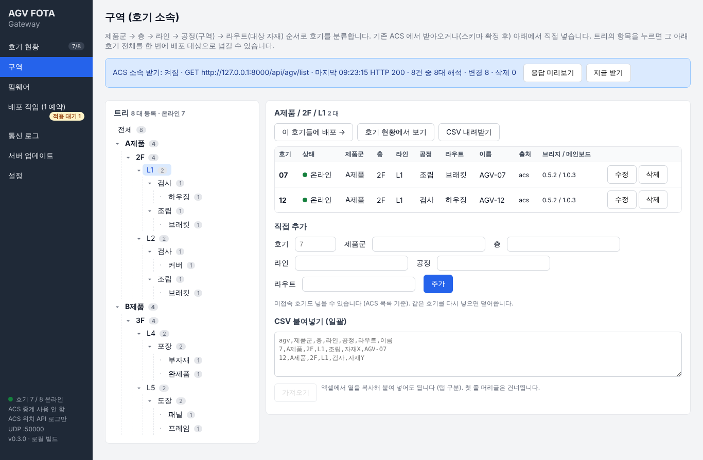

*왼쪽 트리에서 A제품 / 2F / L1 을 고른 화면. 오른쪽에 그 아래 07·12호기가 나오고, "이 호기들에 배포 →" 로 바로 작업을 만듭니다. 위 띠는 ACS 소속 받기 상태입니다.*

- 단계 값 안의 `/` 는 저장할 때 전각 `／` 로 바뀝니다(화면·CSV·ACS·API 공통). 경로 구분자 ` / ` 와 겹치지 않게 하려는 것입니다. 예전 값에 `/` 가 있어도 트리에서는 `／` 로 보입니다.
- 단계가 모두 빈 호기는 트리의 **미분류** 아래로 모입니다. 구역 링크·구역 단위 배포도 이 이름으로 됩니다.
- 트리는 키보드로도 씁니다. Tab 으로 옮겨 항목에서 Enter 는 선택, 접기 단추에서 Enter·Space 는 접기·펼치기입니다.

등록 방법은 세 가지입니다.

| 방법 | 쓰는 곳 | 출처 표시 |
|---|---|---|
| 직접 추가 | 한두 대 | `manual` |
| CSV 붙여넣기 | 여러 대 한 번에, 엑셀에서 복사 | `import` |
| ACS 에서 받기 | ACS 가 호기 소속을 알려 줄 때 | `acs` |

### 5-1. 직접 추가

1. **직접 추가** 칸에 호기 번호(1~99)와 각 단계 값을 적습니다.
2. **추가** 를 누릅니다.

- 아직 접속하지 않은 호기도 넣을 수 있습니다.
- 같은 호기를 다시 넣으면 덮어씁니다.
- 목록의 **수정**·**삭제** 로 고칩니다. 저장에 실패하면 `NN 저장 실패: …` 가 표 위에 나오고 아무것도 바뀌지 않습니다.

### 5-2. CSV 붙여넣기

**CSV 붙여넣기 (일괄)** 칸에 붙여 넣고 **가져오기** 를 누릅니다.

```csv
agv,제품군,층,라인,공정,라우트,이름
7,A제품,2F,L1,조립,자재X,AGV-07
12,A제품,2F,L1,검사,자재Y
```

- 열 순서: `agv,제품군,층,라인,공정,라우트,이름`. 이름은 생략할 수 있습니다.
- 첫 줄 머리글은 건너뜁니다. `#` 로 시작하는 줄은 주석입니다.
- 엑셀에서 열을 복사해 붙여도 됩니다(탭 구분).
- 값에 쉼표·줄바꿈이 있으면 큰따옴표로 묶습니다. 따옴표가 닫히지 않으면 `N행: 따옴표가 닫히지 않음` 으로 그 행만 빠지고 다음 줄부터 다시 읽습니다.
- 호기 번호는 1~99. 틀린 줄은 결과에 `N행: …` 으로 나오고 나머지는 반영됩니다.
- 저장이 실패하면 `저장 실패 — 반영 안 됨` 이 나오고 한 대도 바뀌지 않습니다.
- **CSV 내려받기** 로 지금 목록을 같은 형식으로 받습니다. `=` `+` `-` `@` 로 시작하는 값은 엑셀 수식으로 실행되지 않게 앞에 `'` 를 붙여 내보내고, 다시 가져올 때 뗍니다.

### 5-3. ACS 에서 받기

> ACS 응답 형식은 아직 확정 전입니다(임시 형식). 지금은 직접 추가·CSV 를 씁니다.

1. `appsettings.json` 의 `AcsInventory` 섹션을 채웁니다 ([7-5](#7-5-acs-호기-소속-받기-acsinventory-rest)). `BaseUrl` 은 `http://` 또는 `https://` 로 시작해야 합니다.
2. `AcsInventory.Enabled` 를 `true` 로 바꾸고 서비스를 재시작합니다.
3. **구역** 화면 위 **응답 미리보기** 로 저장 없이 해석 결과를 봅니다.
4. 맞으면 **지금 받기** 를 누릅니다. 이후에는 `IntervalSec`(기본 300초)마다 받습니다.

- 기본값으로는 직접 넣은 값(`manual`·`import`)을 덮어쓰지 않습니다 (`OverrideManual: false`).
- ACS 목록에서 빠진 `acs` 출처 호기는 지웁니다 (`RemoveMissing: true`). 단 `acs` 출처의 절반 이상(2대 이상)이 한 번에 빠지면 **삭제를 보류** 하고 노란 띠(`삭제 보류 N`)로 알립니다. 의도한 삭제면 구역 화면에서 직접 지웁니다.
- 응답에서 목록을 못 찾거나, 빈 목록이거나, 호기 번호를 하나도 읽지 못하면 `실패 … — 반영 안 함` 으로 처리하고 아무것도 바꾸지 않습니다. 미리보기에도 `반영 안 됨: 이유` 가 나옵니다.
- 구역 화면에 빨간 `소속 저장소: … — ACS 소속 반영을 멈춤` 이 뜨면 기동 때 소속 일부를 읽지 못한 것입니다. 원인(깨진 행·깨진 옛 JSON 파일)을 고치고 서버를 다시 시작합니다. 그동안 직접 고치기는 됩니다.
- 필드 이름 맞추기는 [ACS_API.md](https://github.com/Leepy0/AGV_FOTA_GATEWAY/blob/main/docs/ACS_API.md) 를 봅니다.

---

## 6. 배포 작업

### 6-1. 시작 전 안전 수칙

> **굽기는 AGV 를 세운 상태에서만 합니다.** 서버는 AGV 가 섰는지 스스로 알지 못합니다. 운용자가 확인창에서 확인합니다.

| 작업 | 정지 확인 시점 | 영향 |
|---|---|---|
| 메인보드 · 스테이징 후 확인하고 적용 (기본) | 스테이징이 끝난 뒤 **적용 시작** 확인창 | 굽는 호기마다 약 20~30초 메인보드 앱 정지, ACS 응답 끊김 |
| 메인보드 · 바로 적용 | 작업을 만들 때 확인창. 시작 시각에 모두 서 있어야 함 | 위와 같음 |
| 브리지 | 작업을 만들 때 확인창 | 재부팅으로 수 초 통신 끊김 |

- 스테이징(이미지를 브리지에 받아 두기)은 주행 중에도 됩니다. 메인보드 앱은 그대로 돕니다.
- 메인보드 앱이 정지 확인 코드를 갖고 있으면 주행·충전·에러 중일 때 굽기를 거부합니다(`app_ng_01` 등).
- 호기는 **한 대씩 순서대로** 진행합니다. 작업도 한 번에 하나만 실행합니다. 적용 대기 작업이 있으면 다른 작업은 기다립니다.
- 번호 충돌 호기는 작업에서 거부됩니다([3-4](#3-4-같은-호기-번호-충돌)).

### 6-2. 작업 만들기

메뉴 **배포 작업** → **새 작업**.

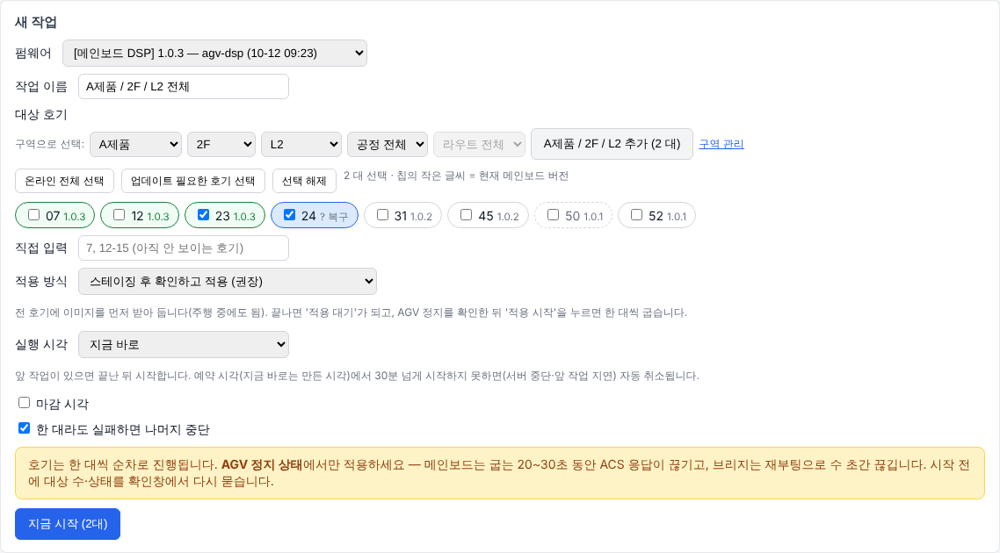

*메인보드 1.0.3 을 고르고 구역 선택으로 A제품 / 2F / L2 의 23·24호기를 고른 화면. 24호기는 앱 버전을 모릅니다(이 캡처는 '복구 적용' 선택이 생기기 전 화면이라 칩이 `? 복구` 로 보이지만, 지금은 `?` 로 보입니다). 적용 방식은 기본값 "스테이징 후 확인하고 적용 (권장)" 입니다.*

1. **펌웨어** 를 고릅니다. `[메인보드 DSP]` / `[브리지 ESP]` 와 버전이 보입니다.
2. **작업 이름** 은 비워도 됩니다. 비우면 `메인보드 1.0.3` 처럼 종류·버전으로 정해집니다. 구역으로 고르면 `B제품 / 3F / L4 전체` 처럼 채워집니다.
3. **대상 호기** 를 고릅니다.
   - **구역으로 선택**: 제품군 → 층 → 라인 → 공정 → 라우트 순서로 고르고 **… 추가 (N 대)** 를 누릅니다.
   - **온라인 전체 선택**: 지금 온라인인 호기 전부(번호 충돌 호기는 뺌).
   - **업데이트 필요한 호기 선택**: 고른 펌웨어와 버전이 다른 온라인 호기만. 미지원·번호 충돌 호기는 뺍니다. 펌웨어를 먼저 골라야 켜지고, 누르면 기존 선택을 지우고 다시 고릅니다.
   - 칩을 하나씩 눌러도 됩니다. 칩의 작은 글씨는 그 호기의 현재 버전입니다.
   - **직접 입력**: `7, 12-15` 처럼 아직 안 보이는 호기를 적습니다. 버튼의 대수에 포함됩니다. 표기가 틀리면 버튼이 꺼집니다.
   - 선택에 번호 충돌 호기가 있으면 경고와 **충돌 호기 빼기** 버튼이 나옵니다.
4. **적용 방식** (메인보드만):
   - `스테이징 후 확인하고 적용 (권장)`: 전 호기에 먼저 받아 두고, 정지를 확인한 뒤 **적용 시작** 을 누르면 굽습니다([6-3](#6-3-적용-대기와-적용-시작)).
   - `바로 적용 — 호기마다 받자마자 굽기 (야간 예약용)`: 호기마다 받자마자 굽습니다. 시작 시각에 대상 AGV 가 모두 서 있어야 합니다.
   - **복구 적용** (체크, 기본 꺼짐): 앱이 응답하지 않는(멈춘·지워진) 메인보드용입니다. 켜면 부트로더가 바로 잡히지 않을 때 최대 60초 동안 메인보드 전원 재투입을 기다리고, 그동안 RFID·ACS 중계가 끊깁니다. AGV 정지 필수. 대상에 앱 버전 `?` 호기가 있는데 꺼 두면 `앱 버전 모름 N 대(…) — 앱이 멈춘 호기면 '복구 적용'으로 배포하세요` 경고가 나옵니다. 살아 있는 구 앱(OTA 지원 코드 없음)은 어느 쪽으로도 안 됩니다([10-5](#10-5-메인보드-ota-실패) `app_no_fwup`).
5. **실행 시각**: `지금 바로` 또는 `예약` (날짜·시각 입력). 지난 시각은 받지 않습니다([6-5](#6-5-예약)).
6. **마감 시각** (선택): 체크하고 시각을 넣으면, 그 시각이 지난 뒤에는 남은 호기를 시작하지 않고 건너뜁니다(적용 단계 포함). 시작 시각보다 뒤여야 합니다.
7. **한 대라도 실패하면 나머지 중단** 은 켜 둡니다(기본).
8. **지금 시작 (N대)** 또는 **예약 (N대)** 를 누릅니다.
9. **확인창** 을 읽고 확인합니다. 끝나면 고른 펌웨어·대상이 비워집니다(같은 작업 두 번 만들기 방지).

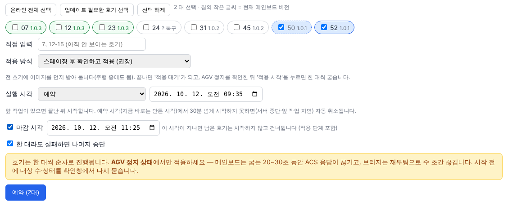

*대상 2대(50호기는 오프라인 점선), 적용 방식과 설명, 실행 시각 `예약`, 마감 시각. 시각 칸은 화면 기본값(지금+10분, 지금+2시간)입니다.*

> **알려진 문제 — 예약·마감 시각 칸** (0.3.0 빌드 기준, 고친 뒤 이 안내를 지울 것)
> 화면의 날짜·시각 칸을 바꿔도 다음 순간 기본값(예약 = 지금+10분, 마감 = 지금+2시간)으로 돌아갑니다. 고치기 전에는 원하는 시각의 작업을 REST 로 만듭니다(오프셋 없는 시각은 서버 PC 시각).
>
> ```bat
> curl -X POST http://localhost:8080/api/jobs -H "Content-Type: application/json" -d "{\"firmwareId\":\"<펌웨어 id>\",\"targets\":[31,45],\"scheduledAt\":\"2026-10-12T22:30\",\"notAfter\":\"2026-10-13T05:00\",\"applyMode\":\"Immediate\"}"
> ```
>
> 펌웨어 id 는 `http://localhost:8080/api/firmware` 에서 봅니다.

확인창에 나오는 것:

| 줄 | 내용 |
|---|---|
| 첫 줄 | 종류와 버전. 복구 적용이면 `— 복구 적용` |
| 대상 | 최종 대수(직접 입력 포함)와 온라인·오프라인·미지원·같은 버전·번호 충돌 수, 메인보드면 앱 버전 모름 수 |
| 호기 | 번호 목록 (20대까지) |
| 시작 | `지금` 또는 `MM-dd HH:mm`. 앞 작업이 있으면 `(앞 작업 '…' 끝난 뒤)`. 마감 시각 |
| 방식 | 스테이징 후 승인 / 바로 적용 / 브리지 OTA. 복구 적용이면 그 안내, 아니고 앱 버전 모름 호기가 있으면 `이대로는 실패` 경고 |
| 마지막 질문 | 승인 방식: 스테이징은 주행 중에도 되니 진행할지. 바로 적용·브리지: **AGV 정지 확인했습니까?** |

| 칩 모양 | 뜻 |
|---|---|
| 파란 배경 | 선택됨 |
| 초록 테두리 | 이미 이 버전 |
| 점선 | 오프라인. 실행할 때 20초 안에 heartbeat 가 없으면 그 호기는 실패 |
| 빨간 테두리 | 메인보드 OTA 를 받을 수 없음(브리지 0.5.0 미만 또는 파티션 없음), 또는 번호 충돌(`충돌`) |
| `?` (메인보드) | 메인보드 앱 버전 모름. 앱이 멈춘 호기면 **복구 적용** 을 켬 |
| `미접속` | 구역에만 있고 아직 heartbeat 가 없음 |

다른 화면에서 바로 오기:

- **구역** 화면 → **이 호기들에 배포 →**: 그 구역의 호기가 채워집니다.
- **호기 현황** 상세 → **이 호기에 배포**: 그 호기가 채워집니다.

### 6-3. 적용 대기와 '적용 시작'

메인보드 작업의 기본 흐름입니다.


*새 작업 → 확인창 → 전 호기 스테이징(주행 중에도 됨) → 적용 대기 → AGV 정지 → '적용 시작' 확인창 → 한 대씩 적용. 취소하면 굽지 않고, 마감이 지나면 자동 종료(실패), 서버를 재시작하면 승인만 풀립니다.*

1. 작업이 시작되면 대상 호기마다 차례로 이미지를 브리지에 받아 둡니다(스테이징). 호기 상태는 `스테이징됨`, 진행률은 30% 입니다.
2. 스테이징이 끝나면 작업이 **적용 대기** 가 됩니다. 메뉴에 `적용 대기 1` 배지가, 배포 작업 화면 위에 "적용 대기 작업 '…' 이 승인을 기다립니다" 띠가 뜹니다.
3. 대상 AGV 를 모두 세웁니다.
4. 작업 줄의 파란 **적용 시작** 을 누릅니다.
5. 확인창을 읽고 확인합니다. 1초 안에 한 대씩 굽기 시작합니다.


*B제품 / 3F / L4 전체가 적용 대기입니다. 31·45호기가 `스테이징됨` 이고, 작업 줄에 "스테이징 끝 — AGV 정지 확인 후 '적용 시작' · 마감 …" 과 **적용 시작**·**취소** 버튼이 있습니다.*

**적용 시작** 확인창 예:

```text
'B제품 / 3F / L4 전체' 적용 시작

스테이징된 2대(31, 45)에 메인보드 1.0.3 을 한 대씩 굽습니다.
호기마다 약 20~30초 메인보드가 멈추고 ACS 응답이 끊깁니다.
마감 10-12 11:24 (119분 남음) — 지나면 남은 호기는 건너뜀

대상 AGV 가 모두 정지 상태인지 확인했습니까?
```

오프라인·번호 충돌 호기가 있으면 그 수도 한 줄씩 나옵니다. 복구 적용 작업이면 복구 적용 안내가, 아니고 앱 버전 모름 호기가 있으면 `앱 버전 모름 N대 — 앱이 멈춘 호기면 이 작업은 실패합니다` 가 나옵니다.

| 상황 | 결과 |
|---|---|
| 적용 대기 중 | 다른 작업은 시작하지 않고 기다립니다(같은 호기의 스테이징을 덮어쓰지 않게) |
| 적용 대기 중 **취소** | 굽지 않습니다. 브리지에 받아 둔 이미지는 다음 스테이징 때 덮어씁니다 |
| 마감 시각이 지남 | 작업이 **실패** 로 끝나고 굽지 않습니다. 마감이 1분 안이면 **적용 시작** 이 막힙니다. 새 작업으로 다시 만듭니다 |
| 서버 재시작 | 적용 대기는 그대로 남고 **승인만 풀립니다**. 정지를 다시 확인하고 **적용 시작** 을 다시 누릅니다 |
| 브리지가 그사이 스테이징을 잃음 (재부팅 등) | 그 호기만 `not_staged`·`job_mismatch` … `새 작업으로 다시 배포` 로 실패 |
| 스테이징 중 한 대 실패 + "실패하면 중단" 켜짐 | 적용 대기로 가지 않고 작업이 실패로 끝남. 받아 둔 호기는 `앞 호기 실패로 중단 (스테이징만 됨)` |

- 스크립트로 승인할 때는 `POST /api/jobs/{id}/approve` 입니다(적용 대기가 아니거나 마감이 지났으면 400). 부르기 전에 정지를 확인합니다.

### 6-4. 진행 보기

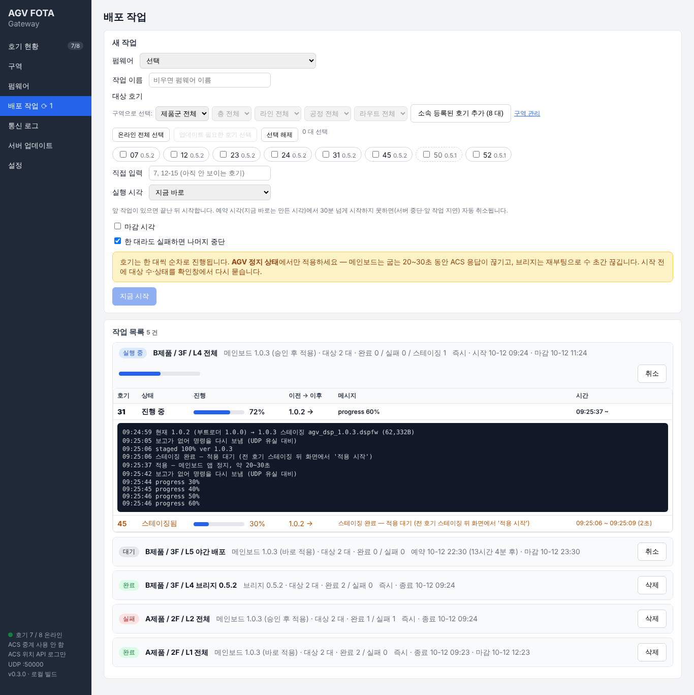

*'적용 시작' 을 누르고 약 10초 뒤. 31호기가 굽는 중(72%)이고, 로그에 스테이징 → 적용 → "보고가 없어 명령을 다시 보냄 (UDP 유실 대비)" → progress 가 보입니다. 45호기는 스테이징된 채 순서를 기다립니다.*

- 실행 중·적용 대기 작업은 자동으로 펼쳐집니다. 작업 줄은 Tab 으로 옮겨 Enter 로도 펼칩니다.
- 작업 줄에 전체 진행 막대가, 호기 줄에 호기별 진행률과 `이전 → 이후` 버전이 나옵니다.
- 진행 중·실패한 호기는 로그(실패는 마지막 12줄)가 바로 보입니다. 다른 호기는 줄을 누르면 로그 전체가 열립니다.
- 메인보드 진행률: 받기 5~30% → 스테이징 30% → 시작 32% → 진입 35% → 지우기 40% → 쓰기 45~90% → 검증 92% → 완료 100%. 진행률은 내려가지 않습니다.

로그에 보이는 안내:

| 로그 | 뜻 · 할 일 |
|---|---|
| `보고가 없어 명령을 다시 보냄 (UDP 유실 대비)` | 5초 동안 브리지 반응이 없어 같은 명령을 다시 보냄(최대 3회). 브리지는 같은 작업을 두 번 처리하지 않음. 할 일 없음 |
| `복구 적용 — 앱이 응답하지 않고 침묵하면 브리지가 부트로더로 바로 들어가고 …` | 복구 적용 작업. 앱이 살아 있으면 평소대로 앱의 정지 확인을 거침 |
| `메인보드 앱 버전 모름 (dsp=?) — 일반 적용: 앱이 응답하지 않으면 실패 …` | 일반 작업인데 앱 버전을 모르는 호기. 실패하면 앱이 멈춘 호기인지 보고 복구 적용 작업으로 다시 |
| `메인보드 전원을 껐다 켜세요 — 브리지가 HELLO 를 보내며 부트로더를 기다리는 중 …` (`wait_power`) | 복구 적용에서 부트로더가 잡히지 않음. **60초 안에** 그 AGV 의 메인보드 전원을 껐다 켭니다. 10초마다 다시 나옴 |
| `메인보드 굽기 재시도 N회째 — 지운 뒤 실패해 부트로더 HELLO 부터 다시` (`retry`) | 지운 뒤 실패해 브리지가 자동으로 다시 굽는 중(최대 2회). 할 일 없음 |
| `완료 ver … (heartbeat 확인)` | 굽고 나서 heartbeat 의 메인보드 버전까지 확인함 |

### 6-5. 예약

- 예약 시각이 되면 실행 중·적용 대기 작업이 없을 때 시작합니다.
- **예약 시각(지금 바로는 만든 시각)에서 30분 넘게 시작하지 못하면 자동 취소** 됩니다. 서버가 꺼져 있었든, 앞 작업이 길어져 밀렸든 같습니다. 야간 예약이 아침에 갑자기 도는 것을 막기 위해서입니다. 호기 메시지는 `앞 작업이 길어져 예약 시각 N분 경과 — 다시 예약하세요` 또는 `서버 중단 중 예약 시각 N분 경과 (30분 초과) — 다시 예약하세요` 입니다. 다시 예약합니다.
- 1분 넘게 지난 예약 시각, 이미 지났거나 예약 시각보다 앞선 마감 시각은 받지 않습니다(`예약 시각이 이미 지났습니다` 등).
- 서버가 막 켜진 뒤 10초(오프라인 판정 × 2) 동안은 작업을 시작하지 않습니다. 호기 heartbeat 를 먼저 모으기 위해서입니다.
- 차례가 된 호기가 오프라인이면 20초까지 heartbeat 를 기다린 뒤 판정합니다(`호기 오프라인 (heartbeat 없음 20초)`).
- 메뉴에 `배포 작업 (1 예약)` 처럼 예약 건수가 보입니다.
- 작업 목록의 시각 칸:

| 표시 | 뜻 |
|---|---|
| `예약 10-12 22:30 (3시간 5분 후)` | 예약 대기 |
| `예약 10-12 22:30 (12분 지남 — 앞 작업 '…' 끝나면 시작)` (주황) | 앞 작업에 밀림. 30분을 넘기면 자동 취소 |
| `즉시 · 앞 작업 '…' 끝나면 시작 (생성 …)` | 지금 바로 작업이 앞 작업을 기다림 |
| `스테이징 끝 — AGV 정지 확인 후 '적용 시작'` | 적용 대기 |
| `… · 마감 10-13 05:00` | 마감 시각이 있음 |

- 야간에 사람 없이 굽으려면 메인보드는 `바로 적용` 으로 만들고, 마감 시각을 생산 시작 전으로 둡니다. 확인창에서 정지 확인을 받습니다.
- 실행 중에 서버가 재시작되면 그 작업은 실패로 끝납니다. Windows 자동 재부팅 시각은 예약 시각과 떨어뜨려 둡니다.
- 화면의 예약·마감 시각 칸 문제는 [6-2](#6-2-작업-만들기) 의 알려진 문제를 봅니다.

### 6-6. 결과와 실패 대처

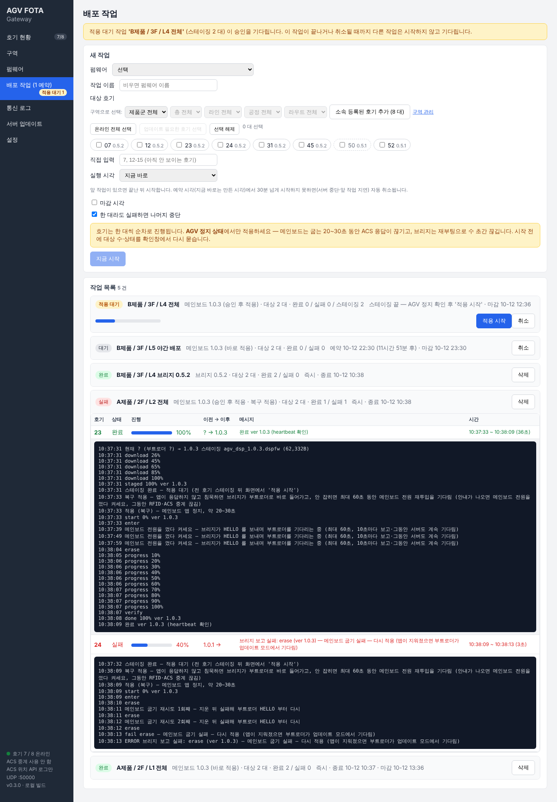

*실패한 "A제품 / 2F / L2 전체" 를 펼친 화면. 23호기는 복구 적용으로 진행했고, `wait_power` 안내 3번 뒤 전원을 다시 넣어 지우기·쓰기·완료까지 갔습니다. 24호기는 지우기 뒤 재시도 1·2회째도 실패해 `fail erase` 로 끝났습니다. 로그 칸은 이 캡처에서만 펼쳤고, 실제 화면에서는 일정 높이로 스크롤됩니다.*

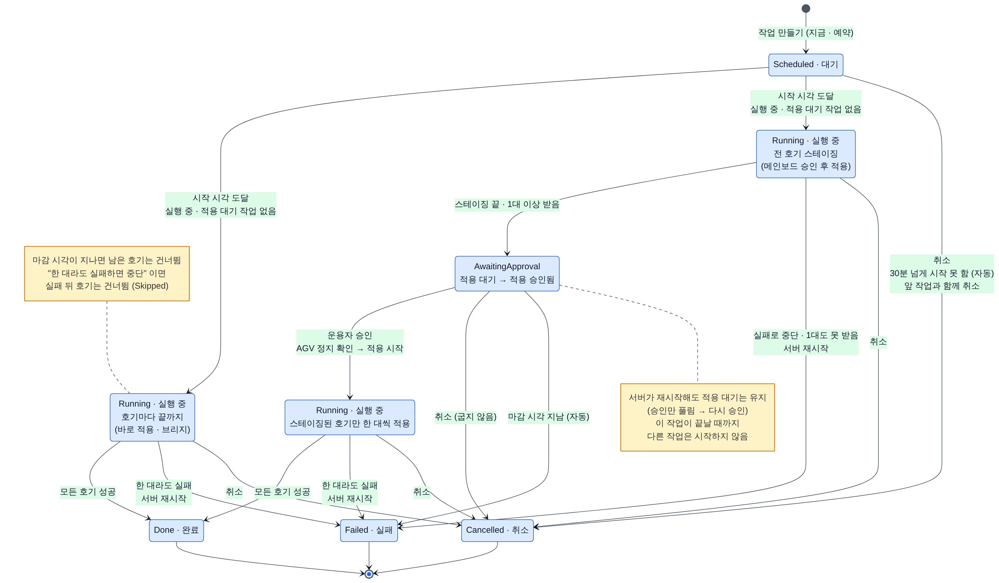

*대기 → 실행 중 → (메인보드 승인 방식이면) 적용 대기 → 승인 → 실행 중(한 대씩 적용) → 완료·실패·취소. 30분 넘게 시작하지 못하면 자동 취소, 서버 재시작 때 실행 중은 실패·적용 대기는 유지됩니다.*

| 작업 상태 | 뜻 |
|---|---|
| 대기 | 예약 시각을 기다리거나 앞 작업이 끝나기를 기다림 |
| 실행 중 | 호기를 한 대씩 진행 중 (스테이징 단계 또는 적용 단계) |
| 적용 대기 | 스테이징을 마치고 **적용 시작** 을 기다림 |
| 적용 승인됨 | 승인했고 곧 적용 시작 |
| 완료 | 모든 호기 성공 |
| 실패 | 한 대 이상 실패, 실행 중 서버가 재시작됨, 또는 적용 대기 중 마감이 지남 |
| 취소 | 사용자가 취소, 앞 작업과 함께 취소, 또는 30분 넘게 시작하지 못해 자동 취소 |

| 호기 상태 | 뜻 |
|---|---|
| 대기 · 진행 중 | 차례를 기다림 · 진행 중 |
| 스테이징됨 | 브리지에 받아 둠. 적용 대기 |
| 완료 · 실패 | 성공 · 실패 (메시지 칸에 사유) |
| 건너뜀 | 시작하지 않음 (취소, 앞 호기 실패, 마감, 서버 재시작) |

| 호기 메시지 | 조치 |
|---|---|
| `호기 오프라인 (heartbeat 없음 20초)` | 호기 전원·Wi-Fi 를 확인하고 다시 작업 |
| `호기 번호 충돌 — 같은 번호의 장치가 둘` | [3-4](#3-4-같은-호기-번호-충돌) 대로 번호를 고친 뒤 다시 |
| `브리지 펌웨어가 메인보드 OTA 를 지원하지 않음 (… 0.5.0 이상 필요)` | 브리지부터 0.5.2 로 올림 (0.5.0 미만은 USB) |
| `브리지에 dspfw 파티션이 없음 …` | 그 브리지를 USB 로 전체 굽기 |
| `브리지가 이미 메인보드를 프로그래밍 중` | 잠시 뒤 다시 |
| `스테이징 URL 이 N자 — 브리지 한도 199자 초과 …` / `OTA URL 이 N자 — 브리지 한도 255자 초과 …` | 펌웨어 파일명을 줄여 다시 올림 |
| `저장된 …: .dspfw 형식·CRC·블록 구조가 틀립니다 …` | 서버에 저장된 파일이 손상. 다시 올림 |
| `브리지 보고 실패: <코드> — <안내>` | 코드별 조치는 [10-5](#10-5-메인보드-ota-실패). 일반 작업이 `app_no_reply`·`no_bootloader` 로 실패하면 끝에 `— 복구 적용으로 다시 배포(앱이 멈춘 경우)` 가 붙음 |
| `브리지 보고 없음 (…초, '…' 대기 중, 재전송 N회)` | 재전송을 다 해도 반응 없음. 통신 로그와 호기 온라인 여부 확인 |
| `브리지 OTA 실패: <사유>` 등 | [10-4](#10-4-브리지-ota-실패) |
| `앞 호기 실패로 중단` (건너뜀) | 원인을 고친 뒤 남은 호기로 새 작업 |
| `마감 시각 지남` (건너뜀) | 필요하면 새 작업 |
| `… 분 경과 — 다시 예약하세요` (건너뜀) | 다시 예약 ([6-5](#6-5-예약)) |
| `서버 재시작` | 서버가 실행 중에 꺼졌음. 새 작업으로 다시 |
| `취소` / `취소 — 브리지는 계속 진행 (heartbeat 버전 확인)` | [6-7](#6-7-취소) |

- 실패한 작업을 다시 돌리는 단추는 없습니다. **새 작업** 을 만듭니다. **업데이트 필요한 호기 선택** 을 쓰면 남은 호기만 고를 수 있습니다. 새 작업은 새 작업 번호로 다시 스테이징합니다(브리지는 같은 작업 번호로 실패한 적용을 10분 동안 다시 굽지 않습니다).
- 작업 기록은 **삭제** 로 지웁니다. 끝나지 않은 작업(대기·실행 중·적용 대기)은 지울 수 없습니다.

### 6-7. 취소

작업 줄의 **취소** 를 누르면 상태에 맞는 확인창이 뜹니다.

| 상태 | 확인창 · 결과 |
|---|---|
| 대기 | 예약 취소 |
| 실행 중, 스테이징 단계 | 진행 중인 호기는 바로 멈추고 남은 호기는 건너뜀. 메인보드 앱은 그대로 |
| 실행 중, 이미 굽기(메인보드)·받기(브리지)를 시작한 호기 | **멈출 수 없습니다.** 메인보드는 약 30초 더 진행되고 다시 켜지며, 브리지는 받기를 마치면 재부팅합니다. 남은 호기만 건너뜀 |
| 적용 대기 | 스테이징된 호기에는 적용하지 않음 |

- 굽기를 시작한 뒤 취소한 호기는 `취소 — 브리지는 계속 진행 (heartbeat 버전 확인)` 으로 남습니다. 서버가 최대 3분 동안 이 작업의 보고와 heartbeat 를 따라가 결과를 로그에 적습니다. 그동안 그 AGV 를 움직이지 않습니다.
  - `취소 — 브리지가 끝까지 진행해 … 로 올라감 (완료 보고)` / `(heartbeat 확인)`: 새 버전으로 바뀜
  - `취소 — 브리지가 굽다가 실패 …`: 굽기 실패. [10-5](#10-5-메인보드-ota-실패) 대로 새 작업
  - `취소 — 적용 안 됨 (브리지가 굽기를 시작하지 않음 …)`: 30초 동안 굽기 흔적이 없음. 앱은 그대로
  - `취소 — … 재설치 (새 슬롯 … 로 재부팅 …)`: 브리지 같은 버전 재설치가 끝남
  - `취소 — 3분 안에 결과 확인 안 됨 …` · `취소 — 버전 변화 없음 …`: 호기 현황에서 직접 확인
- 실행 중·적용 대기 작업을 취소할 때, 이 작업이 끝나면 바로 이어 시작될 대기 작업이 있으면 첫 확인창에 그 수가 나오고 **두 번째 확인창** 이 뜹니다: `대기 작업 N건('…' 등)이 이 작업이 끝나면 바로 시작됩니다.`
  - **확인** = 이 작업만 취소(대기 작업은 바로 시작). **취소** = 대기 작업도 함께 취소.
  - 창을 닫거나 10분 동안 응답하지 않으면 함께 취소합니다(아무것도 바로 시작되지 않는 쪽).
- 스크립트: `POST /api/jobs/{id}/cancel`, 대기 작업까지 함께면 `POST /api/jobs/{id}/cancel?queued=true`.

---

## 7. 설정 appsettings.json

설치 폴더의 `appsettings.json` 을 고칩니다. 지금 적용된 값은 **설정** 화면에서 봅니다.

### 7-1. 고치는 순서

1. 메모장을 **관리자 권한으로 실행** 하고 `C:\AgvFotaGateway\appsettings.json` 을 엽니다. 설치 폴더는 일반 사용자가 쓸 수 없으므로 관리자 권한이 아니면 저장되지 않습니다.
2. 값을 고치고 저장합니다. JSON 문법(쉼표, 따옴표)을 지킵니다. 경로의 `\` 는 `\\` 로 씁니다.
3. 서비스를 재시작합니다. 아래 둘 중 하나.
   - `services.msc` → **AGV FOTA Gateway** → **다시 시작**
   - 관리자 명령 프롬프트:
     ```bat
     net stop AgvFotaGateway
     net start AgvFotaGateway
     ```
4. **설정** 화면에서 바뀐 값을 확인합니다.

- 포트(`Urls`, `UdpPort`, `RfidPort`, ACS `Mode`·`Port`)를 바꿨으면 재시작 대신 `install-service.bat` 을 다시 실행합니다. 방화벽 규칙까지 바뀝니다.
- JSON 문법이 틀리면 서비스가 시작되지 않습니다. [10장](#10-문제-해결)을 봅니다.
- 서버 업데이트는 `appsettings.json` 을 덮어쓰지 않습니다. 새 버전에서 생긴 키는 파일에 없어도 코드 기본값으로 동작합니다.
- 아래 표의 값은 zip 에 든 `appsettings.json` 값이고, 코드 기본값과 같습니다. `Urls` 만은 지우면 안 됩니다.

### 7-2. 서버·브리지 (`Urls`, `Gateway`)

| 키 | 기본값 | 설명 |
|---|---|---|
| `Urls` | `http://0.0.0.0:8080` | 웹 주소와 포트. 지우지 않습니다 |
| `Gateway.UdpPort` | `50000` | 브리지 수신 UDP 포트. 브리지 `server_port` 와 같아야 함 |
| `Gateway.RfidPort` | `50001` | RFID 로그 수신 포트. `0` = 받지 않음 |
| `Gateway.DataDir` | `data` | 데이터 폴더. 상대 경로면 설치 폴더 기준. 절대 경로도 됨 |
| `Gateway.OfflineAfterSec` | `5` | heartbeat 가 이 초 넘게 없으면 오프라인. 기동 직후 작업 유예와 번호 충돌 유지 시간은 이 값의 2배 |
| `Gateway.PublicBaseUrl` | `""` | 브리지가 펌웨어를 받아 갈 서버 주소. 비우면 호기 쪽 NIC 의 IP + HTTP 포트를 자동으로 씀(권장). 고정할 때는 **브리지에 설정된 server IP 와 같은 IPv4** 로 씀: `http://192.168.10.10:8080` |
| `Gateway.AllowedHostNames` | `[]` | 화면·API 에 접속할 때 쓸 수 있는 이름(Host) 추가 목록. 예: `["fota.factory.local"]`. IP 주소·`localhost`·이 PC 이름·FQDN 은 적지 않아도 늘 허용. 목록에 없는 이름으로 접속하면 403(DNS 리바인딩 방어). `"*"` 를 넣으면 검사하지 않음 |

> `PublicBaseUrl` 에 호스트명(`http://fota-pc:8080`)이나 IPv6 를 쓰면 브리지 0.5.2 가 `url_host` 로 거부합니다. 서버는 기동 로그, 설정 화면 'OTA 파일 주소' 줄, 작업 실패 메시지로 경고합니다.

### 7-3. ACS 중계 (`Gateway.Acs`, TCP)

기존 ZigBee 게이트웨이를 대신해 ACS 와 메인보드 프레임을 주고받는 소켓입니다. **소켓 규격 확인 전이라 꺼 둡니다.**

| 키 | 기본값 | 설명 |
|---|---|---|
| `Enabled` | `false` | 켜기 |
| `Mode` | `Client` | `Client` = 이 서버가 ACS 에 접속. `Server` = ACS 가 이 서버로 접속 (방화벽 규칙은 `install-service.bat` 이 만듦) |
| `Host` | `127.0.0.1` | ACS 주소 (`Client` 모드) |
| `Port` | `6000` | ACS 포트 / 대기 포트 |
| `ReconnectSec` | `3` | 끊겼을 때 재접속 간격(초) |
| `AllowedRemotes` | `[]` | `Server` 모드에서 접속을 받을 ACS IP 목록. 예: `["192.168.10.20"]`. 비우면 모두 허용 |

- `Server` 모드는 한 번에 한 연결만 받고, **새 접속이 오면 기존 연결을 닫고 바꿉니다**(ACS PC 가 재부팅된 경우 등). 다른 PC 가 연결을 빼앗지 않도록 `AllowedRemotes` 에 ACS IP 를 넣습니다.
- `AllowedRemotes` 는 IP 를 정확히 비교합니다(대역·호스트명 불가). 읽을 수 없는 값은 무시하고 기동 때 경고합니다. 값이 있는데 하나도 읽을 수 없으면 모두 거부합니다.
- ACS 에서 내려온 프레임 중 업데이트 진입·응답 종류(`F`·`R`)는 메인보드로 넘기지 않고 버립니다(두 모드 공통, 경고는 10초에 한 번). 설정 화면 ACS 중계 카드에 버린 수가 보입니다.
- 상대가 말없이 사라지면 약 20초 안에 끊김을 알아챕니다(TCP keepalive).

### 7-4. ACS 위치 보고 (`AcsApi`, REST)

ACS 로 호기 위치를 보내는 설정입니다. 스키마 미확정이라 기본은 보내지 않고 통신 로그에만 남깁니다. 위치 추정(RTLS)은 아직 구현 전입니다.

| 키 | 기본값 | 설명 |
|---|---|---|
| `Enabled` | `false` | 켜기 |
| `LogOnly` | `true` | `true` = 보내지 않고 통신 로그에 JSON 만 남김 |
| `BaseUrl` | `http://127.0.0.1:8000` | ACS 주소. `http://` 또는 `https://` 로 시작해야 함 |
| `Path` | `/api/agv/positions` | 경로. 호기별 전송이면 `{agv}` 가 호기 번호로 바뀜 |
| `Method` | `POST` | HTTP 방식 |
| `AuthType` | `None` | `None` · `Bearer` · `ApiKey` · `Basic` |
| `AuthValue` | `""` | 인증 값. 환경 변수 `AcsApi__AuthValue` 로도 줌 |
| `ApiKeyHeader` | `X-API-Key` | `ApiKey` 방식의 헤더 이름 |
| `TimeoutMs` | `5000` | 요청 제한 시간(ms) |
| `IntervalMs` | `1000` | 보내는 주기(ms) |
| `OnlyChanged` | `true` | `true` = 바뀐 호기만 |
| `PerAgv` | `false` | `true` = 호기마다 요청 하나 |
| `MaxBackoffSec` | `60` | 연속 실패 때 최대 대기(초). 실패마다 2배 |

- 서버를 재시작하면 DB 의 마지막 위치는 `LOST`·오프라인으로 복원되고, 새 위치가 들어오기 전에는 ACS 로 보내지 않습니다.

### 7-5. ACS 호기 소속 받기 (`AcsInventory`, REST)

| 키 | 기본값 | 설명 |
|---|---|---|
| `Enabled` | `false` | 켜기 |
| `BaseUrl` | `http://127.0.0.1:8000` | ACS 주소. `http://` 또는 `https://` 로 시작해야 함 |
| `Path` | `/api/agv/list` | 호기 목록 GET 경로 |
| `AuthType` · `AuthValue` · `ApiKeyHeader` | `None` · `""` · `X-API-Key` | 위와 같음. 환경 변수 `AcsInventory__AuthValue` |
| `TimeoutMs` | `10000` | 요청 제한 시간(ms) |
| `IntervalSec` | `300` | 받는 주기(초). `0` = 시작할 때 한 번만 |
| `OverrideManual` | `false` | `true` = 직접 넣은 값도 ACS 값으로 덮어씀 |
| `RemoveMissing` | `true` | `true` = ACS 목록에 없는 `acs` 출처 호기는 소속 삭제 (절반 이상 한 번에 빠지면 보류) |
| `Fields.Root` | `""` | 목록이 든 속성 경로. 비우면 자동 |
| `Fields.Agv` · `Name` | `agvId` · `name` | 호기 번호·이름 필드 |
| `Fields.ProductFamily` · `Floor` · `Line` · `Process` · `Route` | `productFamily` · `floor` · `line` · `process` · `route` | 5단계 필드. 중첩은 `a.b` |
| `Fields.AgvIdRegex` | `(?<!\d)(\d{1,2})\s*$` | 호기 값이 글자일 때 번호를 뽑는 정규식 (`AGV-07` → 7) |

### 7-6. 서버 업데이트 (`Update`)

| 키 | 기본값 | 설명 |
|---|---|---|
| `Enabled` | `true` | 자동 확인 켜기 |
| `BaseUrl` | `https://github.com/Leepy0/AGV_FOTA_GATEWAY` | 릴리스 위치. **`https://github.com` 저장소 주소만** 됩니다 ([9-2](#9-2-업데이트-출처와-저장소-공개)) |
| `ManifestUrl` | `""` | 매니페스트 주소를 직접 줄 때. 이것도 https 의 `github.com`·`api.github.com` 주소만 |
| `GitHubToken` | `""` | 비공개 저장소 API 폴백용 토큰 (Contents: Read). 환경 변수 `Update__GitHubToken` |
| `FirstCheckDelaySec` | `3` | 시작 뒤 첫 확인까지(초) |
| `CheckIntervalMin` | `360` | 확인 주기(분). `0` = 시작할 때 한 번만 |
| `AutoApply` | `false` | `true` = 새 버전을 받으면 배포 작업이 실행 중이 아닐 때 자동 적용(재시작). 단 **ACS 중계가 연결돼 있으면 적용을 미루고** 화면에서 적용하게 함. 되돌린 버전은 자동 적용하지 않음 |
| `ServiceName` | `AgvFotaGateway` | 업데이트 때 멈추고 다시 켤 서비스 이름 |

### 7-7. 기타

| 키 | 기본값 | 설명 |
|---|---|---|
| `Logging.LogLevel.Default` | `Information` | 로그 수준. 화면 콘솔과 파일 로그(`data\logs`) 모두에 적용 |
| `Logging.LogLevel.Microsoft.AspNetCore` | `Warning` | 웹 프레임워크 로그 수준 |
| `Logging.File.LogLevel.Default` | (없음) | 파일 로그만 따로 정할 때 추가. 예: 파일에만 `Debug` |
| `AllowedHosts` | `*` | 그대로 둠 |

파일 로그만 자세히 남기려면 `Logging` 을 이렇게 씁니다.

```json
"Logging": {
  "LogLevel": { "Default": "Information", "Microsoft.AspNetCore": "Warning" },
  "File": { "LogLevel": { "Default": "Debug" } }
}
```

> 비밀 값(`AuthValue`, `GitHubToken`)은 일반 사용자도 `appsettings.json` 을 **읽을 수 있습니다**(쓰기만 막힘). 숨겨야 하면 **시스템 환경 변수**(`AcsApi__AuthValue`, `AcsInventory__AuthValue`, `Update__GitHubToken`)로 등록하고 PC 를 재부팅합니다. Windows 서비스는 부팅 때의 환경 변수를 씁니다.

---

## 8. 데이터와 백업

### 8-1. 폴더 구성

```text
C:\AgvFotaGateway\
├─ AgvFotaGateway.exe          서버
├─ AgvFotaGateway.exe.old      서버 업데이트 뒤 남는 이전 버전 (되돌리기용)
├─ AgvFotaGateway.exe.bad      자동 되돌림 때 남는, 기동하지 못한 버전 (있을 때만)
├─ appsettings.json            설정
├─ start.bat · install-service.bat · uninstall-service.bat
└─ data\
   ├─ gateway.db               데이터베이스 (SQLite)
   ├─ gateway.db-wal, -shm     데이터베이스 보조 파일 (함께 다룸)
   ├─ firmware\<id>\<파일>      올린 펌웨어 파일
   ├─ logs\gateway-YYYYMMDD.log 서버 로그 (14일 보관)
   └─ update\                  서버 업데이트 작업 폴더 (apply.log, skip-auto.txt 등)
```

`gateway.db` 에 들어 있는 것:

| 표 | 내용 |
|---|---|
| `firmware` | 펌웨어 목록 (파일 자체는 `data\firmware\`) |
| `jobs`, `job_targets` | 배포 작업(적용 방식·마감·승인 시각·복구 적용 포함), 호기별 결과·로그·스테이징 작업 번호 |
| `agv_groups` | 호기 소속(구역) |
| `agv_positions` | 호기별 최근 위치 |
| `agv_last_seen` | 호기별 마지막 접속·상태 (30초에 한 번, 버전·주소가 바뀌면 바로 기록) |
| `meta` | 스키마 버전 (0.3.0 은 3) |

### 8-2. 백업

| 방법 | 범위 | 서비스 |
|---|---|---|
| **설정** 화면 → **백업 내려받기** | DB 만 | 실행 중에도 됨 |
| 브라우저로 `http://<PC IP>:8080/api/db/backup` | DB 만 (`gateway-YYYYMMDD-HHmm.db`) | 실행 중에도 됨 |
| `data\` 폴더 통째 복사 | DB + 펌웨어 파일 + 로그 | **멈춘 뒤** 관리자 권한으로 복사 |

- DB 백업에는 펌웨어 파일이 들어가지 않습니다. 펌웨어까지 지키려면 `data\firmware\` 도 따로 복사합니다.
- 서비스를 멈추지 않고 파일을 복사하지 않습니다. `gateway.db`·`-wal`·`-shm` 이 서로 맞지 않을 수 있습니다.
- DB 파일을 보려면 [DB Browser for SQLite](https://sqlitebrowser.org/) 의 **Open Database Read Only** 로 열거나, 백업으로 받은 사본을 엽니다.
- 실행 중인 `gateway.db` 를 쓰기 모드로 열어 두면 DB 가 잠깁니다. 브리지 통신은 멈추지 않지만 마지막 접속·작업 기록이 밀리고, 서버 로그에 `마지막 접속 DB 기록 실패 … DB Browser 는 읽기 전용으로 열 것` 경고가 60초에 한 번 남습니다. DB Browser 를 닫으면 `마지막 접속 DB 기록 재개` 가 남고 정상으로 돌아옵니다.

### 8-3. 복원

1. 서비스를 멈춥니다 (`net stop AgvFotaGateway`).
2. `data\gateway.db`, `gateway.db-wal`, `gateway.db-shm` 을 다른 폴더로 옮깁니다(관리자 권한).
3. 백업 파일을 `data\gateway.db` 이름으로 복사합니다.
4. 필요하면 `data\firmware\` 도 백업본으로 되돌립니다.
5. 서비스를 시작합니다 (`net start AgvFotaGateway`).

### 8-4. 옛 JSON 파일 자동 이전

SQLite 이전 버전의 파일이 있으면 첫 실행 때 DB 로 옮깁니다. 옮긴 파일은 이름 뒤에 `.migrated` 가 붙습니다.

| 옛 파일 | 옮겨 가는 표 |
|---|---|
| `data\jobs.json` | `jobs`, `job_targets` |
| `data\firmware\index.json` | `firmware` |
| `data\agv_groups.json` | `agv_groups` |

- 펌웨어 목록·소속은 한 번에 옮기고, 실패하면 원본을 그대로 두고 다음 기동 때 다시 시도합니다. 작업 기록(`jobs.json`)은 파일을 읽지 못하면 원본을 둡니다. 어느 경우든 서비스는 정상으로 뜨고, 원인은 `data\logs` 에 남습니다(소속은 구역 화면 빨간 띠에도).
- 작업 기록은 한 건씩 저장하므로 DB 쓰기가 실패해도 `jobs.json` 은 `.migrated` 로 바뀝니다. 못 쓴 건은 서버가 다시 쓰지만 그 전에 서버가 꺼지면 빠집니다. 처음 올리기 전에 `data\` 를 백업해 둡니다.
- DB 스키마는 서버가 시작할 때 자동으로 맞춥니다(0.2.x 의 v1 → v3). 기존 열은 지우지 않고, 예전 작업은 `바로 적용`·복구 적용 아님으로 읽힙니다.

---

## 9. 서버 업데이트

설치된 서버는 새 정식 릴리스를 스스로 확인하고 받습니다. 적용은 화면에서 누릅니다.


*출처는 https 의 github.com·api.github.com 만 씁니다. zip 을 받아 SHA-256 을 확인하고, 적용 확인창 뒤 새 작업을 먼저 막습니다. 배치 파일이 서비스를 멈추고 이전 exe 를 `.old` 로 둔 채 파일을 바꾼 뒤(`appsettings.json` 제외) 서비스를 시작하고, 2초마다 최대 60초 `/api/health` 를 확인합니다. 응답이 없으면 새 exe 를 `.bad` 로 두고 `.old` 를 되살려 다시 시작합니다.*

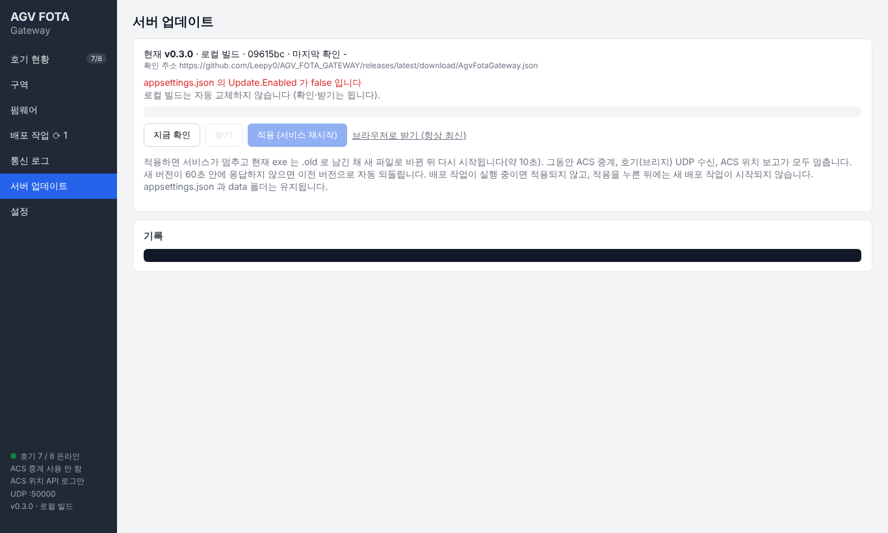

*시연 환경(로컬 빌드, `Update.Enabled=false`)이라 받기·적용 단추가 꺼져 있습니다. 정식 설치본에서는 새 버전이 있으면 켜집니다.*

### 9-1. 화면에서 업데이트

1. 메뉴 **서버 업데이트** 옆에 ● 가 붙으면 새 버전이 있습니다.
2. **지금 확인** 으로 바로 확인할 수도 있습니다.
3. **받기 (vX.Y.Z)** 를 누릅니다. `.partial` 로 받고 SHA-256 이 맞을 때만 채택합니다.
4. 받으면 화면 위에 "새 서버 버전 … 을(를) 받았습니다" 띠가 뜹니다.
5. 배포 작업이 실행 중이 아닐 때 **vX.Y.Z 적용 (서비스 재시작)** 을 누릅니다.
6. 확인창을 읽고 확인합니다. 멈추는 동안 끊기는 것(ACS 중계 상태, 온라인 호기 수)이 나옵니다.
7. 약 10초 뒤 화면이 다시 붙습니다. **기록** 에 `업데이트 vX.Y.Z 적용됨` 이 보이면 끝입니다.

> **v0.2.x → v0.3.0 첫 업데이트만 주의** ([점검 I-01](REVIEW_2026-10-10.md#4-1-서버-업데이트-뒤-서비스로-재시작-안-됨-i-01-높음))
> 파일을 바꾸는 배치는 **지금 돌고 있는 버전** 이 만듭니다. 그래서 v0.2.x 에서 0.3.0 으로 올리는 첫 번은 옛 배치가 돌고, 서비스로 다시 뜨지 않고 exe 가 따로 실행될 수 있습니다. 화면은 정상으로 보이지만 자동 재시작이 동작하지 않습니다. 둘 중 하나로 합니다.
>
> - **권장**: [9-4 수동 업데이트](#9-4-수동-업데이트) 로 올리고, 끝에 `install-service.bat` 을 다시 실행합니다(폴더 권한·ACS 방화벽 규칙까지 반영).
> - 화면에서 적용했다면 바로 `services.msc` 에서 **AgvFotaGateway** 상태를 봅니다. **중지됨** 이면 관리자 명령 프롬프트에서 다음을 실행한 뒤, `install-service.bat` 을 한 번 다시 실행합니다.
>
> ```bat
> taskkill /f /im AgvFotaGateway.exe
> sc start AgvFotaGateway
> ```
>
> 0.3.0 부터는 서비스로 정상 재시작하고, 60초 기동 확인과 자동 되돌림이 동작합니다.

- 자동 확인: 시작 3초 뒤 한 번, 이후 6시간마다.
- **적용을 누른 순간부터 새 배포 작업은 시작하지 않습니다.** 배포 작업이 실행 중이면 적용하지 않습니다(`배포 작업이 실행 중 — 끝난 뒤 적용하세요`).
- 적용 대기 작업은 적용을 막지 않습니다. 재시작 뒤에도 남지만 승인은 풀리므로 **적용 시작** 을 다시 누릅니다.
- **새 버전이 60초 안에 응답하지 않으면 이전 버전으로 자동 되돌립니다.** 기록에 `업데이트 … 이(가) 60초 안에 응답하지 않아 이전 버전 … 로 자동 되돌림 (실패한 exe 는 AgvFotaGateway.exe.bad) — apply.log 확인` 이 남습니다. 그 버전은 자동 적용에서 빠집니다(화면에서 직접 적용은 됨).
- `Update.AutoApply` 를 `true` 로 하면 받기와 적용까지 자동으로 합니다. 단 ACS 중계가 연결돼 있으면 `… ACS 중계 연결 중이라 자동 적용을 미룸 (화면에서 적용)` 으로 멈춥니다. 기본은 `false` 입니다.
- 받아 둔 업데이트는 서버를 재시작해도 남고, 확인이 실패해도 적용할 수 있습니다.
- `appsettings.json` 과 `data\` 는 그대로 둡니다.
- 이전 exe 는 `AgvFotaGateway.exe.old` 로 남습니다. **이전 버전(…)으로 되돌리기** (빨간 단추)로 한 세대 되돌립니다. 되돌린 버전은 자동 적용에서 빠집니다.
- **브라우저로 받기 (항상 최신)** 링크로 zip 을 직접 받을 수 있습니다.

| 화면의 빌드 종류 | 어디서 온 것 | 자동 업데이트 |
|---|---|---|
| 정식 배포 | Releases `vX.Y.Z` zip | 확인 · 받기 · 적용 |
| 테스트 빌드 | `dev` 프리릴리스 zip | 정식 릴리스만 받음. 버전이 같으면 바뀌지 않음 |
| 로컬 빌드 | 직접 빌드 | 확인·받기만. 교체하지 않음 |

### 9-2. 업데이트 출처와 저장소 공개

서버는 `https://github.com/Leepy0/AGV_FOTA_GATEWAY/releases/latest/download/AgvFotaGateway.json` 으로 확인합니다.

- 출처는 **https 의 `github.com`·`api.github.com` 만** 허용합니다. 사내 웹 서버, `http://`, `file://` 공유 폴더는 쓸 수 없습니다(`허용되지 않은 업데이트 주소 …`). 이 경우 [9-4 수동 업데이트](#9-4-수동-업데이트) 를 씁니다.
- 사내 방화벽·프록시에서 열어 둘 주소: `github.com`, `api.github.com`(폴백), `objects.githubusercontent.com`·`release-assets.githubusercontent.com`(GitHub 가 릴리스 파일을 넘겨 주는 주소).
- 서비스(LocalSystem)는 로그인 사용자가 아니라 SYSTEM 계정의 프록시 설정을 씁니다.

| 상황 | 결과 · 할 일 |
|---|---|
| 저장소 **공개** | 기본값 그대로. 위 주소만 열려 있으면 자동 업데이트 됨 |
| 저장소 **비공개** | github.com 매니페스트 주소가 404 → `정식 릴리스가 없거나 접근할 수 없음`. 기본 설정으로는 **자동 업데이트를 쓸 수 없습니다.** 저장소를 공개로 바꾸거나 수동 업데이트 |
| 비공개 + `api.github.com` 이 열린 망 | `GitHubToken`(Contents: Read)을 넣으면 API 폴백으로 확인합니다. 받기까지 되는지는 확인 필요 |

### 9-3. 적용 기록

- 교체 과정: `data\update\apply.log` (배치 파일이 남김)
- 확인·받기·적용·자동 되돌림 메시지: 화면 **기록** (최근 100줄), 서버 로그 `data\logs\` 의 `update:` 줄
- 자동 되돌림이나 수동 되돌리기를 한 버전: `data\update\skip-auto.txt` (자동 적용 제외)

### 9-4. 수동 업데이트

자동 적용이 실패했거나, 인터넷이 없거나, v0.2.x 에서 처음 올릴 때.

1. 새 zip 을 받습니다.
2. 배포 작업이 실행 중이 아닌지 확인합니다.
3. 관리자 명령 프롬프트에서 서비스를 멈춥니다(실행 중인 exe 는 잠겨 있어 바꿀 수 없음).
   ```bat
   net stop AgvFotaGateway
   ```
4. 설치 폴더의 `AgvFotaGateway.exe.old` 가 있으면 지우고, `AgvFotaGateway.exe` 를 `AgvFotaGateway.exe.old` 로 이름을 바꿉니다 (되돌리기용).
5. zip 안 `AgvFotaGateway\` 폴더의 파일을 설치 폴더로 복사합니다. **`appsettings.json` 은 복사하지 않습니다.** `data\` 는 zip 에 없습니다.
6. `install-service.bat` 을 관리자 권한으로 다시 실행합니다. 서비스 설정·폴더 권한·방화벽을 갱신하고 시작합니다. (설정이 그대로면 `net start AgvFotaGateway` 만 해도 됩니다.)
7. **설정** 화면에서 버전을 확인합니다.

### 9-5. 수동 되돌리기

1. `net stop AgvFotaGateway`
2. `AgvFotaGateway.exe` 를 다른 이름으로 바꿉니다 (예: `AgvFotaGateway.exe.bad`).
3. `AgvFotaGateway.exe.old` 를 `AgvFotaGateway.exe` 로 바꿉니다.
4. `net start AgvFotaGateway`

---

## 10. 문제 해결

### 10-1. 로그 위치

| 무엇 | 위치 |
|---|---|
| 서버 로그 | `data\logs\gateway-YYYYMMDD.log` (14일 보관) |
| 서비스 시작 실패 | 이벤트 뷰어 → Windows 로그 → 응용 프로그램 |
| 서버 업데이트 교체 | `data\update\apply.log` |
| 브리지와 주고받은 패킷 | 화면 **통신 로그** (최근 300줄, 재시작하면 지워짐) |
| 작업별 진행 | **배포 작업** 화면에서 호기 줄을 누름 (호기마다 최근 200줄, DB 에 저장) |
| 살아 있는지 | `http://<PC IP>:8080/api/health` → `{"ok":true,"version":…}` |

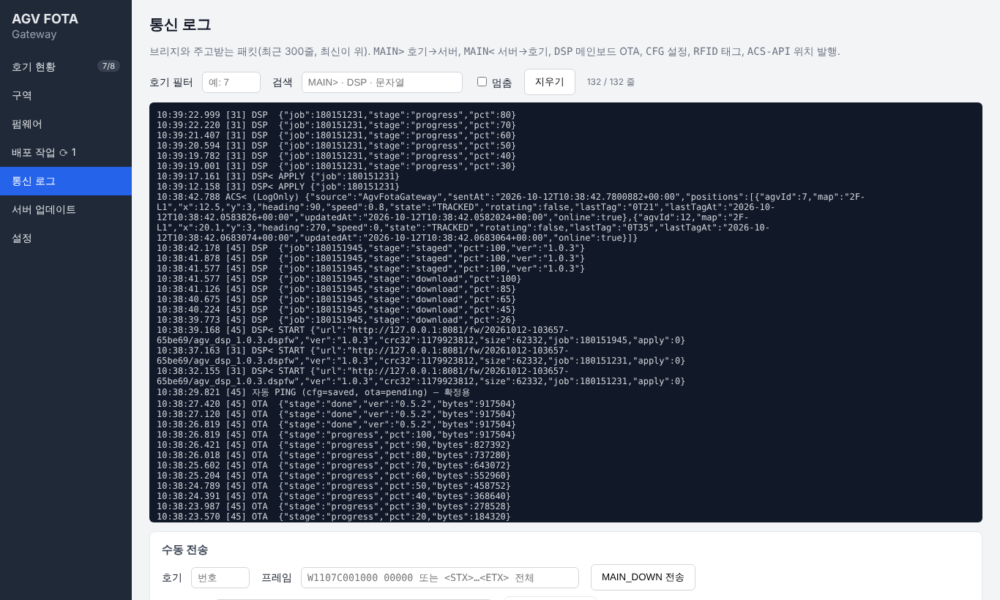

*최신 줄이 위입니다. 31호기 메인보드 진행 보고와 서버의 `DSP<` APPLY 재전송, 45호기의 staged 보고 3회(브리지는 최종 보고를 3번 보냄), 확정용 자동 PING 이 보입니다. 호기 필터와 검색으로 좁힙니다.*

| 통신 로그 표시 | 뜻 |
|---|---|
| `MAIN>` / `MAIN<` | 호기→서버 / 서버→호기 메인보드 프레임 |
| `DSP` / `DSP<` | 메인보드 OTA 보고 / 명령 |
| `OTA` | 브리지 OTA 결과 |
| `CFG>` | 원격 설정 명령의 응답 |
| `RFID>` | RFID 태그 |
| `ACS<` | ACS 로 보낸 위치. `(LogOnly)` 가 붙으면 보내지 않고 내용만 기록 |
| `ACS-INV>` | ACS 호기 소속 받기 결과 |
| `INFO` | **INFO 요청** 에 대한 브리지 응답 |
| `[NN] 자동 PING (cfg=…, ota=…) — 확정용` | 서버가 원격 설정·브리지 OTA 를 확정하려고 보낸 PING |
| `[NN] 주소 충돌 old→new …` | 같은 번호 장치가 둘 ([3-4](#3-4-같은-호기-번호-충돌)) |
| `[NN] 주소 변경 old→new` | 기존 장치가 오프라인이 된 뒤 새 주소로 넘어감 (정상 IP 변경·교체) |
| `[NN] ACS 중계 제외 — ETX/BCC 가 맞지 않는 조각` | 잘리거나 BCC 가 틀린 프레임은 ACS 로 보내지 않음. 자주 보이면 UART 배선·잡음 확인 |
| `호기 번호 N 은 범위(1~99) 밖 …` | 브리지 AGV ID 설정 확인 |
| `BAD packet from …` | 형식이 틀린 패킷 |

수동 전송(화면 아래 **수동 전송**):

- 호기 칸은 비어 있는 채로 시작합니다(호기 현황에서 들어오면 채워짐). 버튼에 대상 호기가 보입니다(`07 호기에 CFG_CMD 전송`).
- 읽기 전용(`cfg`, `stat`, `help`, `setup`, `dsp`, `dsp ver`)이 아닌 설정 명령과 W·N 프레임은 확인창을 거칩니다.
- 짧은 형식 프레임은 프레임 안의 호기 번호를 씁니다. 호기 칸과 다르면 보내지 않습니다. `<STX>` 원문은 호기 칸이 필요합니다.
- `F`(업데이트 진입)·`R`(응답) 프레임은 보낼 수 없습니다. 배포 작업을 씁니다.
- 번호 충돌 호기에는 보내지 않습니다.

### 10-2. 서버·화면

| 증상 | 확인 · 조치 |
|---|---|
| 서비스가 시작되지 않거나 바로 멈춤 | 이벤트 뷰어와 `data\logs` 를 봅니다. 8080 을 다른 프로그램이 쓰는지 `netstat -ano` 결과에서 `:8080` 을 찾습니다. `appsettings.json` 문법 오류. 서비스를 멈추고 `start.bat` 을 관리자 권한으로 실행하면 콘솔에 오류가 보입니다 |
| `start.bat` 이 `data` 에 쓰지 못한다는 오류 | 설치 폴더 권한 때문. 관리자 권한으로 실행하거나 서비스로 운용 |
| `appsettings.json` 을 저장할 수 없음 | 메모장을 관리자 권한으로 실행 |
| 이 PC 에서는 열리는데 다른 PC 에서 안 열림 | 방화벽 규칙 `AGV FOTA Gateway HTTP`. `start.bat` 으로 띄웠거나 포트를 바꾼 뒤라면 `install-service.bat` 을 다시 실행 |
| 화면에 `접속 주소(Host) … 가 허용 목록에 없음 — Gateway.AllowedHostNames 에 추가` (403) | IP 나 PC 이름이 아닌 이름(사내 DNS 별칭 등)으로 접속함. IP 로 접속하거나 그 이름을 `Gateway.AllowedHostNames` 에 넣고 재시작 ([7-2](#7-2-서버브리지-urls-gateway)) |
| 화면 위 빨간 띠 "UDP 50000 포트를 열 수 없음" | 다른 프로그램(BridgeTest 등)이나 두 번째 Gateway 가 UDP 50000 사용 중. 그 프로그램을 끄면 10초 안에 자동 복구 |
| 화면에 "서버에 다시 연결하는 중…" / "다시 연결하지 못했습니다" | 서버가 재시작 중(업데이트 적용, 설정 변경)이거나 네트워크가 끊김. 잠시 뒤 **다시 시도** 또는 새로 고침. 계속되면 서비스 상태 확인 |
| "화면 처리 중 오류가 났습니다: …" | 그 화면만의 오류. **다시 시도** 또는 다른 화면으로 갔다 오기. 반복되면 `data\logs` 와 함께 알림 |
| 설정을 바꿨는데 그대로 | 서비스를 재시작했는지. **설정** 화면 맨 위에 나온 `appsettings.json` 경로가 고친 파일인지 |
| 서버 로그에 `마지막 접속 DB 기록 실패 …` | 다른 프로그램이 `gateway.db` 를 잠금. DB Browser 를 닫거나 읽기 전용으로 엶 ([8-2](#8-2-백업)) |
| 배포 작업 화면 위 `DB 저장 대기 N 건 — gateway.db 에 쓰지 못해 몇 초마다 다시 시도하는 중입니다 …` | 위와 같음. 화면 상태는 맞지만 저장 전에 서버가 재시작되면 마지막 변경(취소·완료·삭제 등)이 사라질 수 있음. DB 를 연 프로그램을 닫으면 띠가 사라짐 |
| 서버 로그에 `[WRN] FileLogger: 옛 로그 삭제 실패 …` | 14일 지난 로그를 지우지 못함(서비스는 계속 돔). `data\logs` 의 파일 속성·권한 확인 |

### 10-3. 호기

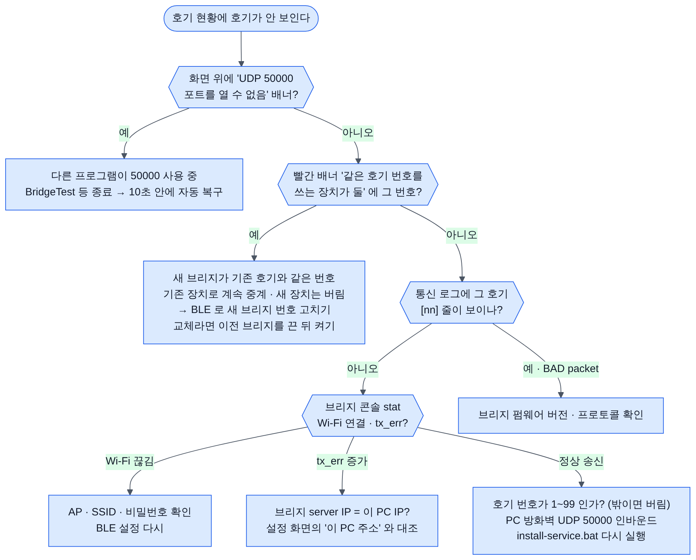

*위에서부터 차례로 확인합니다: UDP 포트 띠 → 번호 충돌 띠 → 통신 로그 → 브리지 `stat` → 호기 번호 1~99·방화벽. 브리지 콘솔 `stat` 은 USB 콘솔이나 BLE 앱에서 칩니다.*

| 증상 | 확인 · 조치 |
|---|---|
| 호기가 아예 안 보임 | 위 그림 순서. 브리지 `server` = 이 PC IP, 방화벽 UDP 50000, 브리지 `stat` 의 `tx_err`, 브리지 AGV ID 가 1~99 인지 |
| 빨간 띠 "같은 호기 번호를 쓰는 장치가 둘 있습니다" | [3-4](#3-4-같은-호기-번호-충돌) |
| `N초 전` (오프라인) | heartbeat 가 5초 넘게 없음. 호기 전원, Wi-Fi(RSSI), AP |
| `ota` 가 `pending` 으로 계속 남음 | 서버 자동 PING 이 브리지에 닿지 않음. 통신 로그에 `자동 PING` 이 있는지, 브리지 `server` IP. 부팅 180초가 지나면 이전 펌웨어로 롤백됨 |
| `cfg` 가 `trial` 로 계속 남음 | 위와 같음. 180초가 지나면 이전 설정으로 복구됨 |
| 메인보드 열 `-` | 브리지 0.5.0 미만. 브리지부터 올림 |
| 메인보드 `?` | 앱이 버전 응답을 안 함. 앱에 `dsp/app` 지원 코드가 있는지, 첫 `.dspfw` 를 아직 적용 안 했는지(앱 헤더가 비면 부트로더가 대기), J4 배선. 앱이 멈춘 호기면 **복구 적용** 작업으로 배포 |
| `⚠ 파티션 없음` | USB 전체 굽기 |
| `손실` 이 계속 늘어남 | 무선 품질. RSSI·AP 위치 |

### 10-4. 브리지 OTA 실패

배포 작업 메시지 기준입니다. 브리지가 보낸 코드에는 `— 안내` 가 붙어 나옵니다.

| 메시지 | 원인 · 조치 |
|---|---|
| `브리지 OTA 실패: url_host` | 펌웨어 URL 의 호스트가 브리지의 `server` IP 와 다름. `PublicBaseUrl` 을 비우거나 브리지 `server` IP 와 같은 IPv4 로 ([7-2](#7-2-서버브리지-urls-gateway)) |
| `브리지 OTA 실패: bad_url` | URL 형식 오류 또는 255자 초과. `PublicBaseUrl` 확인, 파일명 줄이기 |
| `브리지 OTA 실패: mainboard_programming` | 그 브리지가 메인보드를 굽는 중이라 거부. 메인보드 적용이 끝난 뒤 다시 |
| `브리지 OTA 실패: mainboard_staging` | 그 브리지가 메인보드 이미지를 받는 중이라 거부. 스테이징이 끝난 뒤 다시 |
| `브리지 OTA 실패: no_mem` | 브리지 메모리 부족. 잠시 뒤 다시, 반복되면 브리지 재부팅 |
| `브리지 OTA 실패: begin …` / `perform …` | 브리지가 서버 8080 에서 파일을 받지 못함. 방화벽, `PublicBaseUrl`(NIC 여러 개), 무선 품질 |
| `브리지 OTA 실패: finish …` / `project mismatch …` | 이미지 검증 실패. `agv_wifi_bridge.bin` 을 올렸는지 |
| `브리지가 이미 OTA 진행 중` | 잠시 뒤 다시 |
| `OTA_RESULT 없음 (180초, 재전송 N회)` | 브리지 응답 없음. 통신 로그 확인 |
| `OTA 중 브리지가 재부팅됨 (done 보고 없음) — 이전 펌웨어 그대로 …` | 받는 중 브리지가 리셋됨. 다시 실행 |
| `재부팅 후 heartbeat 확인 안 됨 (90초) — 새 펌웨어가 미확정(pending)이면 부팅 180초 뒤 이전 펌웨어로 롤백됨` | 새 펌웨어가 서버에 붙지 못함. 몇 분 뒤 호기 현황에서 버전 확인 |
| `재부팅했지만 이전 슬롯(ota_x) 그대로 — 새 펌웨어 기동 실패로 롤백됨 …` | 새 이미지가 부팅하지 못함. 이미지 확인 |
| `확정(valid) 안 됨 (20초, PING N회) — 부팅 180초 안에 호기 현황에서 PING 하면 확정됨, 재부팅하면 롤백됨` | 서버 PING 이 닿지 않음. **180초 안에** 호기 현황 → 그 호기 행 → **PING**. 지났거나 재부팅했으면 이전 펌웨어로 롤백되므로 다시 실행 |
| `브리지가 이전 업데이트를 확정하지 못함 (ota=pending 유지, PING 10초) …` | 작업 시작 때 PING 을 반복해도 확정되지 않음(서버 패킷이 브리지에 닿지 않음). 호기 현황에서 확정(`valid`)을 확인한 뒤 다시 |
| `버전 불일치: 기대 …, 실제 …` | 롤백됐거나 다른 이미지 |
| `서버 IP 를 알 수 없음 — PublicBaseUrl 설정` | `Gateway.PublicBaseUrl` 을 정함 |

### 10-5. 메인보드 OTA 실패

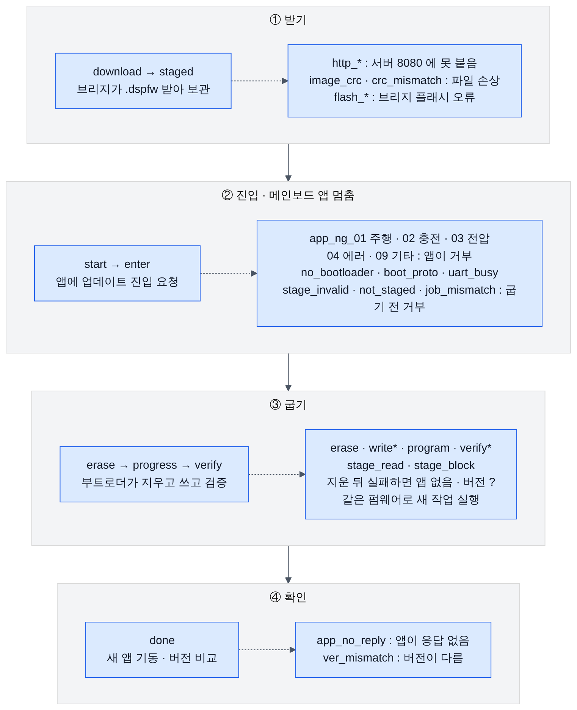

*로그의 마지막 단계와 코드로 어디서 멈췄는지 봅니다. ① 받기(스테이징) ② 진입 ③ 굽기 ④ 확인. 지우기(erase) 뒤에 실패하면 메인보드 앱이 없는 상태가 됩니다.*

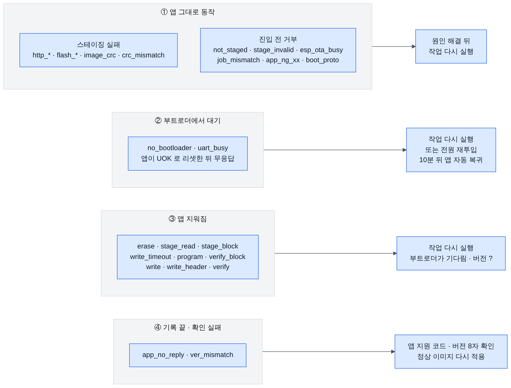

*① 앱 그대로면 원인을 고친 뒤 새 작업. ② 부트로더 대기(진입 승인 뒤 끊김)는 60초 안에 첫 패킷이 없으면 앱으로 자동 복귀. ③ 앱이 지워졌으면(자동 재시도 2회도 실패) 새 작업 → 복구 적용. ④ 확인 실패는 앱 지원 코드·워치독·버전 확인.*

작업 메시지는 `브리지 보고 실패: <코드> — <안내>` 형식입니다. (서버) 표시는 서버가 낸 메시지입니다.

**① 받기 (스테이징)** — 메인보드 앱은 그대로입니다.

| 코드 | 원인 | 조치 |
|---|---|---|
| (서버) `지원하지 않음 … 0.5.0 이상 필요` | 브리지 펌웨어가 낮음 | 브리지부터 0.5.2 로 (0.5.0 미만은 USB) |
| `no_partition` / (서버) `dspfw 파티션이 없음` | 구 파티션 브리지 | USB 전체 굽기 |
| `url_host` | URL 호스트가 브리지 `server` IP 와 다름 | `PublicBaseUrl` 을 비우거나 같은 IPv4 로 |
| `url_too_long` / (서버) `스테이징 URL 이 N자 …` | URL 199자 초과 | 펌웨어 파일명을 줄여 다시 올림 |
| `bad_request` | 브리지가 명령을 읽지 못함 | 서버·브리지 버전 확인 |
| `http_init` · `http_open` · `http_status` · `http_length` · `http_read` · `http_short` · `http_overrun` | 브리지가 서버 8080 에서 파일을 못 받음 | 방화벽, `PublicBaseUrl` |
| `ver_invalid` | 이미지 버전이 1~8자 규칙을 어기거나 두 헤더 버전이 다름. 기존 스테이징은 유지 | `dsp_pack.py --ver` 확인 후 다시 묶음 |
| `image_crc` · `image_bad` · `crc_mismatch` · `stage_invalid` | 받은 파일 손상, 블록 구조 이상 | 다시 실행. 반복되면 `dsp_pack.py` 로 다시 만들어 올림 |
| `flash_erase` · `flash_write` | 브리지 저장 영역 오류 | 다시 실행. 반복되면 브리지 점검 |
| `esp_ota_busy` | 브리지 자체 OTA 중 | 브리지 OTA 가 끝난 뒤 다시 |
| `busy` · `not_ready` / (서버) `브리지가 이미 메인보드를 프로그래밍 중` | 브리지가 앞 명령 처리 중 | 잠시 뒤 다시 |

**② 진입** — 지우기 전이라 앱은 그대로입니다.

| 코드 | 원인 | 조치 |
|---|---|---|
| `app_ng_01` / `02` / `03` / `04` / `09` | 메인보드 앱이 거부: 주행 중 / 충전 중 / 전압 부족 / 에러 상태 / 기타(정지 확인 콜백 없음 포함) | AGV 정지·충전 해제 후 다시 |
| `app_no_fwup` | 앱은 돌고 있지만(프레임이 옴) 업데이트 진입에 응답 없음 — OTA 지원 코드가 없는 앱. 중계는 계속됨 | 지원 코드를 넣은 앱을 JTAG 으로 한 번 굽기 ([dsp/README.md](https://github.com/Leepy0/AGV_Wifi_Bridge/blob/main/dsp/README.md)) |
| `app_no_reply` | 앱이 업데이트 진입에 응답 없고 앱 프레임도 없음. 브리지는 부트로더로 가지 않아 RFID·ACS 중계는 계속되고, 앱 버전을 `?` 로 바꿈 | 정지 확인 후 다시. 앱이 멈춘 호기면 **복구 적용** 작업으로 |
| `uart_busy` | 브리지 → 메인보드 송신 대기열이 가득 참 | 잠시 뒤 다시 |
| `no_bootloader` | 부트로더 응답 없음 (복구 적용이면 60초 전원 재투입 대기 뒤) | 부트로더 설치 여부([dsp/README.md](https://github.com/Leepy0/AGV_Wifi_Bridge/blob/main/dsp/README.md)), 메인보드 전원, J4 배선. 앱이 멈춘 호기면 복구 적용 작업으로 다시, 복구 적용이면 `wait_power` 안내 때 전원을 껐다 켬 |
| `boot_proto` | 부트로더와 브리지의 프로토콜 버전이 다름 | 부트로더 갱신 |
| `not_staged` · `job_mismatch` | 받아 둔 이미지가 없거나 다른 작업 것 (브리지 재부팅 등) | 새 작업으로 다시 |
| `wait_power` (진행, 실패 아님) | 복구 적용에서 부트로더를 기다림 | 60초 안에 메인보드 전원을 껐다 켬 |

**③ 굽기** — **메인보드 앱이 지워진 상태**(버전 `?`)일 수 있습니다.

| 코드 | 원인 | 조치 |
|---|---|---|
| `erase` · `write` · `write_timeout` · `program` · `verify_block` · `stage_read` · `stage_block` · `write_header` · `verify` | 굽는 중 실패. 브리지가 이미 HELLO 부터 2번 더 시도한 뒤 | 같은 펌웨어로 **새 작업** 을 만듭니다. 앱이 지워져 버전이 `?` 이고 부트로더가 기다리고 있으므로 브리지가 부트로더로 바로 굽습니다. `no_bootloader` 로 실패하면 **복구 적용** 을 켜고 다시 |
| `retry` (진행, 실패 아님) | 지운 뒤 실패해 자동 재시도 중 | 할 일 없음 |

**④ 확인**

| 코드 | 원인 | 조치 |
|---|---|---|
| `app_no_reply` | 굽고 나서 앱이 응답 없음 | 앱의 `fwup_boot_ok()` 호출·링커 설정·워치독 확인. 이전 버전 `.dspfw` 로 다시 |
| `ver_mismatch` / (서버) `적용 후 앱 버전 … 이 이미지 … 과 다름` | 앱이 보고한 버전이 이미지와 다름 | 앱의 버전 정의와 `--ver` 가 같은지 |
| (서버) `heartbeat 의 메인보드 버전이 … 가 아님` | 완료 보고 뒤 30초 동안 heartbeat 버전이 안 바뀜 | 호기 현황에서 버전 확인 |
| (서버) `브리지 보고 없음 (N초, '…' 대기 중, 재전송 N회)` | 받기 3분, 적용 중 90초 동안 반응 없음 | 통신 로그, 호기 온라인 여부 |

> 앱이 멈춰 응답하지 않는 메인보드는 복구 적용(브리지가 HELLO 를 반복해 보내는 동안 전원 재투입)으로 살립니다. 앱에 워치독이 없으면 부트 카운터 경로로는 살릴 수 없습니다. "지운 뒤 다시 굽기" 복구는 벤치 시험 항목이고, 실기에서는 아직 검증 전입니다.

### 10-6. 서버 업데이트

| 메시지 | 확인 · 조치 |
|---|---|
| `정식 릴리스가 없거나 접근할 수 없음 (…)` | 정식 릴리스가 없거나 저장소가 비공개. [9-2](#9-2-업데이트-출처와-저장소-공개) |
| `허용되지 않은 업데이트 주소 (…) — https://github.com 저장소 주소만 됩니다` | `Update.BaseUrl`·`ManifestUrl` 을 GitHub 주소로. 사내 서버는 쓸 수 없음 → [9-4](#9-4-수동-업데이트) |
| `확인 실패: …` | 인터넷·방화벽([9-2](#9-2-업데이트-출처와-저장소-공개) 의 주소). `start.bat` 으로는 되는데 서비스로는 안 되면 SYSTEM 계정의 프록시 설정 차이 |
| `GitHub API 횟수 제한 — 1시간 뒤 다시` | 1시간 뒤 다시 |
| `받기 실패: 받은 파일이 손상됨 (SHA-256 불일치) — 다시 받으세요` | **받기** 를 다시 누름 |
| `받기 실패: 릴리스에 검증용 SHA-256 정보가 없음 …` | 릴리스에 `.sha256` 이 없음. 릴리스를 다시 만들거나 수동 업데이트 |
| `배포 작업이 실행 중 — 끝난 뒤 적용하세요` | 작업이 끝난 뒤 적용 |
| `… ACS 중계 연결 중이라 자동 적용을 미룸 (화면에서 적용)` | 정상. ACS 쪽과 맞춘 시각에 화면에서 적용 |
| `로컬 빌드는 자동 교체하지 않음` | Releases 의 zip 으로 설치 |
| `업데이트 … 이(가) 60초 안에 응답하지 않아 이전 버전 … 로 자동 되돌림 …` | 새 버전이 뜨지 않아 되돌림. `apply.log` 와 `data\logs` 를 확인하고 알림 |
| `… 응답하지 않았지만 되돌릴 이전 exe 가 없음 …` · `업데이트 … 파일 교체 실패 …` | `apply.log` 확인 후 [9-4 수동 업데이트](#9-4-수동-업데이트) |
| 적용 뒤 화면은 붙는데 `services.msc` 에는 **중지됨** | v0.2.x → v0.3.0 첫 업데이트의 옛 배치 문제. [9-1](#9-1-화면에서-업데이트) 의 안내대로 |

### 10-7. REST API 오류

스크립트로 `/api/...` 를 부를 때 응답 코드입니다. 본문은 짧은 사유 문자열입니다.

| 코드 | 뜻 | 예 |
|---|---|---|
| 400 | 잘못된 입력 | `대상 호기(1~99)를 하나 이상 targets 에 넣으세요`, `applyMode 는 Approve 또는 Immediate`, `notAfter(마감 시각)가 이미 지났습니다`, `예약 시각이 이미 지났습니다`, `펌웨어 없음`, `복구 적용은 메인보드 작업만 고를 수 있습니다`, 메인보드 버전 8자 규칙, `F`·`R` 수동 프레임, 적용 대기가 아닌 작업 승인 |
| 403 | 다른 사이트의 웹 페이지가 브라우저로 보낸 변경 요청, 또는 허용 목록에 없는 접속 이름(Host) | `다른 출처(…)에서 보낸 요청은 받지 않습니다`(curl·스크립트처럼 Origin 이 없으면 해당 없음), `접속 주소(Host) … 가 허용 목록에 없음 — Gateway.AllowedHostNames 에 추가` |
| 404 | 없음 | 없는 작업·펌웨어, heartbeat 를 받은 적 없는 호기 |
| 409 | 사용 중·충돌 | 끝나지 않은 작업이 쓰는 펌웨어 삭제, 번호 충돌 호기에 수동 전송 |
| 500 | 서버 오류 | `서버 오류: …`. `data\logs` 확인 |

---

## 11. 제거

1. `uninstall-service.bat` 을 우클릭 → **관리자 권한으로 실행** 합니다.
2. 서비스를 멈추고 지웁니다. 방화벽 규칙(`AGV FOTA Gateway HTTP`, `AGV FOTA Gateway Bridge UDP`, `AGV FOTA Gateway ACS TCP`)도 지웁니다.
3. `삭제했습니다.` 가 나오면 끝입니다.

- 설치 폴더와 `data\` 는 남습니다. 다시 `install-service.bat` 을 실행하면 이전 데이터 그대로 이어서 씁니다.
- 완전히 지우려면 `data\` 를 백업한 뒤 설치 폴더를 지웁니다. 폴더 권한 때문에 관리자 권한이 필요합니다.
