# 전체 점검 결과와 보완점 (2026-10-10)

> **대상**: 게이트웨이 저장소 `agv_fota_gateway`(main `b606529`), 브리지 저장소 `AGV_Wifi_Bridge`(main `0dfbdf6`, 브리지 펌웨어 v0.5.1 · 메인보드 부트로더 · PC 도구)
> **방법**: 여러 에이전트가 관점별로 지적을 찾고, 다른 에이전트가 코드에서 직접 반박·확인했습니다([3절](#3-점검-방법)).
> **이 문서의 범위**: 분석 결과입니다. **제품 코드는 고치지 않았습니다.** 문서에서 틀린 내용만 바로 고쳤습니다([10절](#10-이번에-바로-고친-문서)). 코드 보완은 요청이 있으면 묶음 단위로 진행합니다.
>
> **반영 (2026-10-11 추가)**: 91건을 **모두** 게이트웨이 0.3.0 · 브리지 0.5.2 에 반영했습니다. 결과는 [0절](#0-반영-결과-2026-10-11--게이트웨이-030--브리지-052) 에 있습니다. 1~12절은 2026-10-10 점검 당시의 기록으로 그대로 둡니다. 그 안의 **당장의 우회** 는 이전 버전에만 해당합니다.
>
> 전체 흐름은 [SYSTEM_FLOW.md](SYSTEM_FLOW.md), 설치·운용은 [DEPLOY.md](DEPLOY.md) 를 봅니다.

---

## 목차

0. [반영 결과 (2026-10-11 · 게이트웨이 0.3.0 · 브리지 0.5.2)](#0-반영-결과-2026-10-11--게이트웨이-030--브리지-052)
   - [0-1. 운용자가 할 일](#0-1-운용자가-할-일)
   - [0-2. 반영 현황](#0-2-반영-현황)
   - [0-3. 확정한 결정 17건](#0-3-확정한-결정-17건)
   - [0-4. 묶음별 해결](#0-4-묶음별-해결)
   - [0-5. 남은 일](#0-5-남은-일)

**2026-10-10 점검 기록**

1. [한눈에 보기](#1-한눈에-보기)
2. [어디에 몰려 있나](#2-어디에-몰려-있나)
3. [점검 방법](#3-점검-방법)
4. [운영 전에 고칠 것 (P0, 10묶음)](#4-운영-전에-고칠-것-p0-10묶음)
5. [운영 초기에 고칠 것 (P1, 3묶음)](#5-운영-초기에-고칠-것-p1-3묶음)
6. [그 밖의 중간 지적](#6-그-밖의-중간-지적)
7. [낮음 지적](#7-낮음-지적)
8. [결정이 필요한 항목](#8-결정이-필요한-항목)
9. [잘 되어 있는 점](#9-잘-되어-있는-점)
10. [이번에 바로 고친 문서](#10-이번에-바로-고친-문서)
11. [판정이 갈린 항목](#11-판정이-갈린-항목)
12. [부록 — 전체 목록](#부록--전체-목록)

---

## 0. 반영 결과 (2026-10-11 · 게이트웨이 0.3.0 · 브리지 0.5.2)

> **91건을 모두 반영했습니다.** 83건은 코드로 고쳤고, 8건은 점검 당일 문서로 고쳤습니다([10절](#10-이번에-바로-고친-문서)). 결정이 필요했던 항목은 사용자가 17건으로 확정했고, 모두 코드에 넣었습니다.
> 자동 시험(게이트웨이 단위 시험, 가짜 브리지 종단 시험 12개, 브리지·부트로더 호스트 시험)은 통과했습니다. **메인보드 실기 검증은 아직입니다**([0-5](#0-5-남은-일)).

### 0-1. 운용자가 할 일

| 순서 | 할 일 | 자세히 |
|---|---|---|
| ① | 게이트웨이를 0.3.0 으로 올립니다. **v0.2.x 에서 처음 올릴 때만** 옛 교체 배치가 돌아 서비스로 다시 뜨지 않을 수 있습니다(I-01). 수동 업데이트를 쓰거나, 적용 뒤 서비스 상태를 확인합니다. | [DEPLOY 9-1](DEPLOY.md#9-1-화면에서-업데이트) |
| ② | 올린 뒤 `install-service.bat` 을 한 번 다시 실행합니다. 설치 폴더 권한과 ACS 방화벽 규칙이 새로 들어갑니다. | [DEPLOY 2-4](DEPLOY.md#2-4-install-servicebat-이-하는-일) |
| ③ | 브리지를 0.5.2 로 올립니다. 게이트웨이 0.3.0 은 브리지 0.5.2 와 짝으로 시험했습니다. | [DEPLOY 3-1](DEPLOY.md#3-1-브리지에-서버-ip-넣기) |
| ④ | 메인보드 작업은 스테이징이 끝나면 **적용 대기** 에서 멈춥니다. AGV 를 세운 뒤 **적용 시작** 을 누릅니다. | [DEPLOY 6-3](DEPLOY.md#6-3-적용-대기와-적용-시작) |
| ⑤ | 메인보드 현장 설치 전에, 브리지 0.5.2 의 `dsp/boot` 부트로더와 safe 콜백·워치독을 넣은 앱을 JTAG 로 굽습니다. | 브리지 [dsp/README.md](https://github.com/Leepy0/AGV_Wifi_Bridge/blob/main/dsp/README.md) |
| ⑥ | `PublicBaseUrl` 을 고정한다면 브리지에 넣은 서버 IP(IPv4)로 적습니다. 호스트명이면 브리지가 `url_host` 로 거부합니다. | [DEPLOY 7-2](DEPLOY.md#7-2-서버브리지-urls-gateway) |
| ⑦ | 앱이 멈춘(앱 버전 `?`) 메인보드는 작업을 만들 때 **복구 적용** 을 켭니다. 앱 버전 `?` 만으로는 자동으로 켜지지 않습니다. 살아 있는 구 앱(`app_no_fwup`)은 JTAG 로 굽습니다. | [DEPLOY 6-2](DEPLOY.md#6-2-작업-만들기) |
| ⑧ | 화면을 IP·PC 이름이 아닌 사내 DNS 별칭으로 연다면 `Gateway.AllowedHostNames` 에 그 이름을 넣습니다. 넣지 않으면 403 입니다. | [DEPLOY 2-7](DEPLOY.md#2-7-다른-pc휴대폰에서-열기) |

v0.2.x 에서 바뀐 운용 방법 전체는 [DEPLOY.md 'v0.2.x 를 쓰다가 올라온 경우'](DEPLOY.md#v02x-를-쓰다가-올라온-경우) 에 있습니다.

### 0-2. 반영 현황

| 반영한 곳 | 건수 |
|---|---:|
| 게이트웨이 0.3.0 | 61 |
| 브리지 0.5.2 | 14 |
| 양쪽 (게이트웨이 0.3.0 · 브리지 0.5.2) | 8 |
| 문서 (2026-10-10, [10절](#10-이번에-바로-고친-문서)) | 8 |
| **합계** | **91** |

| 관점 | 지적 | 0.3.0 | 0.5.2 | 양쪽 | 문서 |
|---|---:|---:|---:|---:|---:|
| 계약(저장소 간) | 9 | 6 | 1 | 2 | · |
| 서버 핵심 | 11 | 11 | · | · | · |
| 연동·배포 | 11 | 10 | · | · | 1 |
| 화면 | 12 | 12 | · | · | · |
| 보안·안전 | 11 | 7 | 2 | 2 | · |
| 브리지 펌웨어 | 5 | 1 | 3 | 1 | · |
| 메인보드·부트로더 | 11 | · | 8 | 2 | 1 |
| 문서·시험 | 12 | 5 | · | 1 | 6 |
| 누락 점검 | 9 | 9 | · | · | · |
| **합계** | **91** | **61** | **14** | **8** | **8** |

- 지적마다 어떻게 고쳤는지는 [부록](#부록--전체-목록)의 '반영' 열에 있습니다.
- 심각도와 상관없이 모두 반영했습니다(높음 1 · 중간 40 · 낮음 50). 판정이 갈렸던 4건(I-03 · B-01 · G-06 · G-09)은 결정에 따라 반영했고, 반박한 B-06 은 대상이 아닙니다.
- 부트로더 쪽 4건(D-01 · D-03 · D-06 · D-09)은 **JTAG 로 구워야** 메인보드에 들어갑니다. D-07(앱 지원 코드)은 앱을 다시 링크해 구워야 합니다.
- 단위별로 고친 뒤 통합하면서, 여러 파일에 걸쳐 남은 부분(S-06 · S-08 · U-12 등)과 통합 중 찾은 문제(펌웨어 삭제의 잠금 순서, 같은 작업 번호의 중복 명령 처리, 작업 저장 위치)도 함께 고쳤습니다.

### 0-3. 확정한 결정 17건

[8절](#8-결정이-필요한-항목)의 13건(6 · 7 은 결정 11 하나로 합침)에 새로 나온 5건(2 · 7 · 13 · 16 · 17)을 더한 17건입니다. 오른쪽 끝 열은 8절 번호입니다.

| # | 항목 | 선택한 안 | 관련 | 8절 |
|---|---|---|---|---|
| 1 | 메인보드 적용 전 정지 확인 | **스테이징 후 승인**(B안). 전 호기 스테이징 → 적용 대기 → 정지 확인창 → '적용 시작' → 한 대씩 적용. 야간용 '바로 적용' 도 고를 수 있음. 확인창은 모든 작업에 | X-01 · U-01 | 1 |
| 2 | 같은 호기 번호 장치가 둘 | **기존 주소 유지**(A안). 새 주소는 충돌로 경고. 충돌 중 배포·수동 전송 거부, ACS 중계는 기존 주소로 계속 | C-04 · S-03 · X-02 | 새 |
| 3 | 원격 설정 trial · OTA pending 확정 | 서버가 자동 PING (호기당 5초에 한 번) | B-02 · T-02 | 4 |
| 4 | 작업 마감 시각 | **작업마다 선택 입력**(B안). 지나면 남은 호기 건너뜀 | G-09 | 13 |
| 5 | 취소 때 밀려 있던 예약 | 확인창에 'N건이 바로 시작됨' 을 보이고 함께 취소할지 고름 | G-06 | 12 |
| 6 | 서버 자동 적용(`AutoApply`) | 기본 끔 유지. 켜도 ACS 중계가 연결돼 있으면 미룸 | X-10 | 8 |
| 7 | 새 서버 버전이 뜨지 않을 때 | 60초 안에 `/api/health` 가 새 버전을 돌려주지 않으면 `.old` 로 자동 되돌림 | I-02 | 새 |
| 8 | 기동 불능 앱 복구 | **A+B**. 앱 워치독 필수 + 부트로더가 앱으로 가기 전 200ms 동안 HELLO 를 받음. 복구 적용 때 브리지가 전원 재투입을 안내 | D-01 | 2 |
| 9 | 부트플래그 진입 뒤 대기 | 첫 패킷 전 60초(앱이 유효하면 앱으로 복귀), 첫 패킷 뒤 600초 | D-06 | 3 |
| 10 | BLE 설정 비밀번호 | 공통 기본값 `agvsetup` **유지**, 기본값 경고 없음. 같은 연결에서 5회 연속 틀리면 끊음 | X-07 | 5 |
| 11 | 서명 | **출처만 제한**(A안). 서버 업데이트는 https 의 github.com · api.github.com 만, 브리지 URL 은 호스트가 설정된 서버 IP 일 때만. 서명 검증 없음 | X-06 · X-08 | 6 · 7 |
| 12 | ACS Server 모드 | 하향 F·R 프레임 버림, 허용 IP 목록 `Acs.AllowedRemotes`(비우면 모두 허용) | X-04 | 9 |
| 13 | 설치 폴더 권한 | Administrators · SYSTEM 만 쓰기, Users 는 읽기·실행 | X-05 | 새 |
| 14 | 브리지 `hb_ms` 범위 | 0(끔, 디버그용) 또는 100~2000ms | C-06 | 10 |
| 15 | 서비스 프록시 | 공장망에 프록시 없음 → 옵션 없이 주석만 바로잡음 | I-03 | 11 |
| 16 | 저장소 공개 | 나중에 공개 전환. 업데이트 출처는 GitHub 기본값, 사내 업데이트 서버는 만들지 않음 | X-06 | 새 |
| 17 | 릴리스 | 게이트웨이 v0.3.0, 브리지 v0.5.2. 브리지 CI 에 수동 정식 발행(`release=true`) 경로 추가 | I-10 · T-09 | 새 |

점검 때 제안과 다르게 정한 것은 1(당장은 확인창 → 바로 승인 방식), 4(예상 시간 표시 → 마감 시각), 10(현장 공통값으로 교체·경고 → 기본값 유지)입니다.

### 0-4. 묶음별 해결

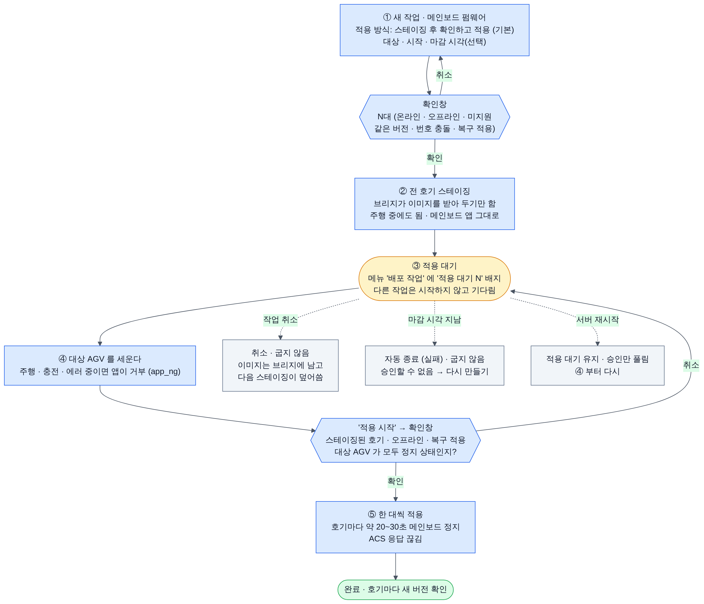

*메인보드 작업의 승인 흐름 (결정 1). 새 작업의 기본 방식은 '스테이징 후 확인하고 적용' 입니다. 전 호기 스테이징(주행 중에도 됨)이 끝나면 적용 대기에서 멈추고, 그동안 다른 작업은 기다립니다. AGV 를 세우고 '적용 시작' 확인창을 거치면 한 대씩 굽습니다. 취소하면 굽지 않고, 마감이 지나면 자동 종료(실패)되며, 서버를 재시작하면 승인만 풀립니다.*

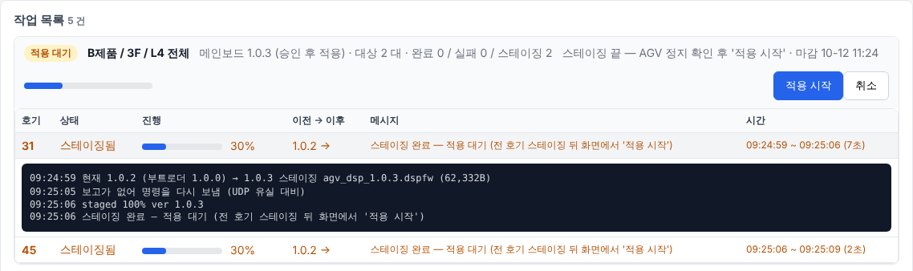

*적용 대기 작업. '스테이징 끝 — AGV 정지 확인 후 '적용 시작'' 과 마감 시각이 보이고, 파란 **적용 시작** 버튼을 누르면 확인창이 뜹니다. 31호기 로그의 '보고가 없어 명령을 다시 보냄 (UDP 유실 대비)' 은 4-2 의 재전송입니다.*

| 묶음 | 해결 | 릴리스 |
|---|---|---|
| [4-1](#4-1-서버-업데이트-뒤-서비스로-재시작-안-됨-i-01-높음) 서버 업데이트 뒤 서비스 재시작 | 서비스 여부를 서버가 배치에 인자로 넘기고, 배치의 `set` 은 모두 따옴표 형식. 60초 기동 확인에 실패하면 `.old` 로 자동 되돌림, 적용 확인창, 적용하는 순간 새 작업 보류 | 0.3.0 |
| [4-2](#4-2-udp-명령보고를-한-번만-보냄-c-01--t-02--c-05--b-02) UDP 한 번만 보냄 | 서버는 5초 무응답이면 최대 3회 재전송하고 heartbeat 로도 판정. 브리지는 최종 보고 3회, 같은 작업 번호의 중복 명령은 다시 굽지 않고 결과만 다시 보냄. 확정 PING 은 1초 간격 최대 20초, `cfg=trial`·`ota=pending` 이면 자동 PING | 양쪽 |
| [4-3](#4-3-메인보드-버전-8자-규칙-미강제-c-02--b-03--d-04--t-03) 버전 8자 규칙 | `dsp_pack.py` · 서버 업로드 · 브리지 스테이징이 1~8자 `[0-9A-Za-z._-]` 를 강제. 서버 비교는 앞 8자 | 양쪽 |
| [4-4](#4-4-agv-정지-확인과-운영자-실수-방지-x-01--u-01--u-05--d-07--b-01--u-03--u-04) 정지 확인·실수 방지 | 위 그림의 승인 흐름. 작업 만들기·적용 시작·취소·수동 전송·서버 업데이트에 확인창. 앱 safe 콜백이 없으면 거부. 앱이 U 에 답하지 않으면 부트로더로 가지 않고 `app_no_fwup`(앱 프레임은 옴)·`app_no_reply`(앱이 조용함)로 끝나 중계가 끊기지 않음. 부트로더 직행은 앱이 조용하고 복구 적용 작업(운용자가 작업마다 고름)이거나 앱 버전이 `?` 일 때만 | 양쪽 |
| [4-5](#4-5-같은-호기-번호--송신원-검증-없음-c-04--s-03--x-02) 같은 호기 번호 | 살아 있는 주소를 지키고 새 주소는 빨간 배너·'충돌' 배지로 경고. 충돌 중 배포·수동 전송 거부. heartbeat 에 `mac` 추가, 호기 번호 1~99 밖은 버림 | 0.3.0 (`mac` 은 0.5.2) |
| [4-6](#4-6-작업-시작-시점-s-01--g-05--g-08--g-07) 작업 시작 시점 | 기동 뒤 10초는 새 작업 안 함, 오프라인 호기는 20초 기다림. 30분 넘게 밀리면 서버가 켜져 있어도 자동 취소. 지난 시각 거부, 늦은 예약 표시, 마감 시각 | 0.3.0 |
| [4-7](#4-7-acs-빈-응답이-소속을-지움-s-04--i-04) ACS 빈 응답 | 목록 없음·빈 목록·전부 해석 실패면 반영하지 않음. 절반 이상이 한꺼번에 빠지면 삭제 보류 | 0.3.0 |
| [4-8](#4-8-파일-로그-예외가-작업으로-번짐-g-03) 파일 로그 예외 | 로거는 어떤 경우에도 예외를 던지지 않음. 옛 로그를 못 지우면 경고 한 줄만 | 0.3.0 |
| [4-9](#4-9-udp-수신-루프의-db-동기-쓰기-s-02) 수신 루프 DB 쓰기 | 수신 루프는 메모리에만 기록, 2초마다 따로 모아 씀(DB 대기 2초). 작업 저장도 잠금 밖에서 | 0.3.0 |
| [4-10](#4-10-부트로더메인보드-복구-한계-d-03--d-06--d-02--b-04--d-05--d-01--x-09--d-08) 부트로더·복구 | 부트로더: SCI 수신 오류 재동기, 첫 패킷 60초, 200ms HELLO 창(**JTAG**). 브리지: 지운 뒤 자동 재시도 2회, 굽는 동안 115200, 지우기 전 블록·`app_crc` 검사. 서버도 업로드 때 같은 검사 | 양쪽 |
| [5-1](#5-1-구역-경로-충돌-g-01--g-02--묶음-11) 구역 경로 충돌 | 단계 이름 안의 `/` 는 `／` 로 저장, '미분류' 는 실제 트리 노드 | 0.3.0 |
| [5-2](#5-2-외부-페이지-요청--설치-폴더-권한-x-03--x-05--묶음-12) 외부 요청·폴더 권한 | 다른 출처의 변경 요청은 403, 접속 이름(Host)이 이 서버 이름이 아니면 403(DNS 리바인딩, `Gateway.AllowedHostNames`). `install-service.bat` 이 폴더 권한을 다시 주고 방화벽 포트를 설정에서 읽음 | 0.3.0 |
| [5-3](#5-3-자동-시험-공백-s-11--t-01--t-09--t-10--t-08--묶음-13) 자동 시험 | `Gateway.Server.Tests` 추가, 가짜 브리지를 0.5.2 에 맞춤, 종단 시험 12개, 브리지 CI 에 host-test. 모두 CI 에서 돎 | 양쪽 |
| [6절](#6-그-밖의-중간-지적) · [7절](#7-낮음-지적) 나머지 | 모두 반영. 지적별 내용은 [부록](#부록--전체-목록) | 양쪽 |

### 0-5. 남은 일

| 할 일 | 이유 | 언제 |
|---|---|---|
| **메인보드 OTA 실기 검증** | 브리지 0.5.2 · 부트로더 · 앱 지원 코드는 호스트 시험과 가짜 브리지로만 확인했습니다 | 벤치 → 1대 실차. 복구 적용(전원 재투입), 115200 전환, 적용 시간(설계 추정 20~30초)을 함께 확인 |
| **부트로더 JTAG 설치** | 부트로더 수정(D-01 · D-03 · D-06 · D-09)은 OTA 로 넣을 수 없습니다 | 현장 설치 전. 브리지 0.5.2 의 `dsp/boot` 로 굽고, 앱은 safe 콜백·워치독을 넣어 다시 링크 |
| **화면의 예약·마감 시각 입력** (0.3.0 문서 캡처 중 발견) | 배포 작업 화면에서 '예약' 시각과 '마감 시각' 칸을 바꿔도 기본값(지금+10분, 지금+2시간)으로 돌아갑니다. 브라우저가 보내는 값에 초가 붙어 `Jobs.razor` 102·107행의 형식으로 읽지 못합니다. REST API(`scheduledAt`, `notAfter`)는 정상입니다 | 0.3.0 릴리스 전에 고침 |
| 정식 릴리스 | 코드는 0.3.0 · 0.5.2 이지만 정식 태그는 게이트웨이 v0.2.0 까지입니다 | 게이트웨이 태그 `v0.3.0`, 브리지 Actions `build` 를 `release=true` 로 |
| 저장소 공개 전환 (결정 16) | 비공개인 동안은 github.com 매니페스트가 404 라 자동 업데이트가 안 됩니다 | 공개 전환 |
| 펌웨어·업데이트 서명 (X-06 · X-08) | 결정 11 로 이번에는 출처만 제한했습니다 | 별도 보안 과제 |
| ACS 규격을 받은 뒤 | Server 모드는 새 접속이 오면 기존 연결을 바꿉니다. 정지 확인은 운용자 승인뿐입니다 | `Acs.AllowedRemotes` 에 ACS IP 넣기, ACS 상태로 정지 자동 확인 검토(8절 결정 1 의 ③) |
| 사내 DNS 별칭 확인 (X-03) | 접속 이름(Host)이 IP·`localhost`·PC 이름이 아니면 403 입니다(DNS 리바인딩 방어) | 별칭으로 접속하는 PC 가 있으면 `Gateway.AllowedHostNames` 에 넣기 |

미확정 항목 전체는 [SYSTEM_FLOW.md 13절](SYSTEM_FLOW.md#13-미확정-항목과-다음-단계) 에 있습니다.

---

> 아래 1~12절과 부록은 **2026-10-10 점검 당시 기록**입니다. 버전·위치·그림은 그 시점(게이트웨이 `b606529`, 브리지 v0.5.1) 기준입니다.

## 1. 한눈에 보기

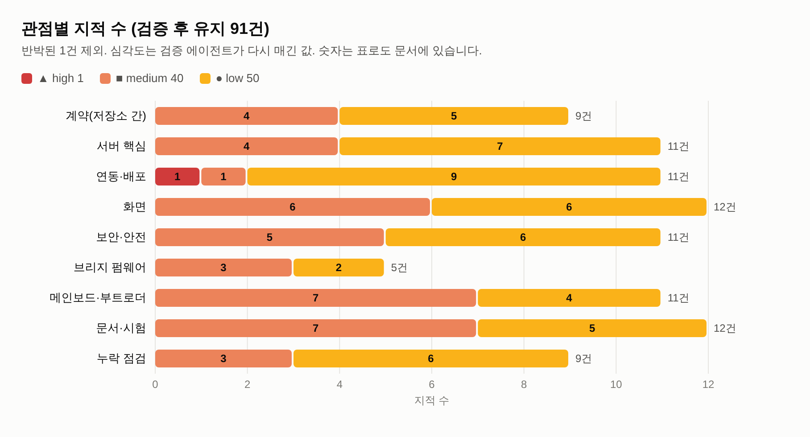

| 관점 | ▲ 높음 | ■ 중간 | ● 낮음 | 합계 |
|---|---:|---:|---:|---:|
| 계약(저장소 간) | · | 4 | 5 | 9 |
| 서버 핵심 | · | 4 | 7 | 11 |
| 연동·배포 | 1 | 1 | 9 | 11 |
| 화면 | · | 6 | 6 | 12 |
| 보안·안전 | · | 5 | 6 | 11 |
| 브리지 펌웨어 | · | 3 | 2 | 5 |
| 메인보드·부트로더 | · | 7 | 4 | 11 |
| 문서·시험 | · | 7 | 5 | 12 |
| 누락 점검 | · | 3 | 6 | 9 |
| **합계** | **1** | **40** | **50** | **91** |

**핵심 다섯 가지**

1. **높음은 1건**입니다. 화면에서 서버 업데이트를 **적용하면 Windows 서비스로 다시 뜨지 않고** 숨은 프로세스로 뜹니다(I-01). 겉보기엔 정상이지만 자동 재시작이 사라지고, 다음에 서비스를 시작하면 포트 충돌로 실패합니다. 배치 파일 한 줄만 고치면 됩니다.
2. **UDP 패킷 하나만 잃어도 정상 업데이트가 실패로 기록됩니다**(C-01 등). 서버와 브리지가 명령과 최종 보고를 한 번씩만 보내기 때문입니다. 50대 작업이면 무선 손실률 0.1% 에서도 한 번 이상 오판할 확률이 약 18% 입니다. 실패 시 중단(기본 켬) 때문에 남은 호기도 전부 건너뜁니다.
3. **AGV 정지 확인이 앱 한 겹뿐**이고, 화면에서 **확인 없이 바로 실행되는 버튼**이 몇 개 있습니다. '지금 시작', 서버 업데이트 '적용', 통신 로그의 수동 전송(호기 칸 기본값 7)이 그렇습니다(X-01, U-01, U-05, U-03).
4. **부트로더 보완은 현장 설치 전에 해야 합니다.** 부트로더는 OTA 로 바꿀 수 없고 JTAG 로만 다시 굽습니다. 수신 오류 처리(D-03)와 10분 정지(D-06)는 50대에 굽기 전에 넣어야 합니다.
5. 구조 자체는 튼튼합니다. 이미지 무결성 검사가 4겹이고, 굽다 끊겨도 부트로더가 남아 다시 실행할 수 있으며, 작업 실행기·DB·자체 업데이트에 복구 경로가 있습니다([9절](#9-잘-되어-있는-점)). 대부분 **작은 수정**으로 막을 수 있습니다.

---

## 2. 어디에 몰려 있나

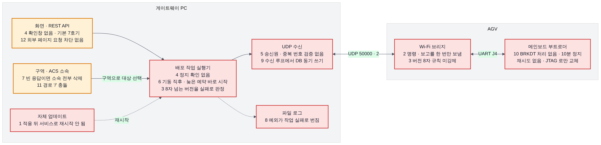

숫자는 [4절](#4-운영-전에-고칠-것-p0-10묶음)·[5절](#5-운영-초기에-고칠-것-p1-3묶음)의 묶음 번호입니다. **빨간 상자**는 운영 전에 고칠 것(P0), **주황 상자**는 운영 초기에 고칠 것(P1)이 있는 곳입니다.

- **게이트웨이 서버**에 가장 많습니다. 작업 실행기의 시작 시점·판정 기준, UDP 수신 처리, 운영자 확인 단계가 중심입니다.
- **브리지 ↔ 서버 계약**에서는 "한 번만 보냄"과 "버전 8자 규칙"이 양쪽 저장소에 걸쳐 있습니다.
- **메인보드 부트로더**는 지적 수는 적지만 나중에 고치기 가장 비쌉니다.

---

## 3. 점검 방법


| 단계 | 내용 | 결과 |
|---|---|---|
| ① 발굴 | 관점 8개(저장소 간 계약, 서버 핵심, 연동·배포, 화면, 보안·안전, 브리지, 메인보드·부트로더, 문서·시험)를 에이전트가 하나씩 맡아 코드 전체를 읽음 | 지적 83건 |
| ② 반박 검증 | 관점마다 **다른** 에이전트가 지적의 파일·줄을 직접 열어 확인. 근거가 없으면 반박하고, 심각도를 다시 매김 | 확인 / 불확실 / 반박 |
| ③ 재검증 | 높음으로 남은 건은 독립 에이전트가 한 번 더 확인 | I-01 높음 유지 |
| ④ 누락 점검 | 전체 결과를 보고 빈 영역 3곳(구역 경로, 파일 로그, 예약 시점)을 추가 발굴 → 검증 | 지적 9건 추가 |
| ⑤ 문서 반영 | 문서 오류는 바로 고치고, 고친 문서도 코드와 다시 대조 | [10절](#10-이번에-바로-고친-문서) |

모두 92건을 발굴했고 87건 확인, 4건 불확실, 1건 반박입니다. 이 문서는 **반박 1건을 뺀 91건**을 다룹니다. 발굴 때 높음이었던 11건 가운데 10건은 검증에서 **중간으로 내려갔습니다**(대부분 "운영자가 문서대로 하면 피할 수 있음" 또는 "조건이 겹쳐야 일어남").

**심각도 기준**

| 심각도 | 뜻 |
|---|---|
| ▲ 높음 | 평범한 운용에서 바로 일어나고, 서버가 멈추거나 복구에 사람이 가야 함 |
| ■ 중간 | 특정 조건(패킷 유실, 잘못된 입력, 재부팅 시점 등)에서 작업이 실패하거나 엉뚱한 호기에 영향 |
| ● 낮음 | 드문 경우, 불편, 표시 오류, 정리할 것 |

**규모 기준**: 작음 = 반나절 안 · 중간 = 1~3일 · 큼 = 1주 이상 (시험 포함)

---

## 4. 운영 전에 고칠 것 (P0, 10묶음)

관련 지적을 묶어 고치는 단위로 정리했습니다. 같은 원인을 여러 관점에서 지적한 경우 한 묶음에 모았습니다.

| # | 묶음 | 왜 운영 전인가 | 규모 | 관련 지적 |
|---|---|---|---|---|
| 1 | 서버 업데이트 뒤 서비스로 재시작 안 됨 | 첫 업데이트부터 자동 재시작이 사라짐 | 작음 | I-01 |
| 2 | UDP 명령·보고를 한 번만 보냄 | 정상 업데이트가 실패로 남고 브리지가 롤백 | 중간 | C-01 T-02 C-05 B-02 |
| 3 | 메인보드 버전 8자 규칙 미강제 | 9자 버전 하나로 전 호기가 '실패' 반복 | 작음 | C-02 B-03 D-04 T-03 |
| 4 | AGV 정지 확인과 운영자 실수 방지 | 주행 중 호기에 굽기·재부팅이 갈 수 있음 | 작음~중간 | X-01 U-01 U-05 D-07 B-01 U-03 U-04 |
| 5 | 같은 호기 번호 · 송신원 검증 없음 | ACS 교통제어 프레임이 다른 장치로 감 | 중간 | C-04 S-03 X-02 |
| 6 | 작업 시작 시점 | 재부팅 직후 야간 예약이 전부 '오프라인' 실패 | 작음 | S-01 G-05 G-08 G-07 |
| 7 | ACS 빈 응답이 소속을 지움 | 구역 단위 배포가 갑자기 불가 | 작음 | S-04 I-04 |
| 8 | 파일 로그 예외가 작업으로 번짐 | 로그 파일 하나로 야간 작업 전체 실패 | 작음 | G-03 |
| 9 | UDP 수신 루프의 DB 동기 쓰기 | DB 를 잘못 열면 브리지 통신 전체가 멈춤 | 중간 | S-02 |
| 10 | 부트로더·메인보드 복구 한계 | 부트로더는 JTAG 로만 교체 — 설치 전이 유일한 기회 | 중간 | D-03 D-06 D-02 B-04 D-05 D-01 X-09 D-08 |

**권장 순서**: 작은 것(1·3·6·7·8)을 먼저 하루 안에 묶어 처리하고, 2·4·5·9 를 다음으로, 10 은 메인보드 실기 검증(벤치 → 1대)과 같이 진행합니다. 4 의 서버 정지 확인과 10 의 D-01 은 [8절](#8-결정이-필요한-항목)의 결정이 먼저 필요합니다.

### 4-1. 서버 업데이트 뒤 서비스로 재시작 안 됨 (I-01, 높음)

> **2026-10-11 반영됨** — 고친 내용은 [0-4절](#0-4-묶음별-해결) 과 부록의 '반영' 열에 있습니다.

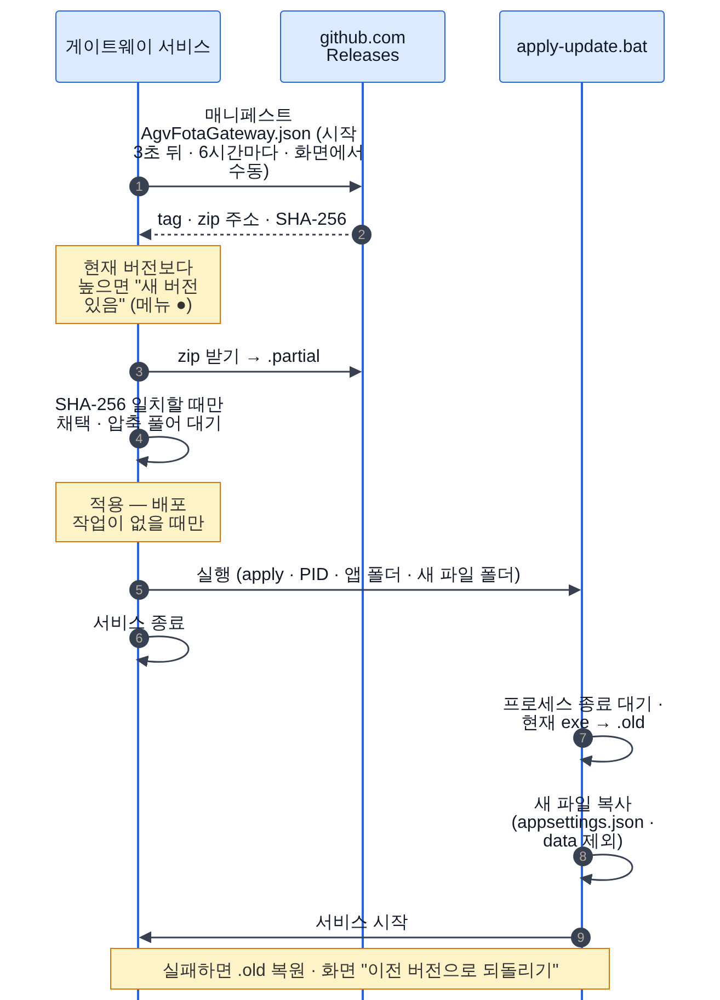

*서버 자체 업데이트 순서 — 2026-10-10 점검 당시(게이트웨이 0.2.x · 브리지 0.5.1) 동작입니다. 0.3.0 · 0.5.2 의 그림은 [SYSTEM_FLOW 9절](SYSTEM_FLOW.md#9-서버-자체-업데이트) 에 있습니다.*

**문제**: 화면의 **적용**은 `apply-update.bat` 을 만들어 실행합니다. 이 배치는 서비스로 실행 중이었는지 기억하려고 다음과 같이 씁니다.

```bat
sc query %SVC% | findstr /C:"RUNNING" >nul && (set WASSVC=1 & sc stop %SVC% >> "%LOG%" 2>&1)
rem ... 파일 교체 ...
if "%WASSVC%"=="1" (
    sc start %SVC% >> "%LOG%" 2>&1
) else (
    start "" /D "%APP%" "%EXE%"
)
```

cmd 에서 `set WASSVC=1 &` 는 `&` 앞의 공백까지 값에 넣어 `WASSVC` 가 `1␠`(1 다음 공백)이 됩니다. 그래서 비교가 거짓이 되고 `sc start` 대신 **exe 를 직접 실행**합니다.

**영향**: 화면에는 '업데이트 적용됨'이 떠서 정상처럼 보입니다. 하지만 서비스 관리자에는 **중지됨**으로 나오고, 프로세스가 죽어도 자동 재시작(`sc failure`)이 동작하지 않습니다. 나중에 `install-service.bat` 을 다시 실행하거나 `sc start` 를 하면, 숨은 프로세스가 8080·50000 포트를 잡고 있어 서비스 시작이 실패합니다. 작업 관리자에서 직접 끝내야 합니다.

**고칠 방법**: `UpdateService.cs` 의 배치 생성 부분에서 `(set "WASSVC=1" & sc stop ...)` 처럼 따옴표로 묶습니다. 더 확실하게는 C# 쪽에서 서비스 여부(`WindowsServiceHelpers.IsWindowsService()`)를 인자로 넘기고 배치는 그 인자로 분기합니다. Windows 실기에서 **적용 → 서비스 관리자에 '실행 중'** 을 확인하는 시험을 릴리스 절차에 넣습니다.

**당장의 우회** (0.3.0 이전에만 해당. 단 **v0.2.x → v0.3.0 첫 업데이트에는 아직 해당**합니다 — [DEPLOY 9-1](DEPLOY.md#9-1-화면에서-업데이트)): 적용 뒤 서비스 관리자에서 상태가 '중지됨'이면 관리자 명령 프롬프트에서 `taskkill /f /im AgvFotaGateway.exe` → `sc start AgvFotaGateway` 를 실행합니다. 고치기 전까지는 [DEPLOY.md 9-4](DEPLOY.md#9-4-수동-업데이트) 의 **수동 업데이트**(서비스를 먼저 멈추고 파일 교체)를 권장합니다. DEPLOY.md 9-1 에 같은 안내를 넣었습니다.

**위치**: `src/Gateway.Server/Services/UpdateService.cs:323`

### 4-2. UDP 명령·보고를 한 번만 보냄 (C-01 · T-02 · C-05 · B-02)

> **2026-10-11 반영됨** — 고친 내용은 [0-4절](#0-4-묶음별-해결) 과 부록의 '반영' 열에 있습니다.

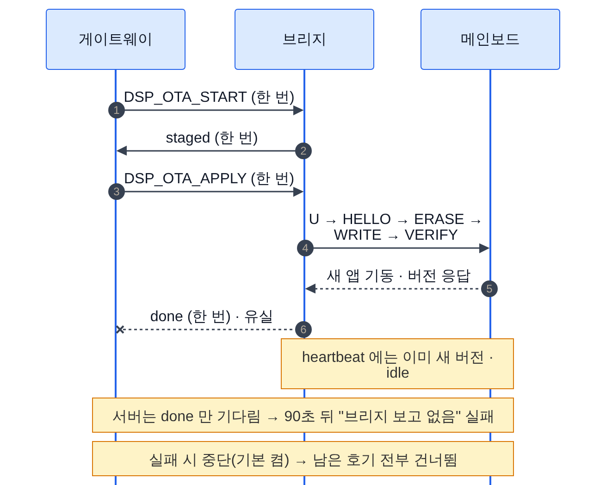

**문제**: 서버는 `DSP_OTA_START` · `DSP_OTA_APPLY` · `OTA_START` 와 확정용 PING 을 **한 번씩만** 보냅니다. 브리지도 최종 보고(`staged`, `done`, `fail`)를 한 번만 보냅니다. 서버는 이 보고 패킷만 기다리고, heartbeat 에 이미 들어 있는 `staged.job` · `dsp` · `dsp_st` · `ota` · `fw` 는 판정에 쓰지 않습니다.

**영향**

| 유실된 패킷 | 결과 |
|---|---|
| 메인보드 `done` | 메인보드는 새 버전으로 정상인데 90초 뒤 '브리지 보고 없음' 실패. 실패 시 중단이면 남은 호기 전부 건너뜀 |
| 메인보드 `staged` | 180초 뒤 실패 |
| 브리지 `OTA_RESULT done` | 3분 뒤 실패. 그동안 서버 하향 패킷이 없으면 브리지가 **정상 설치한 새 펌웨어를 180초 뒤 롤백** |
| 확정 PING | 15초 뒤 '확정(valid) 안 됨'. 180초 안에 PING 을 다시 안 보내면 롤백 |
| 원격 설정 뒤 하향 패킷 없음 (B-02) | 서버가 자동으로 패킷을 보내지 않아 정상 변경도 180초 뒤 원복 |

호기당 핵심 패킷은 4개입니다. 50대 작업 한 번에서 한 번 이상 오판할 확률은 손실률 0.1% 면 약 18%, 0.5% 면 약 63% 입니다.

**고칠 방법** (서버만 바꿔도 대부분 해결)

1. 명령을 보낸 뒤 5초 안에 첫 보고도 없고 heartbeat 변화(`dsp_st=downloading/programming`, `ota=busy`)도 없으면 최대 3회 다시 보냅니다. 재전송 뒤 오는 `busy` 는 '이미 진행 중'으로 해석합니다.
2. 보고를 기다리는 동안 heartbeat 도 함께 봅니다. `staged.job == 작업 번호` 면 staged, `dsp` 앞 8자가 기대값이고 `dsp_st=idle` · `staged=null` 이면 done, `ota=pending` 이거나 `fw` 가 바뀌면 OTA done 으로 봅니다.
3. 확정 PING 은 작업 시작 때처럼 valid 가 될 때까지 1초 간격으로 반복합니다.
4. heartbeat 에 `cfg=trial` 이나 `ota=pending` 이 보이면 서버가 PING 을 자동으로 보냅니다(호기당 5초에 1회). [8절](#8-결정이-필요한-항목) 참고.
5. 같은 버전 재설치 때 재부팅 판정은 `UpSeconds` 감소나 파티션 변경도 근거로 씁니다(C-05).

**당장의 우회** (게이트웨이 0.3.0 · 브리지 0.5.2 이전에만 해당): 작업이 '보고 없음'으로 실패하면 **호기 현황**에서 실제 버전을 먼저 확인합니다. 버전이 이미 새 것이면 성공한 것입니다. 브리지 `ota` 가 `pending` 이면 180초 안에 **PING** 을 누릅니다. [DEPLOY.md](DEPLOY.md) 6-4·10-4 의 조치 표에 이 내용을 넣었습니다.

**위치**: `src/Gateway.Core/Fota/DspOtaClient.cs:58·88`, `src/Gateway.Core/Fota/EspOtaClient.cs:23·57`, 브리지 `main/dsp_ota.c:577·597`, `main/ota.c:149`, `main/app_config.c:156`

### 4-3. 메인보드 버전 8자 규칙 미강제 (C-02 · B-03 · D-04 · T-03)

> **2026-10-11 반영됨** — 고친 내용은 [0-4절](#0-4-묶음별-해결) 과 부록의 '반영' 열에 있습니다.

**문제**: 메인보드 앱은 버전을 8자까지만 돌려줍니다. 이 규칙이 문서에만 있고 `dsp_pack.py`, 서버 업로드, 브리지 어디에서도 막지 않습니다.

**영향**: `--ver 1.2.3-rc1`(9자)로 만든 파일이 업로드를 통과합니다. 굽기와 기동은 정상인데, 브리지는 `done{ver:"1.2.3-rc"}` 를 보내고 서버는 "적용 후 앱 버전이 이미지와 다름"으로 실패 처리합니다. 다시 실행하면 매번 다시 굽고 또 실패합니다. 버전에 `"` 가 들어가면 heartbeat JSON 이 깨져 그 호기의 상태 갱신이 멈춥니다.

**고칠 방법**

1. `dsp_pack.py` 에서 버전을 `^[0-9A-Za-z._-]{1,8}$` 로 제한합니다.
2. 서버 업로드(`FirmwareStore.AddAsync`)에서 같은 규칙을 어기면 거부합니다.
3. 서버의 버전 비교를 '앞 8자 비교' 함수 하나로 통일합니다(`JobService:334`, `DspOtaClient:81`, `Jobs.razor`).
4. 가짜 브리지(`tests/fake_esp.py`)도 버전을 8자로 자르게 해 시험에서 잡히게 합니다.

**당장의 우회** (게이트웨이 0.3.0 · 브리지 0.5.2 이전에만 해당. 8자 규칙은 이제 패커·업로드가 강제): 메인보드 버전은 **8자 이하**로 만듭니다(예: `1.2.3`, `1.2.3rc1`). [DEPLOY.md 4-1](DEPLOY.md#4-1-종류별-차이) 과 [SYSTEM_FLOW.md](SYSTEM_FLOW.md) 에 적어 두었습니다.

**위치**: 브리지 `tools/dsp_pack.py:117`, `main/dsp_ota.c:530`, 게이트웨이 `src/Gateway.Server/Services/FirmwareStore.cs:123`, `JobService.cs:334`

### 4-4. AGV 정지 확인과 운영자 실수 방지 (X-01 · U-01 · U-05 · D-07 · B-01 · U-03 · U-04)

> **2026-10-11 반영됨** — 고친 내용은 [0-4절](#0-4-묶음별-해결) 과 부록의 '반영' 열에 있습니다.

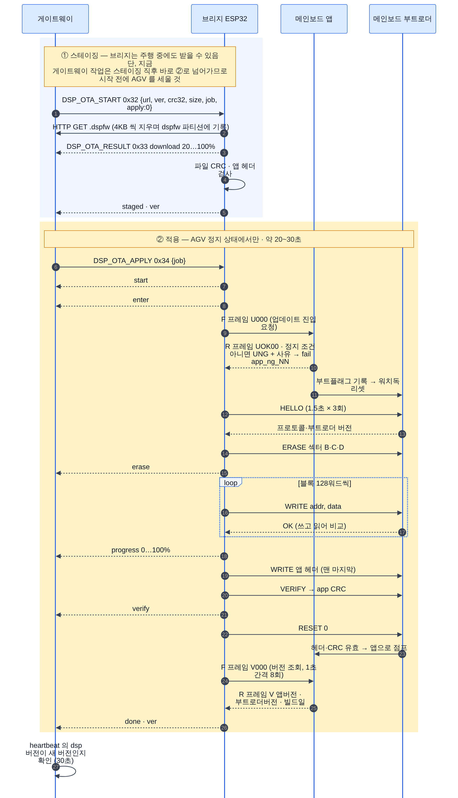

*메인보드 OTA 순서 — 2026-10-10 점검 당시(게이트웨이 0.2.x · 브리지 0.5.1) 동작입니다. 0.3.0 · 0.5.2 의 그림은 [SYSTEM_FLOW 6절](SYSTEM_FLOW.md#6-메인보드-ota-b안) 에 있습니다.*

**문제**

- 설계는 "서버(ACS) 확인 + 메인보드 앱 확인"의 **이중 확인**이었지만, 지금은 **앱 확인 한 겹**만 있습니다. 서버는 적용(`DSP_OTA_APPLY`)과 브리지 재부팅 전에 정지 상태를 보지 않습니다(X-01).
- 앱 쪽 OTA 지원 코드(`app_fwupdate.c`)는 안전 판정 콜백을 `NULL` 로 넘기면 '안전'으로 봅니다. 앱에 붙일 때 빠뜨리면 주행 중에도 진입을 허락합니다(D-07).
- 앱이 `U` 에 응답하지 않으면 브리지는 바로 원시 모드로 들어가 부트로더에 HELLO 를 보냅니다. 앱이 계속 돌고 있으면 부트로더가 답하지 않아 `no_bootloader` 로 끝나므로 굽기까지 가지는 않지만, 그동안 **약 4.5초간 RFID·ACS 중계가 끊깁니다**. 구 앱(`dsp=?`) 호기는 적용할 때마다 이 경로를 탑니다(B-01, 판정 불확실 — [11절](#11-판정이-갈린-항목)).
- 화면에서 확인 없이 바로 실행되는 동작이 있습니다.
  - 배포 **지금 시작**: 확인창이 없고, '직접 입력'에 넣은 호기가 버튼 숫자에 반영되지 않습니다. 1대인 줄 알고 눌렀는데 50대가 시작될 수 있습니다(U-01).
  - 통신 로그 **수동 전송**: 호기 칸이 7 로 미리 채워져 있어, 다른 호기에 보내려던 `set ip`·`reboot` 가 7호기로 갑니다(U-05).
  - 서버 업데이트 **적용·되돌리기**: 확인 없이 서비스를 재시작하고 ACS 중계가 끊긴다는 안내도 없습니다(U-03).
  - 실행 중 작업 **취소**: 확인창은 '중단'이라고 하지만 이미 시작한 메인보드 굽기는 브리지가 끝까지 진행합니다(U-04).

**고칠 방법**

| 대상 | 수정 | 규모 |
|---|---|---|
| `app_fwupdate.c:126` | 콜백이 없으면 거부: `reason = safe ? safe() : 9`. 프레임 형식 검사 추가 | 작음 |
| `Jobs.razor` 지금 시작 | 직접 입력까지 합친 최종 대상 수를 버튼에 표시하고, "N대(온라인·오프라인·같은 버전) — AGV 정지 확인했습니까?" 확인창 | 작음 |
| `Trace.razor` 수동 전송 | 호기 칸 기본값을 비우고, `set`·`save`·`reboot`·`erase` 는 확인창 | 작음 |
| `Update.razor` 적용·되돌리기 | "서비스 약 10초 정지, ACS 중계·온라인 N대 통신 끊김" 확인창 | 작음 |
| `Jobs.razor` 취소 | 굽는 중인 호기가 있으면 "그 호기는 멈출 수 없음(약 30초 계속), 남은 호기만 건너뜀" 으로 문구 변경 | 작음 |
| 브리지 `dsp_ota.c:420` · 서버 | `U` 무응답 때 원시 모드 직행은 복구 적용이거나 메인보드 버전이 `?` 일 때만 허용. 서버는 `dsp=?` 호기를 '복구 적용'으로 명시하고 진행 | 작음 |
| 서버 정지 확인 | 스테이징 뒤 대기 → 운용자 승인 또는 ACS 상태 확인. **방식 결정 필요** | 중간 |

**당장의 우회** (게이트웨이 0.3.0 · 브리지 0.5.2 이전에만 해당): 메인보드·브리지 작업은 **AGV 를 세운 뒤** 시작합니다. '지금 시작' 전에 대상 대수를 다시 보고, 통신 로그에서 수동 전송할 때는 호기 칸을 꼭 확인합니다. [DEPLOY.md 6-1](DEPLOY.md#6-1-시작-전-안전-수칙) 에 적어 두었습니다.

**위치**: `src/Gateway.Server/Services/JobService.cs:330`, `Components/Pages/Jobs.razor:80·217`, `Trace.razor:36`, `Update.razor:23`, 브리지 `dsp/app/app_fwupdate.c:126`, `main/dsp_ota.c:420`

### 4-5. 같은 호기 번호 · 송신원 검증 없음 (C-04 · S-03 · X-02)

> **2026-10-11 반영됨** — 고친 내용은 [0-4절](#0-4-묶음별-해결) 과 부록의 '반영' 열에 있습니다.

**문제**: 서버는 UDP 패킷이 올 때마다 그 호기의 주소(endpoint)를 **마지막 송신원으로 덮어씁니다**. 같은 호기 번호를 쓰는 브리지가 둘이면 주소가 패킷마다 바뀌고, 서버는 이를 감지하지 않습니다.

**영향**: 새 브리지를 번호 설정 없이 켜거나(빌드 기본값), BLE 로 번호를 잘못 넣거나, 사무실 PC 에서 `fake_esp.py --agv 7` 을 운영 서버로 돌리면, ACS 가 그 호기에 보내는 **교통제어 프레임과 OTA 명령이 다른 장치로 갑니다**. 가짜 heartbeat 때문에 배포가 '완료'로 기록될 수도 있습니다.

**고칠 방법**: 살아 있는 호기의 주소와 다른 주소에서 같은 번호가 오면 덮어쓰지 않고 **충돌 표시**를 합니다(통신 로그·호기 현황 경고, 배포·수동 전송 거부). 브리지 heartbeat 에 `mac` 을 넣으면 서버가 확실하게 판정할 수 있습니다. 호기 번호가 1~99 밖이면 버립니다.

**당장의 우회** (게이트웨이 0.3.0 이전에만 해당): 새 브리지는 BLE 로 **호기 번호를 먼저** 넣은 뒤 서버 주소를 넣습니다. 시험용 `fake_esp.py` 는 운영 게이트웨이를 향해 실행하지 않습니다. 호기 현황에서 같은 호기의 IP 가 자꾸 바뀌면 번호 중복을 의심합니다.

**위치**: `src/Gateway.Server/Services/BridgeUdpService.cs:97`

### 4-6. 작업 시작 시점 (S-01 · G-05 · G-08 · G-07)

> **2026-10-11 반영됨** — 고친 내용은 [0-4절](#0-4-묶음별-해결) 과 부록의 '반영' 열에 있습니다.

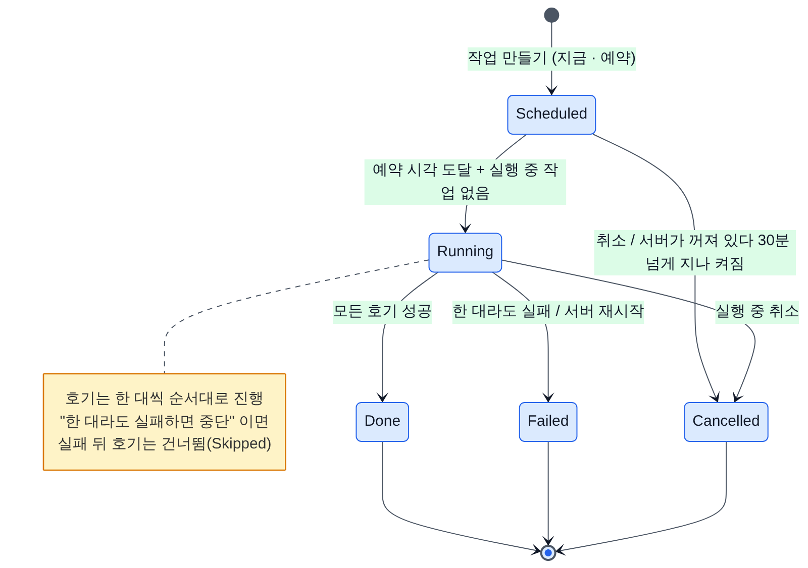

*배포 작업 상태 — 2026-10-10 점검 당시(게이트웨이 0.2.x · 브리지 0.5.1) 동작입니다. 0.3.0 · 0.5.2 의 그림은 [SYSTEM_FLOW 7절](SYSTEM_FLOW.md#7-배포-작업) 에 있습니다.*

**문제와 영향**

- **기동 직후 바로 시작**(S-01): 03:00 예약이 있는데 Windows 업데이트로 02:58 에 재부팅되어 서비스가 03:01 에 뜨면, heartbeat 를 받기도 전에 작업이 시작됩니다. 첫 호기가 '오프라인'으로 실패하고 나머지는 '앞 호기 실패로 중단'으로 끝납니다. 서버 업데이트 적용 직후에도 같습니다.
- **늦은 예약이 그대로 시작**(G-05): 서버가 꺼졌다 켜지면 30분 넘게 지난 예약은 자동 취소되지만, 서버가 켜진 채 **앞 작업이 길어져 밀린 예약**은 몇 시간이 늦어도 그대로 시작합니다. 생산 시간에 걸칠 수 있습니다.
- **지난 시각으로 예약 가능**(G-08): API·화면이 지난 시각을 막지 않아 즉시 실행됩니다.
- **늦어진 예약이 '(곧)'으로만 표시**(G-07): 앞 작업 때문에 기다리는 중이라는 안내가 없습니다.

**고칠 방법**: 실행기는 서비스 시작 뒤 `OfflineAfterSec × 2` 동안 새 작업을 시작하지 않고, 오프라인 검사는 15~20초 heartbeat 를 기다린 뒤 판정합니다. 30분 지난 예약 취소를 실행기 루프에서도 매번 검사합니다. 지난 예약 시각은 거부합니다. 목록에 "N분 지남 — 앞 작업 끝나면 시작" 을 표시합니다.

**당장의 우회** (게이트웨이 0.3.0 이전에만 해당): Windows 자동 재부팅 시각을 예약 시각과 떨어뜨리고, 예약을 겹쳐 잡지 않습니다. 밀린 예약이 생산 시간에 걸칠 것 같으면 직접 취소합니다([DEPLOY.md 6-5](DEPLOY.md#6-5-예약)).

**위치**: `src/Gateway.Server/Services/JobService.cs:173·226`, `Components/Pages/Jobs.razor:209`

### 4-7. ACS 빈 응답이 소속을 지움 (S-04 · I-04)

> **2026-10-11 반영됨** — 고친 내용은 [0-4절](#0-4-묶음별-해결) 과 부록의 '반영' 열에 있습니다.

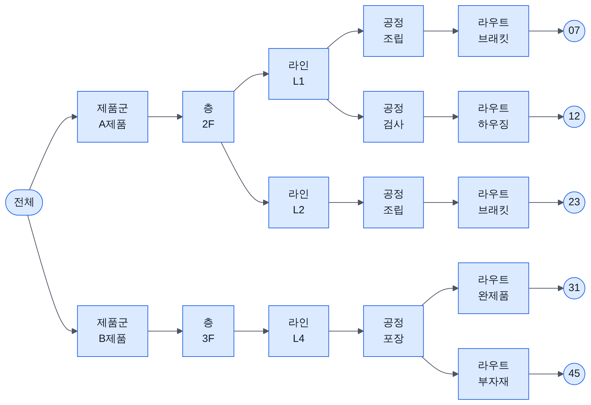

**문제**: 소속 받기를 켜면 기본값 `RemoveMissing=true` 입니다. ACS 가 재기동 중에 HTTP 200 과 `{"success":false}` 를 돌려주거나 필드 이름을 바꾸면, 해석된 목록이 0개가 되고 **ACS 출처 소속이 전부 삭제**됩니다.

**영향**: 구역 화면 트리와 '구역으로 선택'이 비어 구역 단위 배포를 할 수 없습니다. 다음 정상 응답(기본 5분 뒤)까지 이어집니다.

**고칠 방법**: 목록을 못 찾았거나 0개면 **실패로 처리**하고 병합하지 않습니다. 현재 ACS 소속의 절반 이상이 한 번에 사라지면 삭제를 보류하고 경고합니다. ACS 스키마를 받는 월요일 작업 때 같이 넣는 것이 좋습니다.

**당장의 우회** (게이트웨이 0.3.0 이전에만 해당): 소속 받기(`AcsInventory.Enabled`)는 기본값대로 **꺼 둡니다**. 켤 때는 `RemoveMissing=false` 로 시작해 응답을 확인한 뒤 바꿉니다.

**위치**: `src/Gateway.Server/Services/AgvGroupStore.cs:118`, `AcsInventoryPullService.cs:82`

### 4-8. 파일 로그 예외가 작업으로 번짐 (G-03)

> **2026-10-11 반영됨** — 고친 내용은 [0-4절](#0-4-묶음별-해결) 과 부록의 '반영' 열에 있습니다.

**문제**: 파일 로거가 `IOException` 만 잡습니다. 지울 수 없는 옛 로그(읽기 전용 속성 등)가 하나 있으면, 날짜가 바뀐 뒤 첫 로그 기록에서 `UnauthorizedAccessException` 이 호출한 쪽으로 올라갑니다.

**영향**: 그 첫 로그가 야간 예약 작업의 시작 로그면, 대상 30대를 하나도 시도하지 않은 채 '실행기 오류'로 모두 실패합니다. 자정을 넘겨 끝난 작업은 완료 로그에서 예외가 나 '완료'가 '실패'로 덮어씌워집니다. 기동 때 정리하다 예외가 나면 서비스가 뜨지 않습니다.

**고칠 방법**: 로거는 어떤 경우에도 예외를 던지지 않게 합니다. `catch (Exception)` 으로 넓히고, 옛 로그 정리는 파일마다 따로 감싸고, 기록을 먼저 한 뒤 정리합니다.

**당장의 우회** (게이트웨이 0.3.0 이전에만 해당): `data\logs\` 의 로그 파일에 읽기 전용 속성을 걸지 않습니다. 보관하려면 다른 폴더로 **복사**합니다.

**위치**: `src/Gateway.Server/Services/FileLoggerProvider.cs:48`

### 4-9. UDP 수신 루프의 DB 동기 쓰기 (S-02)

> **2026-10-11 반영됨** — 고친 내용은 [0-4절](#0-4-묶음별-해결) 과 부록의 '반영' 열에 있습니다.

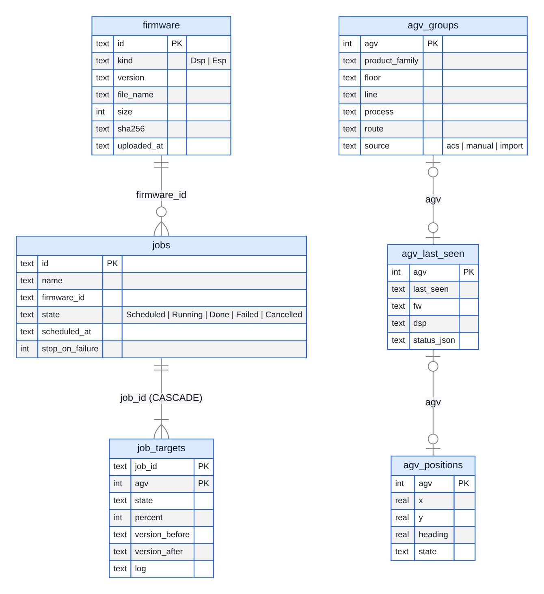

*SQLite 표 — 2026-10-10 점검 당시(게이트웨이 0.2.x · 브리지 0.5.1) 동작입니다. 0.3.0 · 0.5.2 의 그림은 [SYSTEM_FLOW 10절](SYSTEM_FLOW.md#10-데이터) 에 있습니다.*

**문제**: heartbeat 를 받을 때마다 수신 루프 안에서 `agv_last_seen` 을 DB 에 바로 씁니다. DB 가 잠기면 최대 30초 기다립니다.

**영향**: 누군가 DB Browser 로 `gateway.db` 를 쓰기 모드로 열고 변경을 저장하지 않으면, 그동안 heartbeat·MAIN_UP 처리가 멈춥니다. 모든 호기가 5초 뒤 오프라인으로 보이고, ACS 로 올라가는 프레임 중계가 늦어지거나 사라지며, 진행 중인 OTA 는 실패합니다. 원인을 알려 주는 로그도 없습니다.

**고칠 방법**: 수신 루프는 메모리에만 기록하고, 별도 타이머가 모아서 DB 에 씁니다. 쓰기 연결은 짧은 대기 시간(2초)을 쓰고 실패하면 빈도를 줄인 경고 로그를 남깁니다.

**당장의 우회** (게이트웨이 0.3.0 이전에만 해당. DB 를 읽기 전용으로 여는 습관은 계속 권장): DB 를 볼 때는 **읽기 전용으로 열거나**, 화면의 **백업 내려받기**로 받은 사본을 엽니다. [DEPLOY.md 8-2](DEPLOY.md#8-2-백업) 에 강조해 두었습니다.

**위치**: `src/Gateway.Server/Services/AgvRegistry.cs:53`

### 4-10. 부트로더·메인보드 복구 한계 (D-03 · D-06 · D-02 · B-04 · D-05 · D-01 · X-09 · D-08)

> **2026-10-11 반영됨** — 고친 내용은 [0-4절](#0-4-묶음별-해결) 과 부록의 '반영' 열에 있습니다.

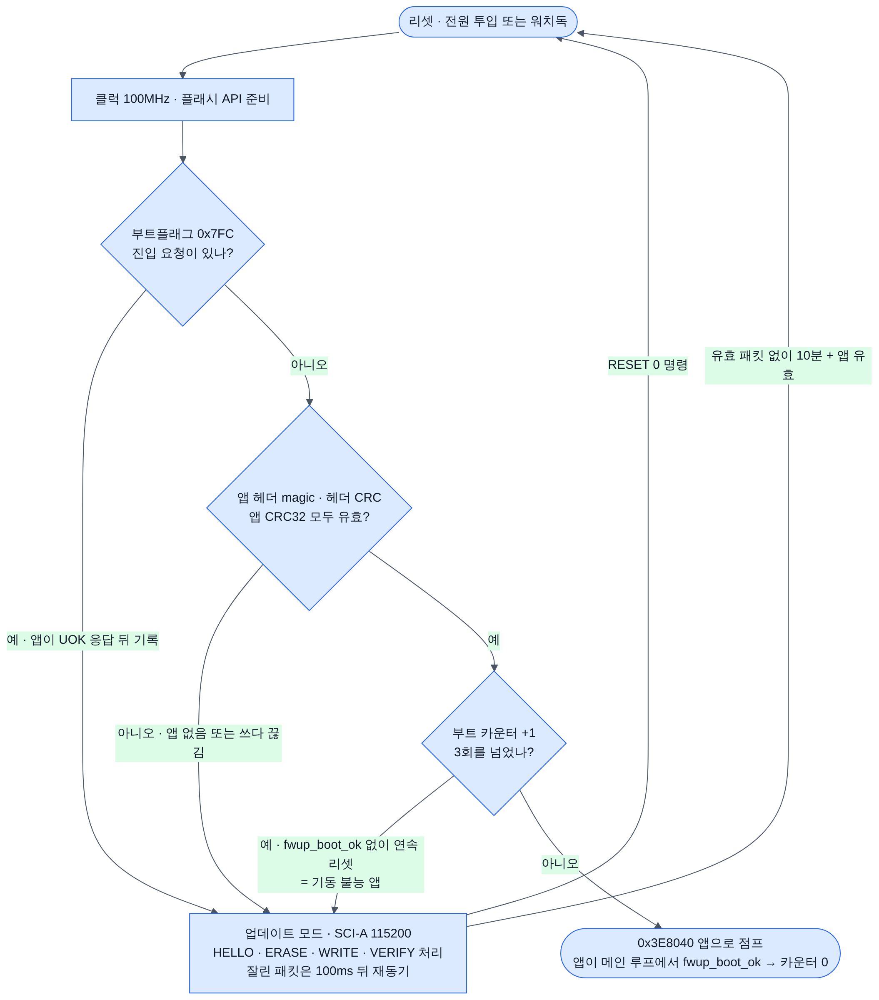

*부트로더 판단 흐름 — 2026-10-10 점검 당시(게이트웨이 0.2.x · 브리지 0.5.1) 동작입니다. 0.3.0 · 0.5.2 의 그림은 [SYSTEM_FLOW 6.3절](SYSTEM_FLOW.md#63-메인보드-메모리-배치와-부트로더) 에 있습니다.*

**왜 지금인가**: 부트로더는 **OTA 로 바꿀 수 없습니다**. 한 번 JTAG 로 구운 뒤 고치려면 50대를 다시 JTAG 로 구워야 합니다. 부트로더 쪽 수정(D-03, D-06, D-01 일부)은 현장 설치 전에 넣습니다. 브리지 쪽 수정은 나중에 OTA 로 넣을 수 있지만, 메인보드 실기 검증 전에 같이 넣는 편이 시험이 한 번으로 끝납니다.

| ID | 문제 | 고칠 방법 | 어디 | 바꾸는 방법 |
|---|---|---|---|---|
| D-03 | 부트로더가 SCI 수신 오류(BRKDT)를 처리하지 않아 브레이크 한 번이면 수신이 멈춤 | 수신 오류 시 SCI 리셋 후 프로토콜 재동기 | 브리지 `dsp/boot/boot_hw.c:84` | **JTAG** |
| D-06 | 부트플래그로 들어온 뒤 브리지가 이어 오지 않으면 유효한 앱이 있어도 10분 정지 | 첫 패킷 전에는 60초, 첫 패킷 뒤에는 600초 | 브리지 `dsp/boot/boot_main.c:91` | **JTAG** |
| D-01 | 기동 불능 앱 복구는 '리셋 반복'일 때만 됨. 멈추거나 J4 통신이 안 되는 앱은 OTA 로 못 살림 | 앱 점프 전 짧은 HELLO 수신 창, 또는 XRS 배선. **범위 결정 필요** | 브리지 `dsp/boot/boot_main.c:108` | **JTAG** |
| D-02 | 설계의 '지운 뒤 실패 시 HELLO 부터 3회 자동 재시도'가 없음 | 지운 뒤 실패면 HELLO→VERIFY 를 2회 더 | 브리지 `main/dsp_ota.c:512` | OTA |
| B-04 · D-05 | 부트로더와 통신할 때 `main_baud` 를 그대로 씀. 115200 이 아니면 매번 실패하고 10분 정지 | 원시 모드 진입 때 115200 으로 바꾸고 끝나면 되돌림 | 브리지 `main/uart_bridge.c:278` | OTA |
| X-09 · D-08 | `.dspfw` 블록 주소·앱 CRC 를 **지우기 전에** 검사하지 않음 | 서버 업로드와 브리지 스테이징에서 블록 순회 검사 | `DspfwImage.cs`, 브리지 `main/dsp_ota.c:401·443` | 서버 · OTA |

**당장의 우회** (`main_baud` 안내는 브리지 0.5.2 이전에만 해당. 앱이 지워졌을 때 새 작업으로 다시 굽는 방법은 지금도 같음): 브리지 설정 `main_baud` 는 **115200 그대로** 둡니다(브리지 FLASH_GUIDE 설정 표에 적어 둠). 메인보드 작업이 실패해 앱이 없어지면 **같은 펌웨어로 새 작업을 실행**합니다([DEPLOY.md 10-5](DEPLOY.md)).

---

## 5. 운영 초기에 고칠 것 (P1, 3묶음)

### 5-1. 구역 경로 충돌 (G-01 · G-02) — 묶음 11

> **2026-10-11 반영됨** — 고친 내용은 [0-4절](#0-4-묶음별-해결) 과 부록의 '반영' 열에 있습니다.

**문제**: 구역은 `제품군 / 층 / 라인 / 공정 / 라우트` 를 ` / ` 로 이어 붙인 문자열로 찾습니다. 이름 안에 `/` 가 있으면(예: 공정 `조립 / 검사`) 다른 단계 조합(공정 `조립` · 라우트 `검사`)과 경로가 같아집니다. **다른 구역의 호기가 배포 대상으로 잡힙니다.** '미분류' 표시 경로도 실제 트리 노드가 아니어서 링크가 빈 목록을 가리킵니다.

**고칠 방법**: 최소한 이름 안의 `/` 를 전각 `／` 로 바꿔 저장합니다(ACS 소속 받기·CSV·API 모두). 근본적으로는 단계 배열로 찾고, 문자열 경로는 표시용으로만 씁니다. 충돌 사례를 시험으로 추가합니다.

**당장의 우회** (게이트웨이 0.3.0 이전에만 해당): 구역 이름에 `/` 를 쓰지 않습니다([DEPLOY.md 5절](DEPLOY.md#5-구역-등록)에 적어 둠).

**위치**: `src/Gateway.Core/Groups/AgvGroup.cs:31·111`

### 5-2. 외부 페이지 요청 · 설치 폴더 권한 (X-03 · X-05) — 묶음 12

> **2026-10-11 반영됨** — 고친 내용은 [0-4절](#0-4-묶음별-해결) 과 부록의 '반영' 열에 있습니다.

**문제**

- 로그인 없는 사내망 전제(결정 사항)인데, **다른 사이트의 페이지가 브라우저를 통해** `/api/update/apply`, `/api/groups/import`, 펌웨어 업로드를 호출하는 것도 막지 않습니다(CSRF, DNS 리바인딩).
- 권장 설치 폴더 `C:\AgvFotaGateway` 는 일반 사용자 쓰기 권한을 상속합니다. 서비스는 LocalSystem 이라, exe·`apply-update.bat` 을 바꿔 두면 다음 재시작 때 SYSTEM 권한으로 실행됩니다. `appsettings.json` 의 ACS API 키도 누구나 읽습니다.

**고칠 방법**: `/api` 의 POST·PUT·DELETE 는 `Origin` 이 다른 호스트이거나 `Sec-Fetch-Site: cross-site` 면 403. `install-service.bat` 에서 설치 폴더 권한을 Administrators·SYSTEM 쓰기, Users 읽기로 바꿉니다(`icacls`).

**위치**: `src/Gateway.Server/Program.cs:125`, `deploy/install-service.bat:20`

### 5-3. 자동 시험 공백 (S-11 · T-01 · T-09 · T-10 · T-08) — 묶음 13

> **2026-10-11 반영됨** — 고친 내용은 [0-4절](#0-4-묶음별-해결) 과 부록의 '반영' 열에 있습니다.

**문제**: 게이트웨이 시험 42개는 모두 `Gateway.Core`(파서·OTA 클라이언트·구역 트리)만 다룹니다. **작업 실행기·자체 업데이트·DB 이전·seq 계산**(`Gateway.Server`)에는 시험이 없습니다. 브리지 저장소 CI 는 빌드만 하고 시험이 없어, OTA 로 못 고치는 부트로더 프로토콜 코드가 검증되지 않습니다. 가짜 브리지(`fake_esp.py`)는 실제 브리지와 오류 문자열·상태 전이가 달라 종단 시험이 현장 경로를 놓칩니다. '무보고 시간 초과' 시험은 실제 시간 초과 경로를 지나가지 않습니다.

**고칠 방법**

1. `tests/Gateway.Server.Tests` 추가. `JobService` 가 UDP 서비스 대신 인터페이스와 `TimeProvider` 를 받게 해, 재시작 시 실행 중 → 실패, 29분·31분 지난 예약, 실패 시 중단, 구 브리지 거부를 시험합니다.
2. 브리지 CI 에 호스트 시험 job: `dsp/common` 을 PC 에서 컴파일해 CRC 벡터, 부트로더 섹터 쓰기 거부, 잘린 패킷 재동기, `dsp_pack.py selftest` 를 돌립니다. 작은 기준 `.dspfw` 를 두고 게이트웨이 파서 결과와 대조합니다.
3. `fake_esp.py` 를 실제 브리지 동작(오류 문자열, 지운 뒤 실패 시 `dsp="?"`, 진행 중 heartbeat)에 맞춥니다.
4. 시간 초과 값을 생성자 인자로 받아 시험에서 짧게 줍니다.

이 묶음은 4절의 수정을 안전하게 넣기 위한 바탕이라, 4절 작업과 함께 조금씩 늘리는 것을 권합니다.

---

## 6. 그 밖의 중간 지적

4·5절 묶음과 10절(문서 교정)에 들어가지 않은 중간 지적입니다. ◆ 는 결정이 필요한 항목입니다([8절](#8-결정이-필요한-항목)).

| ID | 관점 | 내용 | 고칠 방법 | 규모 | 위치 |
|---|---|---|---|---|---|
| C-03 | 계약(저장소 간) | seq 손실 집계 오류: 재부팅 보정이 절반 구간에서만 맞고, PONG·CFG_RESULT는 하향 seq를 반송해 손실로 잡힘 | 1) BridgeUdpService.Handle 에서 Pong/CfgResult 는 CheckSeq 를 건너뛴다. | 작음 | `src/Gateway.Server/Services/AgvRegistry.cs:86` |
| U-02 | 화면 | '대상 호기' 블록 전체가 하나의 <label> 이라 빈 곳을 누르면 '온라인 전체 선택'이 눌림 | 29행 `<label>대상 호기` → `<div class="field"><span class="field-label">대상 호기</span>`, 70행 `</label>` → `</div>` 로 바꿉니다. | 작음 | `src/Gateway.Server/Components/Pages/Jobs.razor:29` |
| U-06 | 화면 | 통신 로그 필터·검색이 입력해도 바로 적용되지 않음 (멈춤 중에는 아예 적용 안 됨) | 11-12행에 `@bind:after="Apply"` 를 추가하고, 13행을 `<input type="checkbox" @bind="paused" @bind:after="() => { if (!paused) Reload(); }" />` 로 바꿉니다(메서드로 빼도 됨)… | 작음 | `src/Gateway.Server/Components/Pages/Trace.razor:46` |
| X-07 ◆ | 보안·안전 | BLE 설정 비밀번호가 전 호기 공통 기본값 'agvsetup'(문서에 공개)이고 평문으로 전송됨. 로그인하면 server 변경이 즉시 확정되어 호기를 가로챌 수 있음 | (1) 서버 출처(CMD_SRC_SERVER)의 'setup on'은 STA 연결 중 최대 개방 시간을 짧게 강제하고, 설정 모드가 열렸다는 것을 heartbeat(setup 필드)로 화면에 경고한다. | 중간 | 브리지: `main/setup.c:176` |

---

## 7. 낮음 지적

4·5절 묶음과 10절에 들어가지 않은 낮음 지적입니다. 대부분 작은 수정이라, 관련 화면이나 파일을 고칠 때 함께 처리하면 됩니다.

| ID | 관점 | 내용 | 규모 | 위치 |
|---|---|---|---|---|
| C-06 ◆ | 계약(저장소 간) | 브리지 hb_ms 허용 범위(최대 60초)와 서버의 1초 주기 전제 대기 시간이 맞지 않음 | 작음 | `src/Gateway.Server/Options/GatewayOptions.cs:15` |
| C-07 | 계약(저장소 간) | INFO와 heartbeat가 상태를 통째로 교체해 서로의 필드(IP·MAC과 RSSI·카운터)를 지움 | 작음 | `src/Gateway.Server/Services/BridgeUdpService.cs:107` |
| C-08 | 계약(저장소 간) | ACS 중계 필터(IsForAcs)가 ETX를 확인하지 않아 잘린 프레임이 ACS로 감 | 작음 | `src/Gateway.Core/Agv/AgvFrame.cs:72` |
| C-09 | 계약(저장소 간) | 메인보드 스테이징 URL 한도 199자를 서버가 모르고, 파일명 길이도 제한하지 않음 | 작음 | `src/Gateway.Server/Services/FirmwareStore.cs:167` |
| S-05 | 서버 핵심 | 예전 JSON 이전 실패 처리가 저장소마다 달라서, 기록이 빠지거나 서비스가 기동하지 못함 | 작음 | `src/Gateway.Server/Services/AgvGroupStore.cs:43` |
| S-06 | 서버 핵심 | 저장소 쓰기가 실패하면 메모리와 DB 가 어긋나고, 화면 처리기에서 예외가 나면 회로가 끊김 | 작음 | `src/Gateway.Server/Services/FirmwareStore.cs:177` |
| S-07 | 서버 핵심 | 재시작 후 복원된 위치가 LOST 로 바뀌지 않음 — 옛 좌표가 TRACKED 로 남거나 새 시각으로 ACS 에 발행됨 | 작음 | `src/Gateway.Server/Services/AgvPositionStore.cs:34` |
| S-08 | 서버 핵심 | 펌웨어 삭제의 '사용 중' 검사가 삭제와 원자적이지 않음 (화면은 확인창을 띄우기 전에 검사) | 작음 | `src/Gateway.Server/Program.cs:106` |
| S-09 | 서버 핵심 | 앞 작업이 실행 중일 때 대기 작업이 있으면 실행기가 매초 Changed 를 발생시킴 — 접속한 모든 화면이 1초마다 다시 그려짐 | 작음 | `src/Gateway.Server/Services/JobService.cs:238` |
| S-10 | 서버 핵심 | REST API 입력 검증이 빠져 있어 잘못된 요청이 500 오류(HTML 오류 페이지)로 끝남 | 작음 | `src/Gateway.Server/Program.cs:112` |
| I-02 | 연동·배포 | 새 버전이 기동에 실패해도 자동 복구가 없고, 수동 되돌리기 절차도 문서에 없음 | 중간 | `src/Gateway.Server/Services/UpdateService.cs:344` |
| I-03 ◆ | 연동·배포 | LocalSystem 서비스에는 사용자 프록시와 로그인 인증, UNC 공유 권한이 적용되지 않아 업데이트 확인이 실패할 수 있음 | 중간 | `src/Gateway.Server/Services/UpdateService.cs:71` |
| I-05 | 연동·배포 | 업데이트 확인이 실패하면 받아 둔 업데이트(Ready)가 Error로 덮여 적용할 수 없고, 받기 실패 뒤에는 버튼이 숨음 | 작음 | `src/Gateway.Server/Services/UpdateService.cs:101` |
| I-06 | 연동·배포 | 적용 직전에 시작된 예약·즉시 작업이 1.5초 뒤 서비스 종료로 중단됨 | 작음 | `src/Gateway.Server/Services/UpdateService.cs:221` |
| I-07 | 연동·배포 | install-service.bat 재실행 시 삭제 후 재생성 방식이라 '삭제 표시됨' 오류로 서비스가 없어질 수 있고, 포트가 하드코딩됨 | 작음 | `deploy/install-service.bat:18` |
| I-09 | 연동·배포 | ACS TCP 중계가 반쯤 끊긴 연결을 감지하지 못하고, Server 모드에서는 ACS 재접속을 거부함 | 중간 | `src/Gateway.Server/Services/AcsRelayService.cs:74` |
| I-10 | 연동·배포 | 정식 배포(workflow_dispatch release=true) 실행이 그 뒤의 main push에 취소될 수 있음 | 작음 | `.github/workflows/build.yml:20` |
| I-11 | 연동·배포 | 위치 변경분 추적의 경쟁 조건으로, 드물게 어떤 변경이 ACS로 끝내 전송되지 않음 | 작음 | `src/Gateway.Server/Services/AgvPositionStore.cs:65` |
| U-07 | 화면 | 구역 '지금 받기'가 예외를 잡지 않아, BaseUrl 을 잘못 넣으면 화면 회로가 죽음 | 작음 | `src/Gateway.Server/Components/Pages/Groups.razor:200` |
| U-08 | 화면 | 호기 현황의 구역 드롭다운에서 들여쓰기가 사라져, 이름이 같은 노드를 구별할 수 없음 | 작음 | `src/Gateway.Server/Components/Pages/Home.razor:42` |
| U-09 | 화면 | 호기 현황의 필터·결과 표시가 실제 상태와 어긋남 (사라지는 활성 필터, 온라인만 센 버전 칩, 실패도 초록 메시지) | 작음 | `src/Gateway.Server/Components/Pages/Home.razor:22` |
| U-10 | 화면 | 펌웨어·설정 화면이 변경을 구독하지 않아, 사용 여부·ACS 상태가 연 시점 값에 멈춤 (설정 문구도 옛 jobs.json) | 작음 | `src/Gateway.Server/Components/Pages/Firmware.razor:59` |
| U-11 | 화면 | 펌웨어 업로드에서 종류를 바꿔도 이전에 고른 파일이 남아, 알 수 없는 오류가 남 | 작음 | `src/Gateway.Server/Components/Pages/Firmware.razor:18` |
| U-12 | 화면 | 접근성 기본 미흡: 키보드로 열 수 없는 클릭 영역, 경고·성공 색 대비 부족, 영어 재접속 창 | 중간 | `src/Gateway.Server/Components/Pages/Home.razor:58` |
| X-04 ◆ | 보안·안전 | ACS 중계 Server 모드가 아무 호스트의 첫 접속을 받아들이고, 하향 프레임 종류를 거르지 않아 F(업데이트 진입) 프레임까지 메인보드로 전달 | 작음 | `src/Gateway.Server/Services/AcsRelayService.cs:76` |
| X-06 ◆ | 보안·안전 | 자체 업데이트가 같은 출처에서 받은 SHA-256만 믿음. 문서가 안내하는 http·file:// 사내 서버를 쓰면 매니페스트와 zip을 함께 바꿔 LocalSystem 권한으로 임의 코드를 실행시킬 수 있음 | 중간 | `src/Gateway.Server/Services/UpdateService.cs:168` |
| X-08 ◆ | 보안·안전 | 브리지가 OTA·스테이징 URL의 호스트를 확인하지 않고 서명 없는 이미지를 설치함. 서버 IP로 출발지를 위조한 패킷 하나로 임의 펌웨어를 주입할 수 있음 | 중간 | 브리지: `main/ota.c:164` |
| X-10 ◆ | 보안·안전 | AutoApply=true이면 서버 업데이트가 실행 중 작업만 피하고 ACS 중계 연결은 보지 않아, 교통제어 경로가 예고 없이 재시작됨 | 작음 | `src/Gateway.Server/Services/UpdateService.cs:221` |
| X-11 | 보안·안전 | 구역 CSV 내보내기가 =,+,-,@로 시작하는 값을 그대로 내보냄(엑셀 수식 주입). 줄바꿈이 든 값도 따옴표로 묶지 않음 | 작음 | `src/Gateway.Core/Groups/AgvGroup.cs:155` |
| B-05 | 브리지 펌웨어 | 메인보드 프로그래밍 중에도 재부팅과 브리지 OTA 가 막히지 않음 | 작음 | 브리지: `main/net_bridge.c:286` |
| D-09 | 메인보드·부트로더 | OTP 대기 상태가 3: F2808 100MHz 최소값은 5 | 작음 | 브리지: `dsp/boot/boot_cfg.h:19` |
| D-10 | 메인보드·부트로더 | READ 진단 명령: 주소 범위 검사가 없고, 재전송 판정이 payload 를 안 봐서 이전 결과를 돌려줌 | 작음 | 브리지: `dsp/common/bootproto.c:255` |
| G-04 | 누락 점검 | 파일 로그가 Information 미만을 고정으로 버려, 설정에서 Debug 로 올려도 서비스 모드에서는 볼 곳이 없음 | 작음 | `src/Gateway.Server/Services/FileLoggerProvider.cs:56` |
| G-06 ◆ | 누락 점검 | 실행 중 작업을 취소하면 밀려 있던 다음 예약이 1~2초 안에 바로 시작됨 | 중간 | `src/Gateway.Server/Services/JobService.cs:198` |
| G-09 ◆ | 누락 점검 | 작업 안에도 시간 제한이 없어, 밤에 시작한 작업의 뒤쪽 호기가 아침 생산 중에 차례로 업데이트됨 | 중간 | `src/Gateway.Server/Services/JobService.cs:263` |

---

## 8. 결정이 필요한 항목

코드만 보고 정할 수 없어 운영 방침이 필요한 항목입니다. **제안**은 점검 결과를 바탕으로 한 권장안입니다. 사용자가 확정한 안은 [0-3절](#0-3-확정한-결정-17건)에 있습니다.

| # | 항목 | 선택지 | 제안 | 관련 |
|---|---|---|---|---|
| 1 | 메인보드 적용 전 **서버 쪽 정지 확인** | ① 지금처럼 운용자 확인 + 확인창 ② 스테이징 후 대기, 운용자가 호기별 적용 승인 ③ ACS 상태로 자동 확인 | 당장은 ①(4-4 확인창). ACS 규격이 오면 ③. 스테이징·적용 분리(②)는 [DSP_OTA_DESIGN.md](https://github.com/leepy0/AGV_Wifi_Bridge/blob/main/docs/DSP_OTA_DESIGN.md) 7절 설계대로 다음 단계 | X-01 |
| 2 | 기동 불능 앱 **복구 범위** | ① 앱 워치독 필수로 정함(리셋 반복 → 부트로더) ② 부트로더에 짧은 HELLO 창 ③ 브리지 GPIO → XRS 배선 | ①은 문서로 바로, ②는 부트로더 JTAG 전에 결정. ③은 하드웨어 변경 | D-01 |
| 3 | 부트플래그 진입 뒤 **대기 시간** | 600초 유지 / 첫 패킷 전 60초 | 60초 | D-06 |
| 4 | 원격 설정 trial · OTA pending **자동 PING** | 서버가 자동으로 보냄 / 운용자가 PING | 서버 자동(호기당 5초에 1회) | B-02 |
| 5 | **BLE 설정 비밀번호** | 전 호기 공통 `agvsetup` 유지 / 현장 공통값으로 교체 / 호기별 | 출고 때 현장 공통값으로 바꾸고, 기본값이면 화면 경고. 로그인 5회 실패 시 닫기 | X-07 |
| 6 | 브리지 OTA **URL 호스트 확인 · 이미지 서명** | 없음 / 호스트 = 설정된 서버 IP 만 허용 / 서명 검증 | 호스트 확인은 바로(작음). 서명은 별도 보안 과제 | X-08 |
| 7 | 서버 업데이트 **출처 검증** | GitHub 만 / 사내 http·file 서버 허용 / 서명 | 서명 전에는 GitHub(https)만. 저장소 공개 여부와 함께 결정 | X-06 |
| 8 | 서버 **자동 적용**(`AutoApply`) | 켬 / 끔 / ACS 연결 중이면 보류 | 기본 끔 유지. 켤 경우 ACS 연결 중이면 보류 | X-10 |
| 9 | ACS Server 모드 **허용 IP · 하향 프레임 거르기** | 아무 접속 허용 / 허용 IP 목록 | `F`·`R` 프레임 차단은 바로. 허용 IP 는 ACS 규격 받은 뒤 | X-04 |
| 10 | 브리지 **heartbeat 주기**(`hb_ms`) 범위 | 브리지 100~2000ms 로 제한 / 서버가 주기를 받아 대기 시간 조정 | 브리지 범위 제한(간단) | C-06 |
| 11 | 서비스(LocalSystem)의 **프록시** | 없음 / `Update.Proxy` 설정 추가 | 공장망에 명시 프록시가 있는지 먼저 확인 | I-03 |
| 12 | 실행 중 작업 취소 시 **밀린 예약** | 바로 시작 / 함께 취소 선택 | 취소 확인창에 "대기 작업 N건이 바로 시작됨" 표시 | G-06 |
| 13 | 작업 **마감 시각** | 없음 / 작업마다 마감(넘으면 남은 호기 건너뜀) | 당장은 예상 소요 시간 표시, 마감은 기능 추가로 | G-09 |

이 밖에 이미 결정 대기 중인 항목(ACS REST 스키마 — 월요일, v0.3.0 정식 릴리스, 저장소 공개 여부)은 [SYSTEM_FLOW.md 13절](SYSTEM_FLOW.md#13-미확정-항목과-다음-단계)에 있습니다.

---

## 9. 잘 되어 있는 점

점검 에이전트들이 공통으로 짚은 강점입니다. 보완할 때 **이 구조는 유지**합니다.

| 영역 | 내용 |
|---|---|
| 메인보드 이미지 무결성 | 4겹 검사: 서버 업로드 때 `.dspfw` 헤더·CRC → 브리지 다운로드 CRC → 부트로더 VERIFY → 기동 뒤 앱 버전 비교 |
| 엉뚱한 이미지 방지 | 스테이징 때 받은 작업 번호와 적용 작업 번호가 다르면 굽지 않음(`job_mismatch`) |
| 굽다 끊겨도 복구 | 앱 헤더를 **마지막에** 써서, 중간에 끊기면 앱 무효 → 부트로더에 머묾 → 같은 펌웨어로 다시 실행 |
| 부트로더 자기 보호 | 부트로더 영역 쓰기·지우기 요청은 `BAD_ADDR` 로 거부 |
| 공통 코드 | 브리지·부트로더·PC 도구가 `dsp/common`(프로토콜·CRC·주소 상수)을 같이 씀 → 양쪽 불일치 위험이 낮음 |
| 작업 실행기 | 재시작 때 실행 중 작업을 실패로 정리, 서버 중단 중 30분 넘게 지난 예약 자동 취소, 실패 시 중단 옵션, 오래된 브리지·파티션 없는 브리지 거부 |
| 데이터 | SQLite WAL, 쓸 때마다 바로 저장, 화면에서 온라인 백업 내려받기, 예전 JSON 자동 이전 |
| 기동 견고성 | UDP 포트가 쓰이고 있어도 서비스를 죽이지 않고 10초마다 재시도, 사유를 화면에 표시 |
| 자체 업데이트 | 매니페스트 → 리다이렉트 → API 3단계 확인(사내망 `api.github.com` 차단 대응), SHA-256 검증, `.old` 한 세대 되돌리기, 복사 실패 시 자동 복원 |
| 배포 파이프라인 | 태그와 csproj 버전이 다르면 CI 실패, 같은 버전 태그 중복 차단, dev·정식 채널 분리, 고정 자산 이름 |
| ACS 연동 기본값 | 중계·위치 보고·소속 받기 모두 꺼짐, 위치는 통신 로그에만(LogOnly). 스키마 확정 전 사고 방지 |
| 브리지 안전망 | 새 펌웨어는 180초 안에 서버 패킷이 없으면 자동 롤백, 원격 설정도 trial 뒤 확정 |

---

## 10. 이번에 바로 고친 문서

문서 오류 지적은 이번 작업에서 바로 고쳤고, 고친 문서도 코드와 다시 대조했습니다.

| ID | 내용 | 고친 곳 |
|---|---|---|
| I-08 · T-11 | 릴리스 자산 이름(`AgvFotaGateway_win-x64.zip` · `.sha256` · `AgvFotaGateway.json`), zip 구조, 수동 업데이트 순서(서비스 먼저 멈춤) | DEPLOY.md, 릴리스 스킬 SKILL.md |
| T-04 | 보관된 A/B 방식 설명('S 프레임이 새 펌웨어 확정') 제거 → B안 기준 | INTERFACES.md |
| T-05 | 작업 취소는 서버 대기만 멈추고, 이미 보낸 메인보드 적용은 브리지가 끝까지 진행 | DEPLOY.md 6절, SYSTEM_FLOW.md |
| T-06 · D-11 | 없는 `BridgeTest dspserial` 안내 제거, `dspota 7 stage app.dspfw apply` 로 수정, HELLO·VERIFY 필드 순서, 타임아웃 값 | 브리지 dsp/README.md, DSP_OTA_DESIGN.md, README.md |
| T-07 | '스테이징은 주행 중에도 가능'에 "지금 게이트웨이 작업은 스테이징 직후 바로 적용하므로 시작 전에 AGV 를 세울 것" 추가, '서버·앱 이중 확인' → 앱 확인만 | 브리지 FLASH_GUIDE.md, SYSTEM_FLOW.md, 도식 |
| T-12 | 문서 사이의 자잘한 불일치(브리지 최소 버전 0.5.0, 슬롯 크기, 명령 목록 등) | README.md(양쪽), DEPLOY.md |
| T-02 (문서 부분) | '확정(valid) 안 됨' 조치가 '브리지 재부팅'이라 롤백을 부름 → "180초 안에 PING" 으로 수정, 작업 시작 때 미확정과 구분 | DEPLOY.md 10-4 |

---

## 11. 판정이 갈린 항목

| ID | 판정 | 내용 | 이유 |
|---|---|---|---|
| I-03 | 불확실 | LocalSystem 서비스에는 사용자 프록시와 로그인 인증, UNC 공유 권한이 적용되지 않아 업데이트 확인이 실패할 수 있음 | 코드 사실은 맞음(서비스는 SYSTEM 의 프록시 설정과 컴퓨터 계정 자격을 씀). 실제로 실패하려면 공장망에 명시 프록시나 컴퓨터 계정 권한이 없는 공유 폴더가 있어야 해 환경 확인이 필요. 기본 경로(github.com 직접)는 문제없음 |
| B-01 | 불확실 | 앱이 'U' 에 응답하지 않으면 부트로더로 바로 넘어가 정지 확인이 우회됨. 주행 중에도 약 4.5초 동안 RFID·ACS 중계가 끊김 | 중계가 약 4.5초 끊기는 것은 맞음. 그러나 "정지 확인 우회"는 틀림: 앱이 U 를 받지 않았으면 메인보드는 부트로더로 가지 않아 HELLO 가 실패하고 지우기 전에 끝남. 높음 → 중간으로 낮춤 |
| B-06 | 반박 | 스테이징 다운로드가 지우기 뒤에 실패하면 이전 스테이징이 사라짐. 주석은 '복원' 한다고 적혀 있음 | 주석은 "남아 있으면 복원"이라는 조건이고 지우기 전 실패 세 경우는 실제로 복원함. 단일 스테이징 영역이라 새 스테이징은 성공해도 이전 것을 덮어쓰므로 설계상 당연. 게이트웨이에는 미리 스테이징해 두는 경로도 없음 |
| G-06 | 불확실 | 실행 중 작업을 취소하면 밀려 있던 다음 예약이 1~2초 안에 바로 시작됨 | 바로 시작되는 동작은 맞지만 "실행 중 작업이 없을 때 시작"이라는 문서화된 동작. 굽는 중인 브리지에 OTA 가 가도 브리지가 busy 로 거부해 재부팅은 없음. 확인창 안내 부족(UX) 수준 |
| G-09 | 불확실 | 작업 안에도 시간 제한이 없어, 밤에 시작한 작업의 뒤쪽 호기가 아침 생산 중에 차례로 업데이트됨 | 마감 시각이 없는 것은 맞지만 결함보다 기능 추가(필드·스키마·화면)에 가까움. 시작이 늦어지는 핵심 위험은 G-05 가 다룸 |

---

## 부록 — 전체 목록

검증 후 유지한 91건과 반박 1건입니다. 심각도는 **검증 뒤 값**이고, 괄호 안은 발굴 때 값이 달랐던 경우입니다. 위치의 `브리지:` 는 AGV_Wifi_Bridge 저장소입니다.

**반영** 열은 2026-10-11 에 추가했습니다. **0.3.0** 은 게이트웨이 0.3.0, **0.5.2** 는 브리지 0.5.2, **0.3.0 · 0.5.2** 는 양쪽에서 고친 것이고, **JTAG** 는 메인보드에 JTAG 로 구워야 들어가는 부트로더 수정입니다. 위치(파일·줄)는 점검 당시 기준입니다.

| ID | 관점 | 심각도 | 판정 | 내용 | 다루는 곳 | 위치 | 반영 (2026-10-11) |
|---|---|---|---|---|---|---|---|
| C-01 | 계약(저장소 간) | 중간 (높음) | 확인 | 한 번만 보내는 UDP 명령과 최종 보고가 유실되면 정상 업데이트도 실패로 처리되고, 브리지가 롤백함 | 4-2절 | `src/Gateway.Core/Fota/DspOtaClient.cs:58` | **0.3.0 · 0.5.2** 서버가 5초 무응답이면 최대 3회 재전송, heartbeat 로도 판정. 브리지 최종 보고 3회 |
| C-02 | 계약(저장소 간) | 중간 (높음) | 확인 | 메인보드 버전 8자 제한이 패커·서버에서 강제되지 않아, 정상으로 구운 뒤에도 실패로 처리됨 | 4-3절 | `src/Gateway.Server/Services/JobService.cs:334` | **0.3.0** 버전 비교를 앞 8자로 통일, 규칙을 어긴 버전은 업로드 거부 |
| C-03 | 계약(저장소 간) | 중간 | 확인 | seq 손실 집계 오류: 재부팅 보정이 절반 구간에서만 맞고, PONG·CFG_RESULT는 하향 seq를 반송해 손실로 잡힘 | 6절 | `src/Gateway.Server/Services/AgvRegistry.cs:86` | **0.3.0** PONG·CFG_RESULT 는 세지 않음, 재부팅·주소 변경 때 기준을 새로 잡음 |
| C-04 | 계약(저장소 간) | 중간 | 확인 | 같은 AGV 번호를 쓰는 브리지 2대를 서버가 감지하지 못해 하향 패킷이 두 장치로 번갈아 감 | 4-5절 | `src/Gateway.Server/Services/BridgeUdpService.cs:97` | **0.3.0** 살아 있는 주소 유지, 새 주소는 '충돌' 경고, 충돌 중 배포·수동 전송 거부 |
| C-05 | 계약(저장소 간) | 낮음 | 확인 | ESP 같은 버전 재설치 때 하향 트래픽이 있으면 재부팅 확인이 실패함 | 4-2절 | `src/Gateway.Core/Fota/EspOtaClient.cs:53` | **0.3.0** 재부팅 판정에 실행 슬롯 변경·가동 시간 감소를 더함 |
| C-06 | 계약(저장소 간) | 낮음 | 확인 | 브리지 hb_ms 허용 범위(최대 60초)와 서버의 1초 주기 전제 대기 시간이 맞지 않음 | 7절 | `src/Gateway.Server/Options/GatewayOptions.cs:15` | **0.5.2** `hb_ms` 는 0 또는 100~2000ms 만 받음 (결정 14) |
| C-07 | 계약(저장소 간) | 낮음 | 확인 | INFO와 heartbeat가 상태를 통째로 교체해 서로의 필드(IP·MAC과 RSSI·카운터)를 지움 | 7절 | `src/Gateway.Server/Services/BridgeUdpService.cs:107` | **0.3.0** INFO 와 heartbeat 를 합쳐 보관, 서로의 필드를 지우지 않음 |
| C-08 | 계약(저장소 간) | 낮음 | 확인 | ACS 중계 필터(IsForAcs)가 ETX를 확인하지 않아 잘린 프레임이 ACS로 감 | 7절 | `src/Gateway.Core/Agv/AgvFrame.cs:72` | **0.3.0** STX·ETX·BCC 가 모두 맞는 E·A 프레임만 ACS 로 |
| C-09 | 계약(저장소 간) | 낮음 | 확인 | 메인보드 스테이징 URL 한도 199자를 서버가 모르고, 파일명 길이도 제한하지 않음 | 7절 | `src/Gateway.Server/Services/FirmwareStore.cs:167` | **0.3.0 · 0.5.2** 서버는 URL 199자 초과면 시작 전 실패·파일명 60자로 줄임. 브리지는 `url_too_long` |
| S-01 | 서버 핵심 | 중간 (높음) | 확인 | 기동 직후 실행 대상이 된 작업이 heartbeat 수신 전에 시작돼 전 호기가 '오프라인'으로 즉시 실패함 | 4-6절 | `src/Gateway.Server/Services/JobService.cs:226` | **0.3.0** 기동 뒤 10초는 새 작업 안 함, 오프라인 호기는 heartbeat 를 20초 기다림 |
| S-02 | 서버 핵심 | 중간 | 확인 | UDP 수신 루프에서 DB 를 동기로 쓴다(AgvRegistry.Touch) — DB 가 잠기면 브리지 통신 전체가 최대 30초씩 멈춤 | 4-9절 | `src/Gateway.Server/Services/AgvRegistry.cs:53` | **0.3.0** 수신 루프는 메모리에만, 2초마다 따로 모아 씀(DB 대기 2초) |
| S-03 | 서버 핵심 | 중간 | 확인 | 같은 호기 번호를 쓰는 브리지가 둘이면 endpoint 가 패킷마다 바뀌어 하향(ACS 지령·OTA)이 엉뚱한 브리지로 감 — 감지·경고 없음 | 4-5절 | `src/Gateway.Server/Services/BridgeUdpService.cs:97` | **0.3.0** C-04 와 같은 수정 |
| S-04 | 서버 핵심 | 중간 | 확인 | ACS 소속 응답이 비거나 형식이 바뀌면 RemoveMissing(기본 true) 때문에 ACS 출처 소속이 전부 삭제됨 | 4-7절 | `src/Gateway.Server/Services/AgvGroupStore.cs:118` | **0.3.0** 목록 없음·빈 목록·전부 해석 실패면 반영 안 함, 절반 이상 삭제는 보류 |
| S-05 | 서버 핵심 | 낮음 | 확인 | 예전 JSON 이전 실패 처리가 저장소마다 달라서, 기록이 빠지거나 서비스가 기동하지 못함 | 7절 | `src/Gateway.Server/Services/AgvGroupStore.cs:43` | **0.3.0** 실패해도 서비스는 뜨고 원본을 두어 다음 기동 때 다시 시도. 펌웨어·소속 이전은 한 트랜잭션 |
| S-06 | 서버 핵심 | 낮음 | 확인 | 저장소 쓰기가 실패하면 메모리와 DB 가 어긋나고, 화면 처리기에서 예외가 나면 회로가 끊김 | 7절 | `src/Gateway.Server/Services/FirmwareStore.cs:177` | **0.3.0** DB 를 먼저 쓰고 성공한 뒤 메모리 반영, 화면 오류는 오류 상자로 |
| S-07 | 서버 핵심 | 낮음 | 확인 | 재시작 후 복원된 위치가 LOST 로 바뀌지 않음 — 옛 좌표가 TRACKED 로 남거나 새 시각으로 ACS 에 발행됨 | 7절 | `src/Gateway.Server/Services/AgvPositionStore.cs:34` | **0.3.0** 복원한 위치는 LOST·오프라인, 새 추정 전까지 ACS 에 안 보냄 |
| S-08 | 서버 핵심 | 낮음 | 확인 | 펌웨어 삭제의 '사용 중' 검사가 삭제와 원자적이지 않음 (화면은 확인창을 띄우기 전에 검사) | 7절 | `src/Gateway.Server/Program.cs:106` | **0.3.0** 사용 확인과 삭제를 작업 잠금 안에서 한 번에 |
| S-09 | 서버 핵심 | 낮음 | 확인 | 앞 작업이 실행 중일 때 대기 작업이 있으면 실행기가 매초 Changed 를 발생시킴 — 접속한 모든 화면이 1초마다 다시 그려짐 | 7절 | `src/Gateway.Server/Services/JobService.cs:238` | **0.3.0** 실제로 바뀐 것이 있을 때만 화면 갱신 알림 |
| S-10 | 서버 핵심 | 낮음 | 확인 | REST API 입력 검증이 빠져 있어 잘못된 요청이 500 오류(HTML 오류 페이지)로 끝남 | 7절 | `src/Gateway.Server/Program.cs:112` | **0.3.0** `/api` 는 400·404·409·500 과 짧은 사유, 입력 검사 추가 |
| S-11 | 서버 핵심 | 낮음 | 확인 | 서버 핵심 서비스(JobService·GatewayDb·저장소)에 대한 자동 테스트가 없음 | 5-3절 | `tests/Gateway.Core.Tests/Gateway.Core.Tests.csproj:1` | **0.3.0** `Gateway.Server.Tests` 추가 (작업 실행기·DB 이전·저장소·로그) |
| I-01 | 연동·배포 | 높음 | 확인 | 자체 업데이트를 적용해도 서비스가 SCM으로 재시작되지 않음 (배치의 `set WASSVC=1 &` 뒤 공백) | 4-1절 | `src/Gateway.Server/Services/UpdateService.cs:323` | **0.3.0** 서비스 여부를 서버가 배치 인자로 넘김. `set` 은 모두 따옴표 형식 |
| I-02 | 연동·배포 | 낮음 (중간) | 확인 | 새 버전이 기동에 실패해도 자동 복구가 없고, 수동 되돌리기 절차도 문서에 없음 | 7절 | `src/Gateway.Server/Services/UpdateService.cs:344` | **0.3.0** 60초 안에 `/api/health` 가 새 버전이 아니면 `.old` 로 자동 되돌림 (결정 7) |
| I-03 | 연동·배포 | 낮음 (중간) | 불확실 | LocalSystem 서비스에는 사용자 프록시와 로그인 인증, UNC 공유 권한이 적용되지 않아 업데이트 확인이 실패할 수 있음 | 7절 | `src/Gateway.Server/Services/UpdateService.cs:71` | **0.3.0** 프록시 옵션 없이 주석만 바로잡음 (결정 15) |
| I-04 | 연동·배포 | 중간 | 확인 | ACS 소속 응답에서 목록을 못 찾거나 빈 배열이면 acs 출처 소속을 전부 삭제함 | 4-7절 | `src/Gateway.Server/Services/AcsInventoryPullService.cs:82` | **0.3.0** S-04 와 같은 수정 |
| I-05 | 연동·배포 | 낮음 | 확인 | 업데이트 확인이 실패하면 받아 둔 업데이트(Ready)가 Error로 덮여 적용할 수 없고, 받기 실패 뒤에는 버튼이 숨음 | 7절 | `src/Gateway.Server/Services/UpdateService.cs:101` | **0.3.0** 확인이 실패해도 받아 둔 업데이트 유지, 받기 단추 다시 켬 |
| I-06 | 연동·배포 | 낮음 | 확인 | 적용 직전에 시작된 예약·즉시 작업이 1.5초 뒤 서비스 종료로 중단됨 | 7절 | `src/Gateway.Server/Services/UpdateService.cs:221` | **0.3.0** 적용을 누르는 순간 새 작업 시작을 막음 |
| I-07 | 연동·배포 | 낮음 | 확인 | install-service.bat 재실행 시 삭제 후 재생성 방식이라 '삭제 표시됨' 오류로 서비스가 없어질 수 있고, 포트가 하드코딩됨 | 7절 | `deploy/install-service.bat:18` | **0.3.0** 서비스가 있으면 멈춘 뒤 `sc config` 로 갱신, 포트는 `appsettings.json` 에서 읽음 |
| I-08 | 연동·배포 | 낮음 | 확인 | 문서와 스킬의 릴리스 자산 이름, zip 구조, 수동 업데이트 순서가 실제와 다름 | [10절](#10-이번에-바로-고친-문서) | `docs/DEPLOY.md:83` | 문서 10절에서 문서 교정 |
| I-09 | 연동·배포 | 낮음 | 확인 | ACS TCP 중계가 반쯤 끊긴 연결을 감지하지 못하고, Server 모드에서는 ACS 재접속을 거부함 | 7절 | `src/Gateway.Server/Services/AcsRelayService.cs:74` | **0.3.0** TCP keepalive(약 20초에 감지), Server 모드는 재접속하면 연결 교체 |
| I-10 | 연동·배포 | 낮음 | 확인 | 정식 배포(workflow_dispatch release=true) 실행이 그 뒤의 main push에 취소될 수 있음 | 7절 | `.github/workflows/build.yml:20` | **0.3.0** 정식 배포는 별도 concurrency 그룹이라 취소되지 않음 |
| I-11 | 연동·배포 | 낮음 | 확인 | 위치 변경분 추적의 경쟁 조건으로, 드물게 어떤 변경이 ACS로 끝내 전송되지 않음 | 7절 | `src/Gateway.Server/Services/AgvPositionStore.cs:65` | **0.3.0** 버전 증가·쓰기·읽기를 한 잠금으로 |
| U-01 | 화면 | 중간 (높음) | 확인 | 배포 '지금 시작'이 확인 없이 바로 실행되고, 최종 대상 수도 보여 주지 않음 | 4-4절 | `src/Gateway.Server/Components/Pages/Jobs.razor:80` | **0.3.0** 직접 입력까지 합친 대수 표시, 시작 전 확인창 |
| U-02 | 화면 | 중간 | 확인 | '대상 호기' 블록 전체가 하나의 <label> 이라 빈 곳을 누르면 '온라인 전체 선택'이 눌림 | 6절 | `src/Gateway.Server/Components/Pages/Jobs.razor:29` | **0.3.0** 바깥 `label` 을 `div` 로 바꿈 |
| U-03 | 화면 | 중간 | 확인 | 서버 업데이트 '적용'·'되돌리기'가 확인 없이 서비스를 재시작하고, ACS 중계가 끊긴다는 안내도 없음 | 4-4절 | `src/Gateway.Server/Components/Pages/Update.razor:23` | **0.3.0** 확인창(ACS 중계 상태·온라인 대수·약 10초 정지·60초 자동 되돌림) |
| U-04 | 화면 | 중간 | 확인 | 실행 중 작업 '취소' 확인창은 '중단'이라고 하지만, 브리지 쪽 메인보드 굽기는 멈추지 않음 | 4-4절 | `src/Gateway.Server/Components/Pages/Jobs.razor:217` | **0.3.0** 명령을 이미 보낸 호기는 '멈출 수 없음' 문구, 3분간 버전 추적 |
| U-05 | 화면 | 중간 | 확인 | 수동 전송(MAIN_DOWN·CFG_CMD)의 호기 칸이 '7'로 미리 채워져 있고, 확인 없이 바로 전송됨 | 4-4절 | `src/Gateway.Server/Components/Pages/Trace.razor:36` | **0.3.0** 호기 칸 빈칸으로 시작, 설정 명령·W/N 프레임은 확인창 |
| U-06 | 화면 | 중간 | 확인 | 통신 로그 필터·검색이 입력해도 바로 적용되지 않음 (멈춤 중에는 아예 적용 안 됨) | 6절 | `src/Gateway.Server/Components/Pages/Trace.razor:46` | **0.3.0** 입력하면 바로 적용, 멈춤 중에도 적용 |
| U-07 | 화면 | 낮음 | 확인 | 구역 '지금 받기'가 예외를 잡지 않아, BaseUrl 을 잘못 넣으면 화면 회로가 죽음 | 7절 | `src/Gateway.Server/Components/Pages/Groups.razor:200` | **0.3.0** 예외 처리, http(s) 주소가 아니면 '잘못된 주소' |
| U-08 | 화면 | 낮음 | 확인 | 호기 현황의 구역 드롭다운에서 들여쓰기가 사라져, 이름이 같은 노드를 구별할 수 없음 | 7절 | `src/Gateway.Server/Components/Pages/Home.razor:42` | **0.3.0** 들여쓰기·'└' 표시·전체 경로 툴팁 |
| U-09 | 화면 | 낮음 | 확인 | 호기 현황의 필터·결과 표시가 실제 상태와 어긋남 (사라지는 활성 필터, 온라인만 센 버전 칩, 실패도 초록 메시지) | 7절 | `src/Gateway.Server/Components/Pages/Home.razor:22` | **0.3.0** 사라진 필터는 '전체'로, 칩·필터 기준 통일, 실패는 빨간색 |
| U-10 | 화면 | 낮음 | 확인 | 펌웨어·설정 화면이 변경을 구독하지 않아, 사용 여부·ACS 상태가 연 시점 값에 멈춤 (설정 문구도 옛 jobs.json) | 7절 | `src/Gateway.Server/Components/Pages/Firmware.razor:59` | **0.3.0** 변경을 구독해 바로 갱신, 옛 문구 정정 |
| U-11 | 화면 | 낮음 | 확인 | 펌웨어 업로드에서 종류를 바꿔도 이전에 고른 파일이 남아, 알 수 없는 오류가 남 | 7절 | `src/Gateway.Server/Components/Pages/Firmware.razor:18` | **0.3.0** 종류를 바꾸면 고른 파일을 비움 |
| U-12 | 화면 | 낮음 | 확인 | 접근성 기본 미흡: 키보드로 열 수 없는 클릭 영역, 경고·성공 색 대비 부족, 영어 재접속 창 | 7절 | `src/Gateway.Server/Components/Pages/Home.razor:58` | **0.3.0** 호기 행·작업 머리·구역 트리 키보드 조작, 색 대비, 재접속 창 한국어 |
| X-01 | 보안·안전 | 중간 (높음) | 확인 | 메인보드 적용과 브리지 재부팅 전에 서버가 정지 상태를 확인하지 않음. 설계의 '이중 확인' 중 앱 쪽 한 겹만 남았고, 그것도 safe 콜백을 넘기지 않으면 그냥 통과 | 4-4절 | `src/Gateway.Server/Services/JobService.cs:330` | **0.3.0 · 0.5.2** 메인보드 작업은 기본이 '적용 대기 → 적용 시작' 승인 (결정 1). 앱은 safe 콜백 없으면 거부 |
| X-02 | 보안·안전 | 중간 (높음) | 확인 | UDP 송신원을 검증하지 않고 마지막 패킷의 주소로 호기 endpoint를 덮어씀. 가짜 브리지나 중복 AGV ID가 하향·OTA·ACS 프레임을 가로챔 | 4-5절 | `src/Gateway.Server/Services/BridgeUdpService.cs:97` | **0.3.0** C-04 와 같은 수정. 호기 번호 1~99 밖은 버림 |
| X-03 | 보안·안전 | 중간 (높음) | 확인 | 사내 다른 웹페이지에서 브라우저로 서버 업데이트 적용·되돌리기, 구역 덮어쓰기, 펌웨어 업로드를 일으킬 수 있음 (CSRF, DNS 리바인딩) | 5-2절 | `src/Gateway.Server/Program.cs:125` | **0.3.0** 다른 출처의 POST·PUT·DELETE 는 403. 접속 이름(Host)이 IP·`localhost`·PC 이름·`Gateway.AllowedHostNames` 가 아니면 모든 요청 403(DNS 리바인딩) |
| X-04 | 보안·안전 | 낮음 (중간) | 확인 | ACS 중계 Server 모드가 아무 호스트의 첫 접속을 받아들이고, 하향 프레임 종류를 거르지 않아 F(업데이트 진입) 프레임까지 메인보드로 전달 | 7절 | `src/Gateway.Server/Services/AcsRelayService.cs:76` | **0.3.0** 하향 F·R 버림, `Acs.AllowedRemotes` (결정 12). 수동 전송도 F·R 거부 |
| X-05 | 보안·안전 | 중간 | 확인 | 권장 설치 폴더(C:\AgvFotaGateway)가 일반 사용자 쓰기 권한을 상속하는데 서비스는 LocalSystem. exe·apply-update.bat 교체로 권한 상승이 가능하고 appsettings의 비밀값도 평문으로 읽힘 | 5-2절 | `deploy/install-service.bat:20` | **0.3.0** `install-service.bat` 이 폴더 권한을 다시 줌 (결정 13) |
| X-06 | 보안·안전 | 낮음 (중간) | 확인 | 자체 업데이트가 같은 출처에서 받은 SHA-256만 믿음. 문서가 안내하는 http·file:// 사내 서버를 쓰면 매니페스트와 zip을 함께 바꿔 LocalSystem 권한으로 임의 코드를 실행시킬 수 있음 | 7절 | `src/Gateway.Server/Services/UpdateService.cs:168` | **0.3.0** https 의 github.com·api.github.com 만 허용 (결정 11·16) |
| X-07 | 보안·안전 | 중간 | 확인 | BLE 설정 비밀번호가 전 호기 공통 기본값 'agvsetup'(문서에 공개)이고 평문으로 전송됨. 로그인하면 server 변경이 즉시 확정되어 호기를 가로챌 수 있음 | 6절 | 브리지: `main/setup.c:176` | **0.5.2** 같은 연결에서 5회 연속 틀리면 끊음, 비밀번호는 유지 (결정 10) |
| X-08 | 보안·안전 | 낮음 (중간) | 확인 | 브리지가 OTA·스테이징 URL의 호스트를 확인하지 않고 서명 없는 이미지를 설치함. 서버 IP로 출발지를 위조한 패킷 하나로 임의 펌웨어를 주입할 수 있음 | 7절 | 브리지: `main/ota.c:164` | **0.5.2** OTA·스테이징 URL 호스트가 설정된 서버 IP 일 때만 받음 (결정 11). 서명은 별도 과제 |
| X-09 | 보안·안전 | 낮음 | 확인 | .dspfw의 블록 주소와 앱 CRC 일치 여부를 지우기(ERASE) 전에 검증하지 않음. 잘못 묶인 이미지는 앱을 지운 뒤에야 실패 | 4-10절 | 브리지: `main/dsp_ota.c:443` | **0.3.0 · 0.5.2** 업로드·스테이징·지우기 전에 블록 주소·`app_crc` 검사 (`image_bad`) |
| X-10 | 보안·안전 | 낮음 | 확인 | AutoApply=true이면 서버 업데이트가 실행 중 작업만 피하고 ACS 중계 연결은 보지 않아, 교통제어 경로가 예고 없이 재시작됨 | 7절 | `src/Gateway.Server/Services/UpdateService.cs:221` | **0.3.0** ACS 중계가 연결돼 있으면 자동 적용을 미룸 (결정 6) |
| X-11 | 보안·안전 | 낮음 | 확인 | 구역 CSV 내보내기가 =,+,-,@로 시작하는 값을 그대로 내보냄(엑셀 수식 주입). 줄바꿈이 든 값도 따옴표로 묶지 않음 | 7절 | `src/Gateway.Core/Groups/AgvGroup.cs:155` | **0.3.0** 수식 첫 글자 앞에 ' 를 붙이고, 줄바꿈 값은 따옴표로 묶음 |
| B-01 | 브리지 펌웨어 | 중간 (높음) | 불확실 | 앱이 'U' 에 응답하지 않으면 부트로더로 바로 넘어가 정지 확인이 우회됨. 주행 중에도 약 4.5초 동안 RFID·ACS 중계가 끊김 | 4-4절 | 브리지: `main/dsp_ota.c:420` | **0.3.0 · 0.5.2** U 무응답이면 `app_no_fwup`(앱 프레임은 옴)·`app_no_reply`(앱이 조용함)로 끝남(중계 유지). 부트로더 직행은 앱이 조용하고 복구 적용 작업(운용자가 작업마다 고름)이거나 앱 버전이 `?` 일 때만 |
| B-02 | 브리지 펌웨어 | 중간 | 확인 | 원격 설정 확인 대기(trial)가 '재부팅 후 3분 안에 들어오는 하향 패킷'에만 의존함. 서버가 이 패킷을 자동으로 보내지 않아 정상적인 변경도 원복됨 | 4-2절 | 브리지: `main/app_config.c:156` | **0.3.0** `cfg=trial`·`ota=pending` 이면 서버가 자동 PING, 호기당 5초에 한 번 (결정 3) |
| B-03 | 브리지 펌웨어 | 중간 | 확인 | 메인보드 버전 문자열이 8자를 넘으면 브리지는 '완료'·스테이징 삭제, 서버는 작업 실패로 처리함. 8자 제한을 강제하는 곳이 없음 | 4-3절 | 브리지: `main/dsp_ota.c:530` | **0.5.2** 규칙을 어긴 이미지는 `ver_invalid` 로 거부, 적용 뒤 정확히 비교 |
| B-04 | 브리지 펌웨어 | 낮음 (중간) | 확인 | 부트로더와 통신할 때 main_baud 를 그대로 써서, 115200 이 아니면 적용할 때마다 AGV 가 10분간 부트로더에 묶임 | 4-10절 | 브리지: `main/uart_bridge.c:278` | **0.5.2** 부트로더와 통신하는 동안 115200 으로 바꾸고 끝나면 되돌림 |
| B-05 | 브리지 펌웨어 | 낮음 | 확인 | 메인보드 프로그래밍 중에도 재부팅과 브리지 OTA 가 막히지 않음 | 7절 | 브리지: `main/net_bridge.c:286` | **0.5.2** 메인보드를 굽는 동안 재부팅·브리지 OTA 거부 |
| B-06 | 브리지 펌웨어 | 낮음 | 반박 | 스테이징 다운로드가 지우기 뒤에 실패하면 이전 스테이징이 사라짐. 주석은 '복원' 한다고 적혀 있음 | 11절 | 브리지: `main/dsp_ota.c:571` | — 반박이라 반영 대상 아님. 0.5.2 는 머리 검사를 통과한 뒤에 기존 스테이징을 지움 |
| D-01 | 메인보드·부트로더 | 중간 (높음) | 확인 | 기동 불능 앱 복구는 '리셋 반복'일 때만 됨: 멈추거나 J4 통신이 안 되는 앱은 OTA 로 못 살림 | 4-10절 | 브리지: `dsp/boot/boot_main.c:108` | **0.5.2** 부트로더 200ms HELLO 창·앱 워치독 필수·복구 적용 `wait_power` (결정 8). **JTAG** |
| D-02 | 메인보드·부트로더 | 중간 | 확인 | 설계서의 'HELLO 부터 3회 자동 재시도'가 구현되지 않음: 지운 뒤 일시 오류 한 번이면 수동 재실행 때까지 메인보드에 앱이 없음 | 4-10절 | 브리지: `main/dsp_ota.c:512` | **0.5.2** 지운 뒤 실패하면 HELLO 부터 2회 더 (`retry`) |
| D-03 | 메인보드·부트로더 | 중간 | 확인 | 부트로더가 SCI 수신 오류(BRKDT)를 처리하지 않음: 브레이크 한 번이면 SCI-A 수신이 멈춤 | 4-10절 | 브리지: `dsp/boot/boot_hw.c:84` | **0.5.2** 수신 오류면 SCI 리셋 뒤 재동기. **JTAG** |
| D-04 | 메인보드·부트로더 | 중간 | 확인 | 버전 문자열의 길이·문자를 검사하지 않음: 9자 이상이면 메인보드는 정상으로 바뀌었는데 서버 작업은 실패 | 4-3절 | 브리지: `tools/dsp_pack.py:117` | **0.3.0 · 0.5.2** `dsp_pack.py` 가 1~8자 `[0-9A-Za-z._-]` 강제, 서버 업로드도 거부 |
| D-05 | 메인보드·부트로더 | 중간 | 확인 | 원시 모드에서 메인보드 UART 를 115200 으로 바꾸지 않음: main_baud 를 바꾼 브리지는 부트로더와 통신 못 함 | 4-10절 | 브리지: `main/uart_bridge.c:278` | **0.5.2** B-04 와 같은 수정 |
| D-06 | 메인보드·부트로더 | 중간 | 확인 | 부트플래그로 들어온 뒤 브리지가 이어 오지 않으면 유효한 앱이 있어도 10분 정지 | 4-10절 | 브리지: `dsp/boot/boot_main.c:91` | **0.5.2** 첫 패킷 전 60초, 첫 패킷 뒤 600초 (결정 9). **JTAG** |
| D-07 | 메인보드·부트로더 | 중간 | 확인 | fwup_handle 의 업데이트 진입 판정이 느슨함: safe 콜백이 NULL 이면 '안전'으로 보고, 4비트 BCC 를 보완하는 검사가 없음 | 4-4절 | 브리지: `dsp/app/app_fwupdate.c:126` | **0.5.2** safe 콜백이 없으면 `UNG09` 로 거부, 11자 형식 검사. 앱에 넣어 다시 구움 |
| D-08 | 메인보드·부트로더 | 낮음 | 확인 | 메인보드를 지우기 전에 스테이징 이미지의 블록을 검증하지 않음 | 4-10절 | 브리지: `main/dsp_ota.c:401` | **0.3.0 · 0.5.2** X-09 와 같은 수정 |
| D-09 | 메인보드·부트로더 | 낮음 | 확인 | OTP 대기 상태가 3: F2808 100MHz 최소값은 5 | 7절 | 브리지: `dsp/boot/boot_cfg.h:19` | **0.5.2** OTPWAIT 5. **JTAG** |
| D-10 | 메인보드·부트로더 | 낮음 | 확인 | READ 진단 명령: 주소 범위 검사가 없고, 재전송 판정이 payload 를 안 봐서 이전 결과를 돌려줌 | 7절 | 브리지: `dsp/common/bootproto.c:255` | **0.5.2** READ 주소 범위 검사, 재전송 판정에 길이·CRC 추가 |
| D-11 | 메인보드·부트로더 | 낮음 | 확인 | 벤치 절차·프로토콜 문서가 코드와 다름: 없는 BridgeTest dspserial, HELLO/VERIFY 필드 순서, 타임아웃 | [10절](#10-이번에-바로-고친-문서) | 브리지: `dsp/README.md:63` | 문서 10절에서 문서 교정 |
| T-01 | 문서·시험 | 중간 (높음) | 확인 | Gateway.Server 쪽(작업 실행기·업데이트·DB 이전·seq 계산)에 자동 시험이 하나도 없음 | 5-3절 | `tests/Gateway.Core.Tests/Gateway.Core.Tests.csproj:21` | **0.3.0** S-11 과 같음. 실제 서버를 띄우는 종단 시험 12개도 CI 에서 실행 |
| T-02 | 문서·시험 | 중간 | 확인 | 브리지 OTA 확정 PING 을 한 번만 보냄: UDP 손실 한 번이면 실패하고, 문서의 조치(재부팅)는 롤백을 부름 | 4-2절 | `src/Gateway.Core/Fota/EspOtaClient.cs:57` | **0.3.0** 확정 PING 을 1초 간격으로 최대 20초, 실패 문구에 올바른 조치 |
| T-03 | 문서·시험 | 중간 | 확인 | 메인보드 버전 '8자 이하' 규칙이 문서에만 있음: 9자 이상이면 굽기는 성공했는데 작업이 실패로 남고 같은 호기가 계속 재선택됨 | 4-3절 | `src/Gateway.Server/Services/FirmwareStore.cs:123` | **0.3.0** C-02 와 같은 수정 |
| T-04 | 문서·시험 | 낮음 (중간) | 확인 | INTERFACES.md 에 보관된 A/B 방식의 설명이 남아 있음: 'Gateway 가 보내는 S 프레임이 DSP 새 펌웨어를 확정' | [10절](#10-이번에-바로-고친-문서) | `docs/INTERFACES.md:34` | 문서 10절에서 문서 교정 |
| T-05 | 문서·시험 | 중간 | 확인 | 작업 '취소' 가 서버 대기만 끊고 브리지의 굽기는 계속된다는 사실이 문서에 없음 | [10절](#10-이번에-바로-고친-문서) | `docs/DEPLOY.md:458` | 문서 10절에서 문서 교정. 0.3.0 취소 확인창도 같은 내용 (U-04) |
| T-06 | 문서·시험 | 중간 | 확인 | dsp/README 3절 벤치 검증 절차가 도구와 맞지 않음: 없는 `BridgeTest dspserial` 을 안내하고, `dspota <agv> apply` 는 job_mismatch 로 실패 | [10절](#10-이번에-바로-고친-문서) | 브리지: `dsp/README.md:63` | 문서 10절에서 문서 교정 |
| T-07 | 문서·시험 | 중간 | 확인 | '스테이징은 주행 중에도 가능' 과 '서버(ACS)·앱 이중 확인' 문구가 실제 서버 동작(스테이징 직후 곧바로 적용, 정지 확인 없음)과 어긋남 | [10절](#10-이번에-바로-고친-문서) | 브리지: `docs/FLASH_GUIDE.md:681` | 문서 10절에서 문서 교정. 0.3.0 부터는 스테이징은 주행 중, 굽기는 승인 뒤 (X-01) |
| T-08 | 문서·시험 | 낮음 (중간) | 확인 | fake_esp.py 가 실제 브리지와 달라 종단 시험이 현장 경로를 놓침 | 5-3절 | `tests/fake_esp.py:101` | **0.3.0** `fake_esp.py` 를 브리지 0.5.2 동작에 맞춤 |
| T-09 | 문서·시험 | 중간 | 확인 | 브리지 저장소 CI 에 시험이 없음: OTA 로 못 고치는 부트로더 프로토콜 코드와 저장소 간 형식 계약이 무검증 | 5-3절 | 브리지: `.github/workflows/build.yml:33` | **0.3.0 · 0.5.2** 브리지 CI 에 host-test(부트로더 프로토콜·패커·기준 `.dspfw`), 게이트웨이도 같은 기준 파일로 대조 |
| T-10 | 문서·시험 | 낮음 | 확인 | DspOtaClient 의 '무보고 시간 초과' 시험이 실제 시간 초과 경로를 지나가지 않음 | 5-3절 | `tests/Gateway.Core.Tests/DspOtaClientTests.cs:120` | **0.3.0** 시간 초과 값을 인자로 받아 실제 시간 초과 경로를 시험 |
| T-11 | 문서·시험 | 낮음 | 확인 | 릴리스 스킬 SKILL.md 의 자산 목록이 실제 CI 와 다르고 같은 문서 안에서도 모순됨 | [10절](#10-이번에-바로-고친-문서) | `.claude/skills/fota-gateway-release/SKILL.md:46` | 문서 10절에서 문서 교정 |
| T-12 | 문서·시험 | 낮음 | 확인 | 문서 사이의 자잘한 불일치와 오래된 값 | [10절](#10-이번에-바로-고친-문서) | `README.md:17` | 문서 10절에서 문서 교정 |
| G-01 | 누락 점검 | 중간 | 확인 | 구역 경로 문자열 충돌: 값에 '/'가 들어가면 다른 구역의 호기가 배포 대상으로 잡힘 | 5-1절 | `src/Gateway.Core/Groups/AgvGroup.cs:111` | **0.3.0** 단계 이름 안의 `/` 는 전각 `／` 로 저장 |
| G-02 | 누락 점검 | 낮음 | 확인 | '미분류' 표시 경로가 트리 노드가 아니어서, 소속 없는 호기의 구역 링크·배포가 빈 목록이나 다른 구역을 가리킴 | 5-1절 | `src/Gateway.Core/Groups/AgvGroup.cs:31` | **0.3.0** '미분류' 를 실제 트리 노드로 |
| G-03 | 누락 점검 | 중간 | 확인 | 파일 로그가 IOException 만 잡아, 지울 수 없는 옛 로그 하나로 기동할 때마다 서비스가 멈추고 매일 자정 뒤 첫 로그 호출이 예외를 받음 | 4-8절 | `src/Gateway.Server/Services/FileLoggerProvider.cs:48` | **0.3.0** 로거는 어떤 경우에도 예외를 던지지 않음 |
| G-04 | 누락 점검 | 낮음 | 확인 | 파일 로그가 Information 미만을 고정으로 버려, 설정에서 Debug 로 올려도 서비스 모드에서는 볼 곳이 없음 | 7절 | `src/Gateway.Server/Services/FileLoggerProvider.cs:56` | **0.3.0** 파일 로그 수준이 설정을 따름 (`Logging:File:LogLevel`) |
| G-05 | 누락 점검 | 중간 | 확인 | 서버가 계속 도는 동안 앞 작업에 밀린 예약은 30분 넘게 늦어도 자동 취소되지 않고 그대로 시작됨 | 4-6절 | `src/Gateway.Server/Services/JobService.cs:226` | **0.3.0** 30분 넘게 밀린 작업은 실행기가 매번 검사해 자동 취소 |
| G-06 | 누락 점검 | 낮음 (중간) | 불확실 | 실행 중 작업을 취소하면 밀려 있던 다음 예약이 1~2초 안에 바로 시작됨 | 7절 | `src/Gateway.Server/Services/JobService.cs:198` | **0.3.0** 취소 확인창에서 대기 작업도 함께 취소할지 고름 (결정 5) |
| G-07 | 누락 점검 | 낮음 | 확인 | 늦어진 예약이 목록에 '(곧)'으로만 보이고, 앞 작업 때문에 기다린다는 안내가 생성할 때도 목록에도 없음 | 4-6절 | `src/Gateway.Server/Components/Pages/Jobs.razor:209` | **0.3.0** 'N분 지남 — 앞 작업 끝나면 시작' 표시 |
| G-08 | 누락 점검 | 낮음 | 확인 | 작업 생성 API·JobService.Create 가 지난 예약 시각을 막지 않아, 몇 시간 전 시각으로 만든 예약이 즉시 실행됨 | 4-6절 | `src/Gateway.Server/Services/JobService.cs:173` | **0.3.0** 지난 예약 시각·지난 마감 시각은 거부 |
| G-09 | 누락 점검 | 낮음 | 불확실 | 작업 안에도 시간 제한이 없어, 밤에 시작한 작업의 뒤쪽 호기가 아침 생산 중에 차례로 업데이트됨 | 7절 | `src/Gateway.Server/Services/JobService.cs:263` | **0.3.0** 작업마다 마감 시각(선택), 지나면 남은 호기 건너뜀 (결정 4) |
