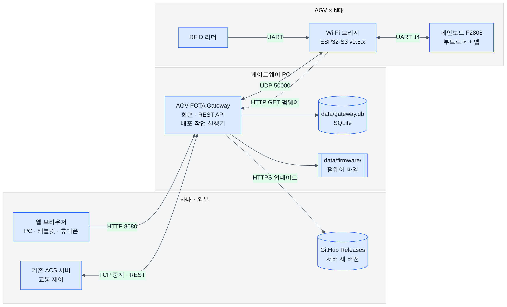
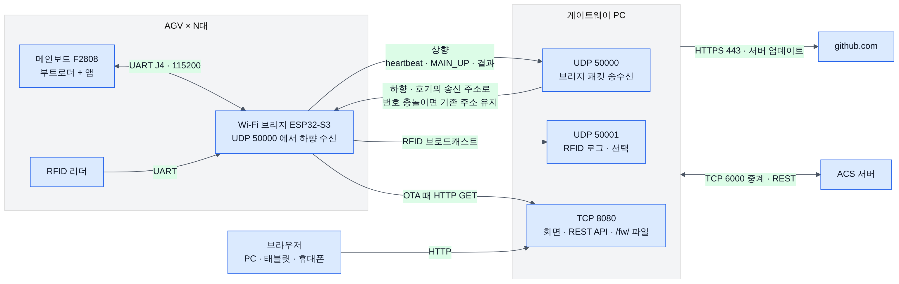
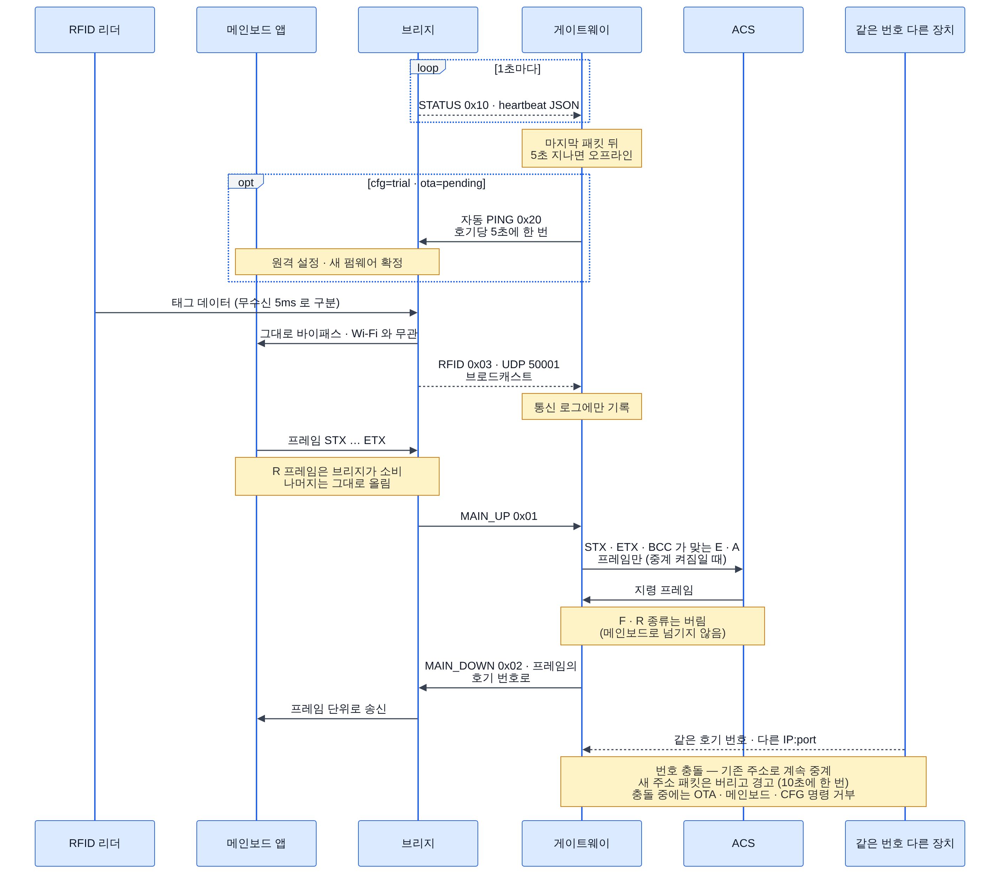
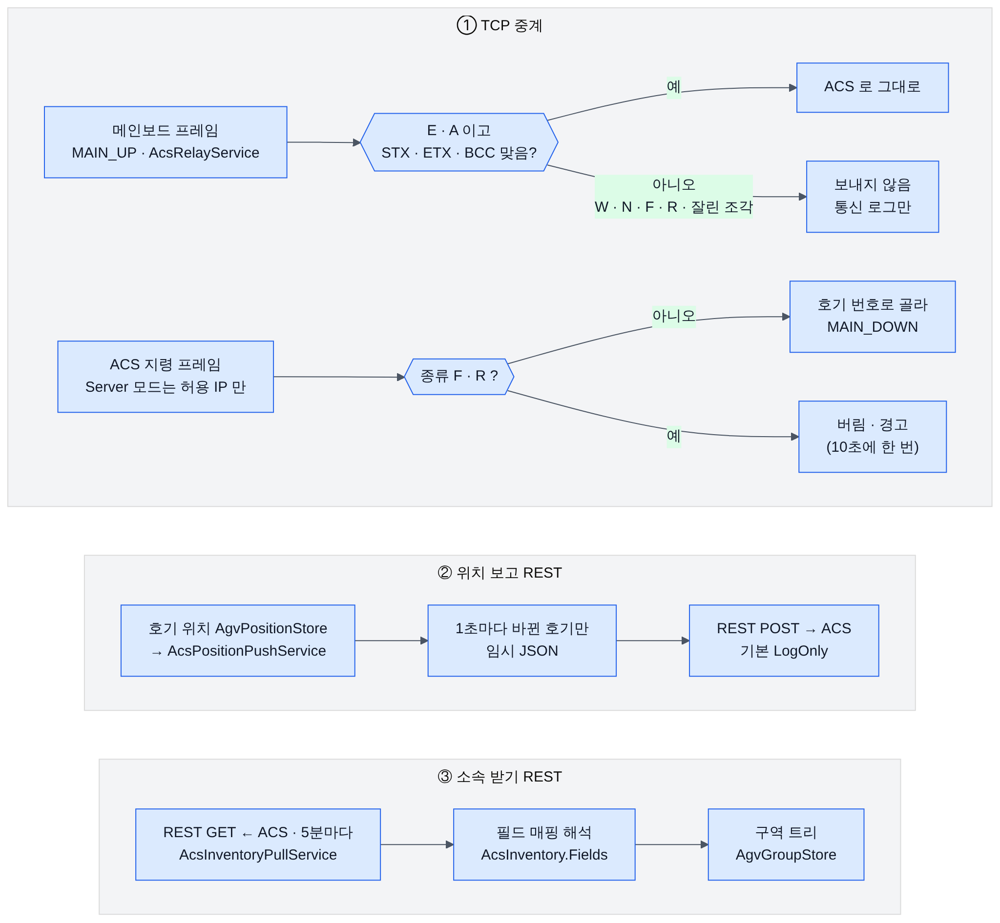
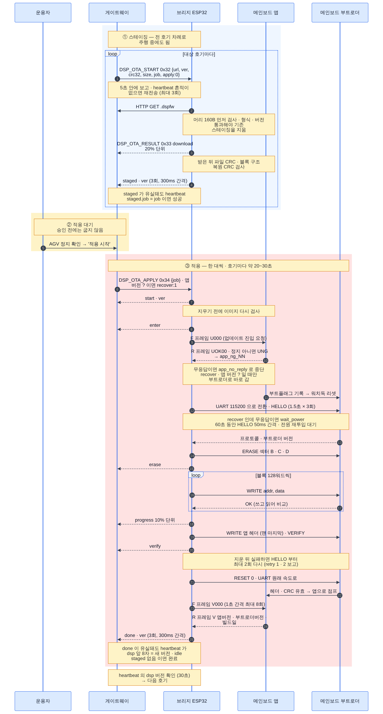
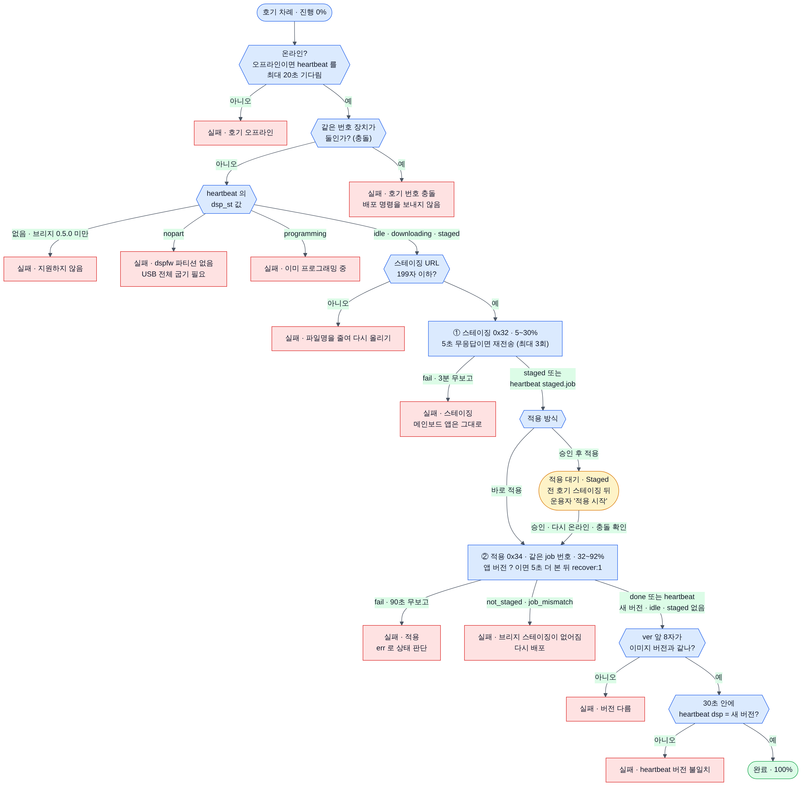
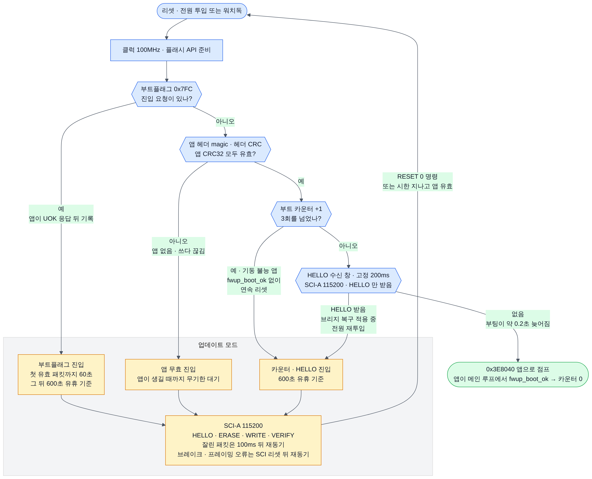
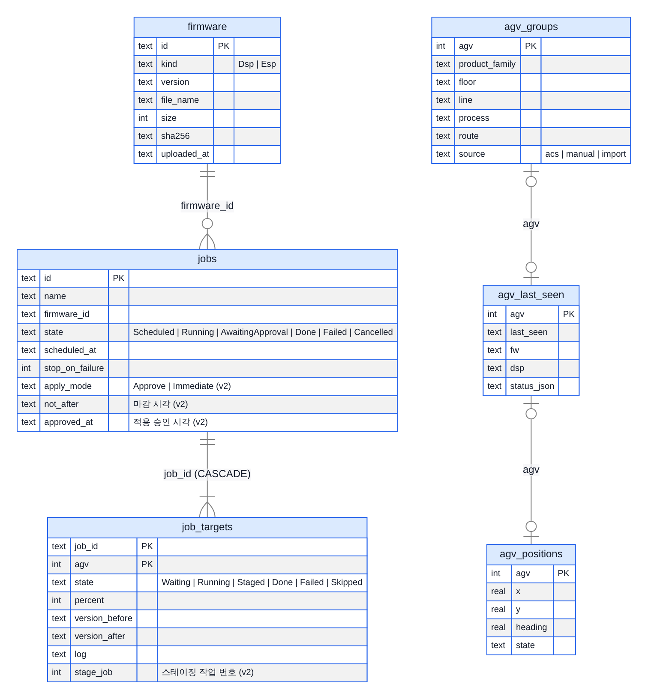

# AGV FOTA 시스템 — 전체 흐름

이 문서는 AGV 펌웨어 무선 업데이트(FOTA) 시스템 전체를 한 번에 이해하기 위한 안내서입니다.
무엇이 있고, 서로 무엇을 주고받고, 업데이트·중계·연동이 어떤 순서로 흐르고, 실패하면 어떻게 되돌리는지를 다룹니다.

- 설치·운영 절차는 [DEPLOY.md](DEPLOY.md) 를 봅니다. 패킷·REST 규격 요약은 [INTERFACES.md](INTERFACES.md) 에 있습니다.
- 기준: 게이트웨이 서버 **0.3.0**, 브리지 펌웨어 **0.5.2**. 코드와 설정을 열어 확인한 값만 적었습니다(2026-10-12).
- 그림 원본은 `docs/diagrams/*.mmd` 입니다.

**목차**

1. [한눈에 보기](#1-한눈에-보기)
2. [구성 요소와 역할](#2-구성-요소와-역할)
3. [통신 경로와 포트](#3-통신-경로와-포트)
4. [평상시 흐름](#4-평상시-흐름)
5. [브리지 OTA](#5-브리지-ota)
6. [메인보드 OTA (B안)](#6-메인보드-ota-b안)
7. [배포 작업](#7-배포-작업)
8. [구역 (호기 소속)](#8-구역-호기-소속)
9. [서버 자체 업데이트](#9-서버-자체-업데이트)
10. [데이터](#10-데이터)
11. [화면 안내](#11-화면-안내)
12. [코드 지도](#12-코드-지도)
13. [미확정 항목과 다음 단계](#13-미확정-항목과-다음-단계)

---

## 1. 한눈에 보기


*브라우저·ACS·GitHub 는 게이트웨이 PC 와, AGV 의 브리지는 UDP 50000 으로 게이트웨이와 통신한다.*

- 사내 PC 한 대에서 도는 **게이트웨이 서버**가 AGV 마다 달린 **Wi-Fi 브리지**와 UDP 로 통신합니다.
- 운용자는 브라우저로 펌웨어를 올리고, 대상 호기와 시각을 정해 **한 대씩 순차로** 배포합니다.
- **브리지 펌웨어**는 브리지가 서버에서 직접 HTTP 로 받아 교체합니다.
- **메인보드 펌웨어**는 브리지가 받아 두었다가(스테이징) 메인보드의 상주 부트로더로 UART 를 통해 굽습니다(B안).
  메인보드 작업은 기본으로 **전 호기 스테이징 → 적용 대기 → 운용자 승인 → 한 대씩 적용** 순서로 흐릅니다.
- 브리지는 서버 IP 하나로만 통신하므로, ACS 와의 프레임 중계·REST 연동도 같은 서버가 맡습니다.

| 저장소 | 내용 | 상태 |
|---|---|---|
| `agv_fota_gateway` | 게이트웨이 서버. ASP.NET Core .NET 10 Blazor Server, Windows 서비스, 런타임 포함 단일 exe | 다음 릴리스 v0.3.0. 정식 릴리스 태그는 v0.2.0 까지 |
| `AGV_Wifi_Bridge` | 브리지 펌웨어(ESP32-S3, ESP-IDF v6.1) + `dsp/`(메인보드 부트로더·앱 지원 코드) + `tools/`(`dsp_pack.py`, `dsp_flash.py`, `BridgeTest.cs`, `flash.bat`) | 다음 릴리스 v0.5.2 |
| `DSP_OTA` | 이전 메인보드 OTA 방식(서버가 AGV 로 프레임 블록을 보내는 방식) | 보관됨. B안으로 대체 |

### 1.1 0.3.0 · 0.5.2 에서 달라진 점

전체 점검(2026-10-10)의 지적과 결정을 반영한 결과입니다. 운용자가 알아 둘 것만 추립니다.

| 바뀐 것 | 운용자가 할 일 | 자세히 |
|---|---|---|
| 메인보드 작업은 스테이징 뒤 **적용 대기**에서 멈춥니다 | AGV 를 세운 뒤 작업의 **적용 시작**을 누릅니다 | [7.1](#71-메인보드-작업-순서-승인-후-적용) |
| 작업을 만들 때·적용할 때·취소할 때 확인창이 뜹니다 | 대상 수와 상태를 읽고 확인합니다 | [7.3](#73-규칙) |
| 작업마다 **마감 시각**을 줄 수 있습니다 | 야간 작업은 마감 시각을 켭니다 | [7.3](#73-규칙) |
| 서버가 cfg=trial·ota=pending 을 보면 **자동으로 PING** 합니다 | 수동 PING 이 필요 없습니다 | [4.6](#46-자동-확정-ping) |
| UDP 명령은 **재전송**되고 최종 보고는 **3회** 옵니다. heartbeat 로도 판정합니다 | 없음 | [6.2](#62-단계) |
| 같은 호기 번호 장치가 둘이면 **충돌**로 표시하고 기존 장치를 지킵니다 | 빨간 배너가 뜨면 한쪽 브리지 번호를 고칩니다 | [4.5](#45-호기-식별과-번호-충돌) |
| 앱이 멈춘 메인보드는 작업을 만들 때 **복구 적용** 을 켜야 합니다. 앱 버전 `?` 만으로는 켜지지 않습니다 | 화면의 '앱 버전 모름' 경고를 보고, 앱이 멈춘 호기면 복구 적용 작업으로 배포합니다 | [6.5](#65-기동-불능-앱-복구--부트-카운터와-복구-적용) |
| 메인보드 버전은 **1~8자** `[0-9A-Za-z._-]` 만 됩니다 | `dsp_pack.py --ver` 를 규칙에 맞춥니다 | [6.6](#66-앱-쪽-요구-사항) |
| `PublicBaseUrl` 은 **브리지 server IP 와 같은 IPv4** 여야 합니다 | 호스트명을 썼으면 IPv4 로 고치거나 비웁니다 | [5](#5-브리지-ota) |
| 서버 자체 업데이트는 60초 안에 새 버전이 뜨지 않으면 **자동으로 되돌립니다** | v0.2.x 에서 처음 올릴 때만 서비스 상태를 확인합니다 | [9](#9-서버-자체-업데이트) |
| ACS 하향의 `F`·`R` 프레임은 메인보드로 넘기지 않습니다 | Server 모드면 `AllowedRemotes` 에 ACS IP 를 넣습니다 | [4.4](#44-acs-연동-세-갈래) |
| 화면·API 는 IP·`localhost`·PC 이름으로 접속할 때만 열립니다 | 사내 DNS 별칭으로 접속한다면 `Gateway.AllowedHostNames` 에 넣습니다 | [2.5](#25-브라우저) |

---

## 2. 구성 요소와 역할

### 2.1 메인보드 (TMS320F2808) — 부트로더 + 앱

- AGV 의 주행 제어 보드입니다. 브리지와 J4(SCI-A)로 연결됩니다. 평소 속도는 브리지 `main_baud`, 굽는 동안은 115200 입니다.
- 플래시 섹터 A 에 **상주 부트로더**가 있습니다. OTA 로 지우거나 바꾸지 않습니다. 바꾸려면 JTAG 가 필요합니다.
- 섹터 B·C·D 에 **앱**이 있습니다. OTA 는 이 영역만 교체합니다.
- 앱에는 OTA 지원 코드(`dsp/app/app_fwupdate.c`)와 **안전 확인 콜백·워치독**이 들어가야 합니다(6.6절).
- 처음 한 번은 호기마다 유선(JTAG)으로 **브리지 0.5.2 의 `dsp/boot`** 부트로더와 재링크한 앱을 굽습니다.
- 이어서 브리지로 `.dspfw` 를 한 번 적용해 앱 헤더를 채웁니다. 그 전에는 앱이 돌지 않습니다(6.6절).

### 2.2 Wi-Fi 브리지 (ESP32-S3)

- 기존 ZigBee 통신보드를 대체합니다.
- 메인보드 UART 프레임을 그대로 서버와 UDP 로 중계합니다. ACK·재전송은 기존처럼 메인보드가 관리합니다.
- RFID 리더 데이터를 메인보드로 바이패스하고, 네트워크로도 브로드캐스트합니다.
- 1초마다 heartbeat(상태 JSON)를 서버로 보냅니다.
- 자기 펌웨어를 OTA 로 교체합니다(두 슬롯 `ota_0`/`ota_1`, 180초 자동 롤백).
- 메인보드 이미지를 `dspfw` 파티션(384KB)에 받아 두었다가 부트로더로 굽습니다.
- 설정은 USB 콘솔, 서버 원격 명령(UDP), 휴대폰 BLE 로 바꿉니다.

### 2.3 게이트웨이 서버 (AGV FOTA Gateway)

Windows 서비스 `AgvFotaGateway` 로 돕니다. 서비스 하나하나의 역할은 다음과 같습니다(`src/Gateway.Server/Program.cs` 에 등록).

| 서비스 | 하는 일 |
|---|---|
| `BridgeUdpService` | UDP 50000 으로 브리지 패킷을 받고 보냅니다. 호기 번호 충돌을 감지하고, cfg=trial·ota=pending 이면 자동 PING 을 보냅니다. UDP 50001 RFID 는 통신 로그에만 남깁니다. UDP 50000 을 열 수 없으면 10초마다 다시 시도하고 화면에 배너를 띄웁니다 |
| `AgvRegistry` | 호기별 최신 heartbeat·주소·카운터·충돌 상태를 들고 있습니다. 마지막 접속은 2초마다 모아서 DB 에 씁니다 |
| `JobService` | 배포 작업을 예약·순차 실행합니다. 메인보드 작업은 스테이징 → 적용 대기 → 승인 → 적용으로 나눕니다 |
| `FirmwareStore` | 업로드한 펌웨어를 검사해 `data/firmware/` 에 둡니다. 브리지가 받아 가도록 `/fw/` 주소로 내줍니다 |
| `AcsRelayService` | ACS TCP 중계. 기본 꺼짐 |
| `AcsPositionPushService` | 호기 위치를 ACS 로 REST 보고. 기본 꺼짐 |
| `AcsInventoryPullService` | ACS 에서 호기 소속(구역)을 REST 로 받기. 기본 꺼짐 |
| `AgvGroupStore` | 구역(호기 소속) 저장과 트리 |
| `AgvPositionStore` | 호기 위치. RTLS 결과가 들어갈 자리이며 지금은 시험 주입만 있습니다 |
| `UpdateService` | 서버 자체 업데이트(확인·받기·적용·되돌리기) |
| `TraceLog` | 통신 로그 최근 300줄(메모리) |
| `GatewayDb` | SQLite 데이터베이스 `data/gateway.db` |
| `FileLoggerProvider` | 파일 로그 `data/logs/gateway-날짜.log`(14일 보관) |

### 2.4 ACS (기존 교통 제어 서버)

- 지금까지 ZigBee 게이트웨이와 TCP 로 AGV 프레임을 주고받던 서버입니다.
- 게이트웨이와는 세 갈래로 연결됩니다: TCP 중계, 위치 보고(REST), 호기 소속 받기(REST). 4.4절에서 다룹니다.
- 세 갈래 모두 규격이 확정되지 않아 기본값은 꺼짐입니다.

### 2.5 브라우저

- PC·태블릿·휴대폰에서 `http://<게이트웨이 PC IP>:8080` 으로 접속합니다.
- 로그인은 없습니다(사내망 전제). 대신 다른 웹페이지에서 브라우저로 보낸 변경 요청(`/api` 의 POST·PUT·DELETE·PATCH)은 403 으로 거부합니다.
- 접속 주소(Host)도 봅니다. IP 주소, `localhost`, 이 PC 이름·FQDN, `Gateway.AllowedHostNames` 에 적은 이름이 아니면 화면·API 모두 403 입니다(DNS 리바인딩 방어). 사내 DNS 별칭으로 접속한다면 그 이름을 `Gateway.AllowedHostNames` 에 넣습니다. 지금 허용 목록은 **설정** 화면 '접속 이름' 줄에 보입니다.
- 화면 7개: 호기 현황, 구역, 펌웨어, 배포 작업, 통신 로그, 서버 업데이트, 설정. 같은 기능을 REST API(`/api/...`)로도 씁니다.

---

## 3. 통신 경로와 포트


*하향은 호기의 송신 주소로 보내고, 번호가 충돌하면 기존 주소를 유지한다. OTA 파일만 브리지가 TCP 8080 으로 받아 간다.*

| 포트 | 방향 (게이트웨이 PC 기준) | 용도 | 설정 |
|---|---|---|---|
| TCP 8080 | 인바운드 | 웹 화면, REST API, 브리지가 받아 가는 펌웨어 파일 `/fw/{id}/{file}` | `Urls` (`http://0.0.0.0:8080`) |
| UDP 50000 | 인바운드(상향)·아웃바운드(하향) | 브리지 패킷 전부 | `Gateway.UdpPort`, 브리지 `server_port`·`local_port` |
| UDP 50001 | 인바운드 | 브리지 RFID 원본(진단용 로그) | `Gateway.RfidPort` (0 = 끔), 브리지 `rfid_dst`·`rfid_port` |
| TCP 6000 | 아웃바운드(`Client`) 또는 인바운드(`Server`) | ACS 중계. 기본 꺼짐, 포트는 임시값 | `Gateway.Acs.*` |
| HTTP(S) | 아웃바운드 | ACS REST (위치 보고·소속 받기). 기본 꺼짐 | `AcsApi.BaseUrl`, `AcsInventory.BaseUrl` |
| HTTPS 443 | 아웃바운드 | 서버 새 버전 확인·받기 (github.com, api.github.com 만) | `Update.BaseUrl` |

- `install-service.bat` 은 `appsettings.json` 에서 포트를 읽어 인바운드 방화벽 규칙을 만듭니다.
  - `AGV FOTA Gateway HTTP`: `Urls` 의 포트 전부
  - `AGV FOTA Gateway Bridge UDP`: `Gateway.UdpPort`, `Gateway.RfidPort`(0 이면 뺌)
  - `AGV FOTA Gateway ACS TCP`: ACS 중계가 켜져 있고 `Server` 모드일 때 `Gateway.Acs.Port`
- 포트를 바꾸면 `install-service.bat` 을 다시 실행합니다. 서비스를 지우지 않고 멈춘 뒤 설정만 갱신합니다.

### 3.1 브리지 UDP 패킷

헤더 10바이트 + payload(최대 512바이트), 리틀 엔디언입니다.

| 오프셋 | 크기 | 내용 |
|---|---|---|
| 0 | 2 | magic `A5 5A` |
| 2 | 1 | ver = 1 |
| 3 | 1 | type (아래 표) |
| 4 | 1 | AGV ID (호기 번호 1~99) |
| 5 | 1 | flags (0) |
| 6 | 2 | seq — 타입별 순번. 서버가 누락을 셉니다 |
| 8 | 2 | payload 길이 |

| type | 이름 | 방향 | payload | 서버 처리 |
|---|---|---|---|---|
| `0x01` | MAIN_UP | 브리지 → 서버 | 메인보드 UART 프레임 원본 | 통신 로그 `MAIN>`, OTA 대기자에 전달, 온전한 E·A 프레임만 ACS 로 |
| `0x02` | MAIN_DOWN | 서버 → 브리지 | 메인보드로 보낼 프레임(256바이트 이하) | ACS 지령·수동 전송 |
| `0x03` | RFID | 브리지 → `rfid_dst` | RFID 리더 원본 | 통신 로그 `RFID>` |
| `0x10` | STATUS | 브리지 → 서버 | heartbeat JSON (4.1절) | 호기 상태 갱신, 필요하면 자동 PING |
| `0x11` | INFO_REQ | 서버 → 브리지 | 없음 | 호기 현황 "INFO 요청" |
| `0x12` | INFO | 브리지 → 서버 | JSON: agv, mac, ip, fw, part, ota, cfg, setup, up, dsp, dspb, dsp_build, dsp_st, staged | 호기 상태에 합침, 통신 로그 |
| `0x20` | PING | 서버 → 브리지 | 임의(서버는 현재 시각) | 확정용 자동 PING, 호기 현황 "PING" |
| `0x21` | PONG | 브리지 → 서버 | PING 의 seq·payload 그대로 | 무시 (seq 검사 제외) |
| `0x30` | OTA_START | 서버 → 브리지 | 브리지 펌웨어 URL (ASCII, 255자 이하) | 5절 |
| `0x31` | OTA_RESULT | 브리지 → 서버 | JSON: stage(start/progress/done/fail/busy), pct, bytes, ver, err | 5절 |
| `0x32` | DSP_OTA_START | 서버 → 브리지 | JSON: url(199자 이하), ver, crc32, size, job, apply | 6절 |
| `0x33` | DSP_OTA_RESULT | 브리지 → 서버 | JSON: job, stage, pct, ver, err | 6절 |
| `0x34` | DSP_OTA_APPLY | 서버 → 브리지 | JSON: job, recover(선택, 1 = 복구 적용) | 6절 |
| `0x40` | CFG_CMD | 서버 → 브리지 | 설정 명령 한 줄 (`cfg`, `set ip …`, `save`, `reboot` …) | 통신 로그 화면 "CFG_CMD 전송" |
| `0x41` | CFG_RESULT | 브리지 → 서버 | 명령 결과 텍스트 (seq = 요청 seq) | 통신 로그 `CFG>` (seq 검사 제외) |

브리지와 서버의 약속:

- 서버는 호기마다 패킷을 보낸 주소(IP:포트)를 endpoint 로 기억했다가 그곳으로 하향을 보냅니다. 살아 있는 endpoint 가 있는데 다른 주소에서 같은 번호가 오면 endpoint 를 바꾸지 않습니다(4.5절).
- 브리지는 설정된 `server` IP 에서 온 하향만 받습니다. MAIN_DOWN·OTA·CFG·DSP 패킷은 AGV ID 가 같을 때만 처리합니다.
- 서버 하향을 하나라도 받으면 브리지는 미확정 새 펌웨어(`ota=pending`)와 원격 변경 설정(`cfg=trial`)을 확정합니다. 서버는 이 상태를 보면 자동으로 PING 을 보냅니다(4.6절).
- Wi-Fi 가 끊긴 동안의 상향은 버퍼링하지 않고 버립니다. seq 는 계속 오르므로 서버의 **손실** 열에 누락 수가 쌓입니다.
- 손실은 타입별로 셉니다. PONG·CFG_RESULT 는 요청 seq 를 반송하므로 세지 않습니다. 브리지 재부팅(heartbeat `up` 감소)이나 endpoint 변경 때 기준을 새로 잡고, 번호가 1000 넘게 뒤로 가면 재동기로 봅니다.
- 브리지 OTA URL 과 스테이징 URL 은 **호스트가 브리지에 설정된 server IP 와 같아야** 받습니다(브리지 0.5.2, 5절).

### 3.2 AGV 프레임 형식

메인보드 UART 프레임은 기존 AGV-ACS 규격을 따릅니다. 브리지와 서버는 내용을 바꾸지 않고 그대로 옮깁니다.

```
STX  종류  PAN  MSG  AGV(2)  본문 …  ' '  BCC  ETX
0x02  1자   1자  1자  숫자2자          공백  1자  0x03
```

| 칸 | 내용 |
|---|---|
| 종류 | 프레임 종류 문자. ACS 로는 `E`(이벤트)와 `A`(ACK)만 넘깁니다 |
| PAN · MSG | PAN ID, 메시지 ID |
| AGV | 호기 번호 두 자리(`07`). 서버는 이 값으로 대상 호기를 고릅니다 |
| BCC | STX·ETX 를 뺀 바이트(끝 공백 포함) 합의 하위 4비트를 ASCII-HEX 한 글자로 |

예: 브리지가 07호기 앱에 버전을 묻는 프레임 `<STX>F3107V000 7<ETX>`.

- 브리지는 메인보드 수신을 **ETX 기준**으로 자릅니다. ETX 없이 수신이 끊기면(115200bps 기준 약 20ms) 받은 만큼 보냅니다.
- 한 프레임은 **256바이트**를 넘으면 안 됩니다. 서버도 256바이트가 넘는 MAIN_DOWN 은 보내지 않습니다.
- `F`(브리지 → 앱)와 `R`(앱 → 브리지)은 메인보드 OTA 용 새 종류 문자입니다. 브리지가 만들고 소비하므로 서버에 올라오지 않습니다.
  서버는 ACS 하향과 수동 전송에서 `F`·`R` 을 거부합니다(4.4절). 프로토콜 문서 등록은 아직입니다(13절).

---

## 4. 평상시 흐름


*heartbeat 와 자동 PING, RFID 바이패스, ACS 로는 온전한 E·A 만, ACS 하향 F·R 은 버림. 같은 번호의 다른 장치가 보낸 패킷은 버리고 기존 주소를 유지한다.*

### 4.1 heartbeat (STATUS 0x10)

- 주기: 1초. 브리지 설정 `hb_ms` 로 바꿉니다. 허용값은 **0(끔, 디버그용) 또는 100~2000ms**(기본 1000)입니다.
  범위 밖 값은 `set` 과 설정 페이지가 거부하고, 예전 버전이 저장한 범위 밖 값은 부팅 때 기본값으로 바뀝니다.
- Wi-Fi 가 연결돼 있을 때만 보냅니다.

| 필드 | 뜻 | 화면 (호기 현황) |
|---|---|---|
| `fw` | 브리지 펌웨어 버전 | 브리지 fw |
| `mac` | 브리지 STA MAC (`xx:xx:xx:xx:xx:xx`, 0.5.2 부터) | 상세 · 주소. 번호 충돌 판정에도 씀 |
| `part` | 실행 중인 슬롯 (`ota_0`/`ota_1`) | 슬롯 |
| `ota` | `pending`(새 펌웨어 미확정) · `valid` · `busy`(OTA 중) | ota |
| `up` | 브리지 가동 시간(초) | 상세 · 가동 |
| `rssi` · `ch` · `bssid` | Wi-Fi 신호·채널·AP | RSSI, 상세 · Wi-Fi |
| `disc` · `reason` | Wi-Fi 끊김 횟수, 마지막 끊김 사유 | 상세 · Wi-Fi (끊김 횟수만. `reason` 은 heartbeat 원문에서) |
| `m_rx` · `m_tx` · `r_rx` | 메인보드 수신·송신 프레임 수, RFID 수신 수 | 상세 · UART |
| `u_err` | UART 오류 합계 | 상세 · UART |
| `n_off` · `n_err` | Wi-Fi 끊김 중 버린 상향 수, 송신 오류 수 | 상세 · 네트 |
| `heap` | 남은 메모리 | 상세 · 네트 |
| `cfg` | `saved` · `trial`(원격 변경 확인 대기) · `default` | cfg |
| `setup` | 무선 설정 모드(BLE·SoftAP) 열림 1/0 | cfg 옆 `(AP)` |
| `dsp` · `dspb` · `dsp_build` | 메인보드 앱 버전 · 부트로더 버전 · 빌드일. 모르면 `?` | 메인보드 앱 / 부트 |
| `dsp_st` | `idle` · `downloading` · `staged` · `programming` · `nopart`(파티션 없음) | 메인보드 열의 표시 |
| `staged` | 받아 둔 메인보드 이미지 `{job, ver}` 또는 `null` | 스테이징 |

- 서버는 INFO 와 heartbeat 를 **합쳐서** 보관합니다. INFO 로 받은 IP·MAC 은 이후 heartbeat 가 와도 남고, INFO 직후에도 RSSI·카운터는 직전 heartbeat 값이 남습니다.

오프라인 판정과 기록:

- 서버는 그 호기에서 UDP 50000 으로 **어떤 패킷이든** 받은 지 **5초**(`Gateway.OfflineAfterSec`)가 지나면 오프라인으로 봅니다.
- 마지막 접속은 30초마다(버전·슬롯·주소가 바뀌면 바로) 기록 대상으로 표시하고, **2초마다 모아서** DB(`agv_last_seen`)에 씁니다. 그래서 서버를 다시 켜도 "n분 전" 으로 보입니다.
- DB 쓰기는 수신 루프와 떨어져 있습니다. 다른 프로그램이 DB 를 잠가도 통신은 멈추지 않고, 기록만 미뤄지며 서비스 로그에 60초에 한 번 경고가 남습니다.
- 오프라인이 되면 그 호기 위치 상태는 `LOST` 로 바뀝니다(1초마다 다시 판단).

### 4.2 메인보드 프레임 중계 (MAIN_UP / MAIN_DOWN)

1. 메인보드가 프레임을 보냅니다. 브리지는 ETX 를 받는 즉시 MAIN_UP 으로 서버에 보냅니다.
2. 브리지는 `R` 프레임(자기 질문에 대한 앱 응답)만 소비하고 나머지는 그대로 올립니다. `E`·`A` 프레임에서 그 호기의 PAN ID 를 배워 둡니다.
3. 서버는 받은 프레임을 통신 로그에 남깁니다. ACS 중계가 켜져 있으면 **STX·ETX·BCC 가 모두 맞는** `E`·`A` 프레임만 ACS 로 넘깁니다.
   ETX 없이 끊긴 조각·잘린 조각·BCC 오류는 버리고 통신 로그에 `ACS 중계 제외 — ETX/BCC 가 맞지 않는 조각 (누적 N)` 을 남깁니다.
4. ACS 가 보낸 지령 프레임은 프레임 안의 호기 번호로 대상을 골라 MAIN_DOWN 으로 보냅니다. 종류 `F`·`R` 은 버립니다.
5. 브리지는 MAIN_DOWN 을 프레임 단위로 메인보드에 보냅니다. RFID 바이패스 데이터와 섞이지 않습니다.

통신 로그 화면의 **수동 전송**에서도 MAIN_DOWN 을 보낼 수 있습니다.
호기 칸은 비어 있는 채로 시작하고, `W`·`N` 프레임과 읽기 전용(`cfg`, `stat`, `help`, `setup`, `dsp`, `dsp ver`)이 아닌 설정 명령은 확인창을 거칩니다.
`F`·`R` 프레임과 번호 충돌 중인 호기로의 전송은 거부합니다.

### 4.3 RFID 바이패스

1. RFID 리더가 브리지로 데이터를 보냅니다. 브리지는 5ms 무수신으로 한 덩어리를 자릅니다.
2. 브리지가 먼저 메인보드로 그대로 보냅니다. **Wi-Fi 상태와 무관**하게 동작합니다.
3. 이어서 `rfid_dst`(기본 `255.255.255.255:50001` 브로드캐스트)로 보냅니다.
4. 서버는 UDP 50001 에서 받아 통신 로그에만 남깁니다(`RFID>`).

메인보드 OTA 적용 중(브리지가 UART 를 독점하는 동안)에는 RFID 바이패스도 멈춥니다.
RFID 리더 보드레이트 기본값은 9600 이며, 현장 리더에 맞는지 확인이 필요합니다.

### 4.4 ACS 연동 세 갈래


*상향은 STX·ETX·BCC 가 맞는 E·A 만 넘기고, 하향 F·R 은 버림(10초에 한 번 경고). Server 모드는 허용 IP 만 받는다.*

| 갈래 | 서비스 | 기본값 | 동작 | 미확정 |
|---|---|---|---|---|
| ① TCP 중계 | `AcsRelayService` | `Gateway.Acs.Enabled=false`, `Mode=Client`, `127.0.0.1:6000` | 상향은 온전한 `E`·`A` 프레임만 그대로. 하향은 호기 번호로 MAIN_DOWN, `F`·`R` 은 버림 | 기존 ZigBee 게이트웨이의 소켓 규격(접속 방향, 프레임 구분, 호기 매핑) |
| ② 위치 보고 | `AcsPositionPushService` | `AcsApi.Enabled=false`, 켜도 `LogOnly=true` | 1초(`IntervalMs`)마다 바뀐 호기만 POST. LogOnly 면 통신 로그에 JSON 만 | REST 스키마 |
| ③ 소속 받기 | `AcsInventoryPullService` | `AcsInventory.Enabled=false` | 시작 3초 뒤, 이후 300초(`IntervalSec`)마다 GET → 구역 반영 | REST 스키마 |

① TCP 중계:

- `Client` 는 서버가 ACS 에 접속하고, 끊기면 3초(`ReconnectSec`) 뒤 다시 붙습니다.
- `Server` 는 리스너를 서비스 수명 동안 열어 두고 **한 번에 한 연결**만 씁니다. 새 접속이 오면 기존 연결을 닫고 교체합니다(ACS PC 가 정전 뒤 다시 붙는 경우).
- `Server` 모드는 `Gateway.Acs.AllowedRemotes`(IP 목록)에 있는 주소만 받습니다. 비우면 모두 받습니다. **다른 PC 가 접속해 ACS 연결을 빼앗지 않도록 ACS IP 를 넣습니다.**
  - IP 를 그대로 비교합니다(CIDR·호스트명 없음). 해석되지 않는 항목은 기동 때 경고하고 무시합니다. 항목이 있는데 하나도 해석되지 않으면 모두 거부합니다.
- 하향 `F`(업데이트 진입)·`R`(브리지용 응답)은 ACS 가 보낼 종류가 아니므로 메인보드로 넘기지 않습니다. 10초에 한 번 경고하고 수를 셉니다(설정 화면 "하향 차단"). 두 모드 모두 같습니다.
- 두 모드 모두 TCP keepalive(10초 무통신, 3초 간격, 3회)를 걸어 FIN·RST 없이 사라진 상대를 약 20초 안에 알아챕니다. 보내기에 실패하면 연결을 끝내고 다시 붙거나 다시 기다립니다.
- 연결 중 ACS 로 보낼 프레임은 최대 512개까지 쌓고, 넘치면 오래된 것부터 버립니다. 끊긴 동안 올라온 프레임은 ACS 로 보내지 않고 버립니다.

② 위치 보고:

- 실패하면 큐에 쌓지 않고 다음 주기에 최신값을 보냅니다. 연속 실패는 주기를 2배씩 늘려 최대 60초(`MaxBackoffSec`)까지 둡니다.
- 서버를 다시 켜면 DB 의 마지막 위치를 `LOST`·오프라인으로 복원합니다. heartbeat 가 돌아와도 `LOST` 로 남고, 새 추정이나 주입이 와야 `TRACKED` 가 됩니다. 복원한 값은 바뀌기 전까지 ACS 로 보내지 않습니다.

③ 소속 받기:

- 실패하면 1분, 2분, 4분, 8분 간격으로 다시 시도합니다(주기보다 길어지지 않음).
- 응답에서 호기 목록을 못 찾거나, 빈 목록이거나, 모든 레코드의 호기 번호 해석에 실패하면 **반영하지 않고** 실패로 셉니다(8절).
- `BaseUrl` 이 `http://` 나 `https://` 로 시작하지 않으면 요청을 보내지 않고 '잘못된 주소' 로 실패합니다.
- 위치 보고 본문·소속 응답의 임시 형식과 반영 지점은 [ACS_API.md](ACS_API.md) 에 있습니다.

### 4.5 호기 식별과 번호 충돌

서버는 패킷의 **송신 주소(IP:포트)** 로 호기의 endpoint 를 정합니다. 같은 호기 번호를 쓰는 장치가 둘이면 이렇게 처리합니다.


*52호기 번호를 쓰는 장치가 하나 더 붙었다. 처음 주소(:50017)로 계속 중계하고 새 주소(:50117)의 패킷은 버린다. 표에는 '충돌' 배지.*

**화면에 빨간 배너가 뜨면 할 일**: 한쪽 브리지의 `agv` 번호를 고칩니다. 브리지를 교체하는 중이면 이전 브리지를 끈 뒤 새 브리지를 켭니다.

| 상황 | 서버 판단 | 동작 |
|---|---|---|
| 처음 보는 호기 | 새 주소 채택 | endpoint 로 기억 |
| 기존 endpoint 가 살아 있음(5초 안에 패킷) + 다른 주소에서 같은 번호 | **충돌** | endpoint·상태·seq 를 바꾸지 않고 새 주소의 패킷을 통째로 버림(상태 갱신, ACS 상향, OTA 보고 모두). `[NN] 주소 충돌 old→new …` 를 통신 로그와 서비스 로그에 10초에 한 번 |
| 기존 endpoint 가 오프라인 | 주소 변경 | 새 주소 채택, 통신 로그 `[NN] 주소 변경 old→new`, seq 기준·이전 상태 버림 |
| 두 주소의 MAC 을 모두 알고 같음 | 주소 변경 | 같은 장치의 IP 변경으로 봄. MAC 은 INFO 와 브리지 0.5.2 heartbeat 에 있음 |
| 호기 번호가 1~99 밖 | 버림 | 통신 로그에 10초에 한 번 |

- 충돌 상태는 마지막 충돌 패킷 뒤 **10초**(`OfflineAfterSec`×2) 동안 이어집니다.
- 충돌 중에는 OTA_START·DSP_OTA_START·DSP_OTA_APPLY·CFG_CMD 를 보내지 않습니다. 배포 작업은 그 호기를 `호기 번호 충돌 — 같은 번호의 장치가 둘` 로 실패 처리하고, 수동 전송은 거부합니다(REST 는 409). 자동 PING 도 보내지 않습니다.
- MAIN_DOWN(ACS 지령)·PING·INFO_REQ 는 기존 endpoint 로 계속 보냅니다.
- `GET /api/agvs` 에 `conflict`, `conflictEndPoint`, `conflictAt`, `conflictCount` 가 있습니다.

### 4.6 자동 확정 PING

- 브리지는 원격 설정을 `save` → `reboot` 하면 `cfg=trial`, 자기 OTA 로 재부팅하면 `ota=pending` 으로 뜹니다. 180초 안에 서버 패킷을 받아야 확정하고, 못 받으면 이전 설정·펌웨어로 되돌아갑니다.
- 서버는 heartbeat·INFO 에서 `cfg=trial` 이나 `ota=pending` 을 보면 그 호기에 **PING 을 호기당 5초에 한 번** 보냅니다. 번호 충돌 중인 호기는 빼냅니다.
- 통신 로그에 `[NN] 자동 PING (cfg=…, ota=…) — 확정용` 이 남습니다. 운용자가 할 일은 없습니다.
- 서버가 꺼져 있거나 브리지가 서버에 닿지 못하면 지금처럼 180초 뒤 되돌아갑니다.

---

## 5. 브리지 OTA


*확인창 → 온라인·충돌 확인 → OTA_START(재전송 최대 3회) → 브리지가 URL 호스트를 확인하고 받기 → done 3회 → 재부팅 → 1초 간격 PING 으로 확정. done 이 유실돼도 heartbeat 로 진행하고, 확정이 없으면 180초 뒤 롤백.*

1. **펌웨어** 화면에 `agv_wifi_bridge.bin`(앱 이미지)을 올립니다. 서버가 이미지 안의 버전과 프로젝트명(`agv_wifi_bridge`)을 읽어 검사합니다. bootloader·partition-table·merged 이미지는 거부됩니다.
2. **배포 작업** 화면에서 그 펌웨어와 대상 호기·실행 시각을 골라 작업을 만듭니다. 확인창에서 대상 수와 "AGV 정지 확인" 을 묻습니다(7절). 브리지 작업에는 적용 대기 단계가 없습니다.
3. 작업이 그 호기 차례가 되면 서버가 온라인인지 봅니다. 오프라인이면 heartbeat 를 최대 20초 기다리고, 번호 충돌이면 거부합니다.
   `ota=pending` 이 남아 있으면 PING 을 1초마다 최대 10초 보내 먼저 확정합니다.
4. 서버가 OTA_START(0x30)에 URL 을 담아 보냅니다: `http://<서버 IP>:<HTTP 포트>/fw/<펌웨어 id>/<파일>`(255자 이하).
   - 서버 IP 는 그 호기 쪽 네트워크 카드 주소를 자동으로 씁니다. `Gateway.PublicBaseUrl` 을 넣으면 그 값을 씁니다.
   - **`PublicBaseUrl` 은 브리지에 설정된 server IP 와 같은 IPv4** 로 적습니다(`http://192.168.10.5:8080`). 호스트명이면 브리지 0.5.2 가 `url_host` 로 거부합니다. 서버는 기동 로그·설정 화면·작업 실패 메시지로 경고합니다.
   - 5초 안에 수신 흔적(OTA_RESULT, heartbeat `ota=busy`)이 없으면 같은 URL 을 최대 3회 다시 보냅니다.
5. 브리지가 URL 을 검사합니다. 형식 오류·255자 초과는 `bad_url`, 호스트가 server IP 가 아니면 `url_host`, 메인보드를 굽거나 스테이징 중이면 `mainboard_programming`·`mainboard_staging` 으로 거부합니다.
6. 브리지가 HTTP 로 받아 빈 슬롯에 씁니다. OTA_RESULT 로 `start` → `progress`(10% 단위) → `done` 을 보고합니다. 최종 결과(`done`·`fail`·`busy`)는 약 300ms 간격으로 **3회** 보냅니다.
7. 브리지가 재부팅합니다. 이때 중계가 1~2초 끊깁니다. 새 슬롯은 `ota=pending` 상태로 뜹니다.
   `done` 이 모두 유실돼도 서버는 heartbeat 의 재부팅 흔적(슬롯 변경, `ota=pending`, fw 변경, `up` 감소)으로 다음 단계로 갑니다.
8. 서버가 PING 을 1초 간격으로 최대 20초 보내 브리지가 새 펌웨어를 확정하게 합니다(`ota=valid`).
9. 서버가 heartbeat 의 `fw` 를 이미지 버전과 비교해 같으면 완료로 기록합니다.

진행률은 시작 10%, 재부팅 대기 70%, 완료 100% 로 표시됩니다. 같은 버전을 다시 설치해도 슬롯 변경으로 정상 완료를 판정합니다.

### 실패와 롤백

| 상황 | 서버 기록 (메시지) | 브리지 상태 | 복구 |
|---|---|---|---|
| 호기가 오프라인 | `호기 오프라인 (heartbeat 없음 20초)` | 20초 기다려도 받은 패킷이 없음 | 브리지 `server` IP, 방화벽 UDP 50000 확인 |
| 번호 충돌 | `호기 번호 충돌 — 같은 번호의 장치가 둘` | 같은 번호 장치가 둘 | 한쪽 브리지 번호 수정 (4.5절) |
| 시작 전 미확정이 풀리지 않음 | `브리지가 이전 업데이트를 확정하지 못함 (ota=pending 유지, PING 10초) …` | `pending` | 호기 현황에서 확정(valid)을 확인한 뒤 다시 |
| URL 이 너무 김 | `OTA URL 이 N자 — 브리지 한도 255자 초과 …` | 받지 않음 | 펌웨어 파일명을 줄여 다시 올림 |
| URL 호스트가 server IP 와 다름 | `브리지 OTA 실패: url_host — …` | 받지 않음 | `PublicBaseUrl` 을 server IP 와 같은 IPv4 로, 또는 비움 |
| 메인보드 작업 중 | `브리지 OTA 실패: mainboard_programming` / `mainboard_staging — …` | 메인보드 굽기·스테이징 중 | 끝난 뒤 다시 |
| 받기 실패 | `브리지 OTA 실패: begin …` / `perform …` / `finish …` | 현재 펌웨어 그대로 | 방화벽 TCP 8080, `PublicBaseUrl` 확인 |
| 다른 프로젝트 이미지 | `브리지 OTA 실패: project mismatch (…)` | 현재 펌웨어 그대로 | 올바른 `agv_wifi_bridge.bin` |
| 이미 진행 중 | `브리지가 이미 OTA 진행 중` | 브리지 OTA 진행 중 | 끝난 뒤 다시 |
| 결과 보고 없음 | `OTA_RESULT 없음 (180초, 재전송 n회)` | 알 수 없음 | 통신 로그 확인 |
| 받는 중 브리지 리셋 | `OTA 중 브리지가 재부팅됨 (done 보고 없음) — 이전 펌웨어 그대로 …` | 이전 펌웨어 | 다시 |
| 새 펌웨어 기동 실패 | `재부팅했지만 이전 슬롯(ota_x) 그대로 — 새 펌웨어 기동 실패로 롤백됨 …` | 이전 슬롯으로 롤백 | 이미지 확인 |
| 재부팅 뒤 무응답 | `재부팅 후 heartbeat 확인 안 됨 (90초) — 새 펌웨어가 미확정(pending)이면 부팅 180초 뒤 이전 펌웨어로 롤백됨` | 새 펌웨어가 서버와 통신 못함 → **180초 뒤 자동 롤백** | 롤백 뒤 원인 확인 |
| 확정 안 됨 | `확정(valid) 안 됨 (20초, PING n회) — …` | `pending` | 부팅 180초 안에 호기 현황에서 PING. 재부팅하면 롤백 |
| 버전 다름 | `버전 불일치: 기대 …, 실제 …` | 롤백됐거나 다른 이미지 | 확인 후 다시 |

- 브리지 0.5.0 부터 파티션이 바뀌었습니다(OTA 슬롯 1.75MB + `dspfw` 384KB). OTA 로는 파티션이 바뀌지 않으므로 0.5.0 미만 브리지는 호기마다 USB 전체 굽기가 한 번 필요합니다.
- 구 파티션인 채 OTA 로 0.5.x 가 올라간 브리지는 `dsp_st=nopart` 로 보고합니다. 화면에 "⚠ 파티션 없음" 으로 보이고 메인보드 작업은 시작 전에 거부됩니다.
- 브리지는 메인보드를 굽는 동안 `reboot`(서버 CFG_CMD·BLE·콘솔)을 `busy: mainboard programming - reboot refused, retry when done` 으로 거부합니다.

---

## 6. 메인보드 OTA (B안)


*① 전 호기 스테이징(재전송, 머리 검사 뒤에야 기존 스테이징을 지움, staged 3회) ② 적용 대기에서 운용자 승인 ③ 한 대씩 APPLY — 지우기 전 이미지 재검사, 115200 전환 뒤 HELLO, 지운 뒤 실패하면 자동 재시도, done 3회, heartbeat 로도 판정.*

서버는 메인보드와 직접 프레임을 주고받지 않습니다. 브리지에 명령만 보내고, 브리지가 메인보드를 프로그래밍한 뒤 단계를 보고합니다.

### 6.1 스테이징과 적용을 나누는 이유

- 다운로드는 Wi-Fi 상태에 따라 오래 걸릴 수 있습니다. 받는 동안 브리지는 자기 플래시에만 쓰므로 메인보드는 계속 주행·중계해도 됩니다.
- 굽기는 브리지와 메인보드 사이의 UART 로 합니다. Wi-Fi 가 흔들려도 굽는 시간과 성공 여부에 영향이 없습니다.
- 받아 둔 이미지는 브리지 `dspfw` 파티션에 남습니다(재부팅 뒤에도). 굽기에 실패해도 다시 적용할 수 있습니다.
- AGV 를 세워야 하는 시간이 적용 단계만으로 줄어듭니다(설계 추정 20~30초, 실측 전).
- 브리지는 받는 동안 4KB 씩 지우며 기록합니다. 한 번에 지우면 중계가 멈추기 때문입니다.

**서버 동작**: 작업의 적용 방식이 **승인 후 적용**(기본)이면 전 호기를 먼저 스테이징하고 '적용 대기' 에서 멈춥니다. 운용자가 AGV 정지를 확인하고 **적용 시작**을 누르면 한 대씩 적용합니다.
**바로 적용**이면 호기마다 스테이징 직후 곧바로 적용합니다. 순서와 화면은 [7.1절](#71-메인보드-작업-순서-승인-후-적용)에 있습니다.

정지 확인은 두 겹입니다. 서버에서는 운용자가 확인창으로 승인하고, 메인보드에서는 앱이 `U000` 요청에 주행·충전·에러 중이면 거부합니다(`app_ng_NN`).

### 6.2 단계

| stage (보고) | 하는 쪽 | 내용 | 서버 진행률 |
|---|---|---|---|
| `download` | 브리지 | 머리 160B(파일 헤더+앱 헤더)를 먼저 받아 형식·버전을 검사한 뒤 기존 스테이징을 지우고 `dspfw` 파티션에 기록. 20% 단위 보고 | 5~30% |
| `staged` | 브리지 | 파일 CRC·블록 구조·복원 CRC 검사 후 보관 완료. `ver` 포함. 약 300ms 간격 3회 | 30% |
| — | 서버 | **적용 대기** (승인 후 적용일 때). 운용자가 '적용 시작' 을 누를 때까지 | 30% |
| `start` | 브리지 | 적용 시작 (0x34 수신). 받아 둔 버전 포함 | 32% |
| `enter` | 브리지 → 앱 | `F…U000` 진입 요청. 앱이 정지 조건을 보고 `R…UOK00` 응답 → 부트플래그 기록 → 워치독 리셋 | 35% |
| — | 브리지 | 앱이 2초 안에 답하지 않으면: 최근 3초 안에 앱 프레임이 왔으면 `app_no_fwup`(업데이트 진입 코드가 없는 구 앱). 앱이 조용하면 `recover:1`(복구 적용 작업)이거나 앱 버전이 `?` 일 때만 부트로더로 바로 감(`recover` 가 없으면 HELLO 3회만). 아니면 `app_no_reply` 로 중단하고 앱 버전을 `?` 로 바꿈. 중단하는 경우 중계는 끊기지 않음 | — |
| — | 브리지 → 부트로더 | 메인보드 UART 를 115200 으로 바꾸고 HELLO (1.5초 × 3회). 프로토콜·부트로더 버전 확인 | — |
| `wait_power` | 브리지 | 복구 적용에서 HELLO 3회가 무응답이면 최대 60초 동안 HELLO 를 50ms 간격으로 보내며 **메인보드 전원 재투입**을 기다림. 10초마다 보고 | 그대로 |
| `erase` | 브리지 → 부트로더 | 브리지가 받아 둔 이미지를 다시 검사한 뒤 섹터 B·C·D 지우기 (응답 대기 20초, 최대 3회 시도) | 40% |
| `progress` | 부트로더 | 최대 128워드 블록 쓰기, 쓰고 읽어 비교. 10% 단위 보고 | 45~90% |
| — | 부트로더 | 앱 헤더를 **맨 마지막에** 기록 | — |
| `verify` | 부트로더 | 앱 CRC 비교 | 92% |
| `retry` | 브리지 | 지운 뒤 실패하면 HELLO → 지우기 → 쓰기 → 헤더 → 검증을 최대 2회 더. `pct` = 재시도 번호 | 그대로 |
| — | 브리지 → 앱 | RESET 뒤 `F…V000` 버전 조회 (1초 간격 최대 8회). UART 를 `main_baud` 로 되돌림 | — |
| `done` | 브리지 | 앱이 답한 새 버전 보고. 받아 둔 이미지를 지움. 약 300ms 간격 3회 | 100% |

서버가 판정하는 방법:

- 명령(START·APPLY)을 보낸 뒤 **5초** 동안 수신 흔적(이 job 의 보고, heartbeat `dsp_st=downloading`·`programming`)이 없으면 같은 JSON 을 **최대 3회** 다시 보냅니다. 작업 로그에 `보고가 없어 명령을 다시 보냄 (UDP 유실 대비)` 가 남습니다.
- 최종 보고가 모두 유실돼도 heartbeat 로 판정합니다.
  - 스테이징 성공: heartbeat `staged.job` 이 이 작업 번호.
  - 적용 성공: 이 job 을 본 흔적이 있고, `dsp` 앞 8자가 이미지 버전과 같고, `dsp_st=idle`, `staged=null`.
- 같은 내용의 최종 보고가 3회 와도 한 번만 처리합니다. `wait_power` 처럼 주기적으로 오는 진행 보고는 매번 화면에 보입니다.
- 마지막으로 두 가지를 확인합니다.
  1. `done` 의 `ver` 가 이미지 버전과 앞 8자가 같은가.
  2. 30초 안에 heartbeat 의 `dsp` 가 새 버전(앞 8자)이 되는가.


*온라인 대기(최대 20초) → 번호 충돌 거부 → dsp_st 확인 → URL 199자 확인 → 스테이징(재전송) → 바로 적용 또는 적용 대기·승인 → 같은 job 으로 적용(복구 적용 작업이면 recover) → 버전 앞 8자 비교 → heartbeat 30초 확인.*

- `job` 번호는 서버가 만듭니다: `(유닉스 초 % 10,000,000) × 100 + 호기`. 스테이징 때 쓴 번호를 대상별로 DB(`job_targets.stage_job`)에 남겨 두었다가 **적용도 같은 번호로** 보냅니다. 번호가 다르면 브리지가 `job_mismatch` 로 거부합니다.
- 스테이징 대기는 "보고가 3분 넘게 끊기면", 적용 대기는 "보고가 90초 넘게 끊기면" 실패입니다. 명령이 닿은 흔적이 없으면 재전송을 다 쓴 뒤에만 시간 초과로 봅니다. 복구 적용의 `wait_power`·`retry` 보고도 보고이므로 받을 때마다 대기 시한이 늘어납니다.
- `recover:1` 은 운용자가 **복구 적용** 을 켠 작업의 APPLY(재전송 포함)에만 넣습니다. 앱 버전이 `?` 여도 자동으로 넣지 않습니다(6.5절).

브리지 0.5.2 의 중복 명령 처리(서버 재전송에 안전):

- 같은 job 을 받거나 굽는 중이면 다시 온 START·APPLY 는 무시합니다.
- 이미 받아 둔 job 의 START 는 다시 받지 않고 `staged` 를 다시 보고합니다.
- 최근 10분 안에 같은 job 의 결과(받기 실패, 적용 `done`·`fail`)가 있으면 다시 받거나 굽지 않고 그 결과를 다시 보고합니다. 그래서 `done` 뒤에 재전송된 APPLY 에도 같은 `done` 이 돌아옵니다.
- 그래서 실패한 적용을 같은 job 으로 다시 보내도 굽지 않습니다. 다시 하려면 새 작업을 만듭니다. 새 작업은 새 job 번호로 스테이징부터 합니다.

### 6.3 메인보드 메모리 배치와 부트로더


*섹터 A 는 부트로더(교체 불가), 섹터 D·C·B 는 앱. RAM 끝 6워드는 부트 카운터와 부트플래그로 남겨 둔다.*

| 영역 | 주소 | 내용 |
|---|---|---|
| 앱 헤더 | 0x3E8000 – 0x3E803F (64워드) | magic, 앱 길이, 앱 CRC32, 빌드 시각, 버전, 헤더 CRC16. 패커가 채우고 맨 마지막에 씀 |
| 앱 codestart | 0x3E8040 | 부트로더가 여기로 점프 |
| 앱 코드 | 0x3E8042 – 0x3F3FFF | codestart 포함 앱 영역(0x3E8040 – 0x3F3FFF) 최대 49,088워드 |
| 부트로더 | 섹터 A 0x3F4000 – | OTA 로 지우지 않음. 부트로더 정보 블록 0x3F7F00 |
| CSM 비밀번호 | 0x3F7FF8 – 0x3F7FFF | 0xFFFF 유지 (0x0000 이면 영구 잠김) |
| 부트 카운터 | RAM 0x0007FA – 0x0007FB | 앱과 부트로더 링커에서 모두 제외 |
| 부트플래그 | RAM 0x0007FC – 0x0007FF | 앱과 부트로더 링커에서 모두 제외 |


*부트플래그 → 앱 유효 → 부트 카운터 → 200ms HELLO 수신 창 → 앱 점프. 업데이트 모드에 들어온 사유에 따라 기다리는 시간이 다르다.*

1. 리셋되면 부트로더가 클럭(100MHz)과 플래시 API 를 준비합니다.
2. 부트플래그가 있으면(앱이 `UOK` 뒤 기록) 지우고 업데이트 모드로 갑니다.
3. 앱 헤더 magic·헤더 CRC·앱 CRC32 가 하나라도 틀리면 업데이트 모드로 갑니다. 쓰다가 끊긴 앱은 여기서 걸립니다.
4. 유효하면 부트 카운터를 1 올립니다. 3을 넘으면 업데이트 모드로 갑니다.
5. 앱으로 점프하기 전에 **200ms 동안 SCI-A 115200 에서 HELLO 만** 기다립니다. HELLO 가 오면 업데이트 모드로 갑니다. 이 창 때문에 부팅이 약 0.2초 늦어집니다.
6. 업데이트 모드는 SCI-A 115200 으로 HELLO·ERASE·WRITE·VERIFY·RESET 을 처리합니다.
   - 패킷 중간에 100ms 넘게 끊기면 파서를 처음부터 다시 시작합니다. 브레이크·프레이밍 오류가 나면 SCI 를 리셋하고 다시 동기를 잡습니다(브리지가 굽는 중에 재부팅돼도 HELLO 부터 이어서 할 수 있음).

| 업데이트 모드에 들어온 사유 | 기다리는 시간 |
|---|---|
| 부트플래그 (`U000` 승인) | 첫 유효 패킷까지 **60초**. 그 안에 오지 않고 앱이 유효하면 앱으로 돌아감. 첫 패킷 뒤에는 600초 무통신 기준 |
| 앱 무효 (헤더·CRC 틀림) | 무기한 |
| 부트 카운터 초과, HELLO 창 | 600초 무통신 뒤 앱이 유효하면 앱으로 리셋 |

### 6.4 실패하면 — 단계별 상태와 복구


*지우기 전에 실패하면 앱이 그대로 돈다. 부트로더 대기에서 60초 안에 첫 패킷이 없으면 앱으로 돌아간다. 지운 뒤 자동 재시도 2회도 실패하면 새 작업으로 복구 적용한다.*

- 적용 단계에서 실패하면 브리지는 받아 둔 이미지를 남기고 `dsp_st=staged` 로 돌아갑니다.
- 스테이징 중 머리 검사에서 거부되면 기존 스테이징이 그대로 남습니다. 지우기 시작한 뒤 실패하면 받아 둔 이미지가 없어집니다(`idle`).
- 서버에서 **새 작업**을 만들면 어느 경우든 새 job 번호로 스테이징부터 새로 합니다.

아래 `err` 는 통신 로그의 `DSP` 줄과 배포 작업의 메시지(`브리지 보고 실패: <err> — 안내`)에 나옵니다. 안내 문구는 서버가 붙입니다.

| `err` | 단계 | 뜻 | 메인보드 상태 | 복구 |
|---|---|---|---|---|
| `url_host` | 명령 접수 | URL(리다이렉트 포함) 호스트가 브리지 server IP 가 아님. 호스트명·사용자 정보 URL 도 거부 | 앱 그대로 | `PublicBaseUrl` 을 server IP 와 같은 IPv4 로, 또는 비움 |
| `url_too_long` | 명령 접수 | URL 199자 초과(잘라 쓰지 않음). 서버가 먼저 막음 | 앱 그대로 | 펌웨어 파일명을 줄여 다시 올림 |
| `busy` `not_ready` `bad_request` | 명령 접수 | `busy` 굽는 중 또는 명령 큐 가득, `not_ready` 브리지 준비 전, `bad_request` 명령 JSON 오류 | 앱 그대로 | 잠시 뒤 다시 |
| `no_partition` | 명령 접수 | `dspfw` 파티션 없음 (`nopart`) | 앱 그대로 | USB 전체 굽기. 서버는 작업 시작 전에 거부 |
| `http_init` `http_open` `http_status` `http_length` `http_read` `http_overrun` `http_short` | download | 브리지가 서버 파일을 못 받음. `http_length` 는 크기가 `size` 와 다르거나 384KB 초과 | 앱 그대로 | 방화벽 TCP 8080, `PublicBaseUrl` 확인 후 다시 |
| `ver_invalid` | download · 적용 시작 | 이미지 버전이 1~8자 `[0-9A-Za-z._-]` 가 아니거나 앱 헤더 버전과 파일 헤더 버전이 다름 | 앱 그대로 (지우기 전에 거부) | `dsp_pack.py --ver` 를 고쳐 다시 묶음 |
| `image_crc` | download | 파일 헤더·앱 헤더 CRC 가 틀림 | 앱 그대로 | `dsp_pack.py` 로 다시 만들어 올림 |
| `image_bad` | download · 적용 시작 | 블록 구조 결함(블록 크기, 앱 영역 밖 주소, 역순·겹침, 파일 끝 불일치) 또는 복원 CRC32 가 `app_crc` 와 다름 | 앱 그대로 (지우기 전에 거부) | `dsp_pack.py` 출력 파일을 올림 |
| `crc_mismatch` | download | 서버가 준 `crc32` 와 파일 CRC 가 다름 | 앱 그대로 | 펌웨어를 다시 올림 |
| `flash_erase` `flash_write` | download | 브리지 `dspfw` 파티션 지우기·쓰기 실패 | 앱 그대로 | 다시. 반복되면 브리지 점검 |
| `esp_ota_busy` | 명령 접수 · 적용 시작 | 브리지 자체 OTA 진행 중 | 앱 그대로 | 끝난 뒤 다시 |
| `not_staged` `stage_invalid` | 적용 시작 | 받아 둔 이미지가 없거나 CRC 가 깨짐 | 앱 그대로 | 새 작업 (서버 메시지 "새 작업으로 다시 배포") |
| `job_mismatch` | 적용 시작 | 적용 `job` 이 받아 둔 이미지의 `job` 과 다름 (다른 작업이 덮어씀) | 앱 그대로 | 새 작업 |
| `app_ng_01` … `app_ng_09` | enter | 앱이 진입 거부. 01 주행 중, 02 충전 중, 03 전압 부족, 04 에러, 09 기타·안전 콜백 없음 (코드는 제안값) | 앱 그대로 | AGV 정지·조건 해소 후 새 작업 |
| `app_no_fwup` | enter | 앱이 `U000` 에 답하지 않지만 최근 3초 안에 앱 프레임이 옴. 앱은 살아 있으나 OTA 지원 코드(`fwup_handle()`)가 없음. 복구 적용이어도 부트로더로 가지 않음(RFID·ACS 중계 유지) | 앱 그대로 | 지원 코드를 넣은 앱을 JTAG 으로 한 번 굽기(6.6절) |
| `app_no_reply` | enter | 앱이 `U000` 에 2초 안에 답하지 않고 앱 프레임도 없음. 복구 적용이 아니면 부트로더로 가지 않음(RFID·ACS 중계 유지). 브리지가 앱 버전을 `?` 로 바꿈 | 앱 그대로 | 정지 확인 후 새 작업. 앱이 멈춘 호기면 **복구 적용** 작업으로 다시 배포(일반 작업이면 메시지 끝에 `복구 적용으로 다시 배포(앱이 멈춘 경우)` 가 붙음). 앱이 살아 있으면 브리지 재조회로 버전이 돌아옴 |
| `uart_busy` | enter · HELLO 전 | 메인보드 송신 대기열이 가득 차 `U` 를 못 보냄, 또는 UART 115200 전환 실패 | 앱 그대로 | 잠시 뒤 다시 |
| `boot_proto` | HELLO | 부트로더 프로토콜 버전·블록 크기 불일치. 브리지가 RESET 으로 앱에 되돌림 | 앱으로 복귀 | 부트로더 갱신 필요 (JTAG) |
| `no_bootloader` | HELLO | 부트로더가 답하지 않음 (보통 4.5초, 복구 적용은 `wait_power` 60초까지) | `UOK` 뒤였으면 부트로더 대기(60초 뒤 앱 복귀), 아니면 앱 그대로 | 부트로더 설치·J4 배선 확인. 앱이 멈춘 호기면 복구 적용 작업으로 다시, 복구 적용 중이면 안내가 뜰 때 전원 재투입 |
| `erase` | erase | 지우기 실패·무응답 (자동 재시도 2회 포함) | **앱 지워짐**, 부트로더 대기. 버전 `?` | 새 작업 (부트로더가 기다리므로 브리지가 바로 HELLO. 안 되면 복구 적용 작업) |
| `stage_read` `stage_block` | progress | 받아 둔 이미지 읽기 오류·블록 형식 오류 | 앱 지워짐 | 새 작업 (스테이징부터) |
| `write_timeout` `write` `program` `verify_block` | progress | 블록 쓰기 무응답·거부·플래시 쓰기 실패·읽어 비교 실패 (자동 재시도 2회 포함) | 앱 지워짐 | J4 배선·메인보드 전원 확인 후 새 작업 |
| `write_header` | 헤더 | 앱 헤더 쓰기 실패 | 앱 무효, 부트로더 대기 | 새 작업 |
| `verify` | verify | 앱 CRC 불일치 | 앱 무효, 부트로더 대기 | 새 작업 |
| `app_no_reply` | 확인 | 리셋 뒤 1초 간격 8회 조회에 앱이 `V000` 으로 답하지 않음 | 기록은 끝남. 앱이 리셋을 반복하면 부트 카운터로 부트로더 대기 | 앱의 OTA 지원 코드·`fwup_boot_ok()`·워치독 확인. 앱이 멈췄으면 복구 적용 |
| `ver_mismatch` | 확인 | 앱이 답한 버전이 이미지와 다름 | 새 앱이 돌고 있을 수 있음 | 버전 문자열·패킹 확인 |

서버가 스스로 남기는 실패 메시지:

| 메시지 | 뜻 |
|---|---|
| `호기 오프라인 (heartbeat 없음 20초)` | 시작 때 오프라인이었고 20초 기다려도 패킷이 없음 |
| `호기 번호 충돌 — 같은 번호의 장치가 둘` | 4.5절 |
| `브리지 펌웨어가 메인보드 OTA 를 지원하지 않음 (… 0.5.0 이상 필요)` | heartbeat 에 `dsp_st` 가 없음 |
| `브리지에 dspfw 파티션이 없음 … USB 로 한 번 전체 굽기 필요` | `dsp_st=nopart` |
| `브리지가 이미 메인보드를 프로그래밍 중` | `dsp_st=programming` |
| `저장된 … : .dspfw 형식·CRC·블록 구조가 틀립니다 …` | 서버에 저장된 파일이 손상됨 |
| `스테이징 URL 이 N자 — 브리지 한도 199자 초과 …` | 펌웨어 파일명을 줄여 다시 올림 |
| `서버 IP 를 알 수 없음 — PublicBaseUrl 설정` | 그 호기 쪽 서버 주소를 못 찾음 |
| `브리지 보고 없음 (180초, 'staged' 대기 중, 재전송 n회)` | 스테이징 중 3분간 보고·진행 표시 없음 |
| `브리지 보고 없음 (90초, 'done' 대기 중, 재전송 n회)` | 적용 중 90초간 보고·진행 표시 없음 |
| `브리지 보고 실패: not_staged — … 새 작업으로 다시 배포` (`job_mismatch` 도 같은 꼴) | 적용 때 `not_staged`·`job_mismatch` (서버 재시작 뒤 브리지가 스테이징을 잃은 경우 등) |
| `적용 후 앱 버전 … 이 이미지 … 과 다름` | `done` 의 버전이 이미지와 다름 (앞 8자 비교) |
| `heartbeat 의 메인보드 버전이 … 가 아님 (현재 …)` | 30초 안에 heartbeat `dsp` 가 새 버전이 되지 않음 |

### 6.5 기동 불능 앱 복구 — 부트 카운터와 복구 적용

**부트 카운터** — 리셋이 반복되는 앱(링커·클럭 설정 실수, 워치독 리셋 반복)을 잡습니다.

- 부트로더는 앱으로 점프할 때마다 RAM 0x0007FA 의 카운터를 1 올립니다.
- 앱은 메인 루프에 들어가면 `fwup_boot_ok()` 를 불러 카운터를 0 으로 만듭니다. `F` 프레임을 처리할 때도 자동으로 부릅니다.
- `fwup_boot_ok()` 없이 3번 연속 기동하면, 다음 리셋 때 부트로더가 업데이트 모드로 들어가 새 이미지를 기다립니다.
- 전원이 끊기면 카운터의 magic 이 깨져 0 으로 취급합니다.
- 리셋 없이 멈추는 앱은 이 경로로 잡히지 않습니다. 그래서 **앱 워치독이 필수**입니다(6.6절).

**복구 적용** — 앱이 멈추거나 지워져 응답하지 않는 호기를 살립니다. **운용자가 작업마다 고릅니다**(메인보드 작업만).

1. 새 작업에서 **복구 적용** 을 켭니다. 그 작업의 모든 대상 APPLY(재전송 포함)에 `"recover":1` 이 들어갑니다. 작업 머리에 `· 복구 적용` 이 붙고, 만들 때·적용 시작 때 확인창에 안내가 나옵니다.
   - 서버는 앱 버전 `?` 만 보고 복구 적용을 붙이지 않습니다. 살아 있는 구 앱 호기가 RFID·ACS 중계가 끊긴 채 부트로더 대기에 오래 묶이지 않게 하려는 것입니다.
   - 대상에 앱 버전 `?` 호기가 있으면 화면이 `앱 버전 모름 N 대(…) — 앱이 멈춘 호기면 '복구 적용'으로 배포하세요` 를 경고합니다.
   - 일반 작업이 `app_no_reply`·`no_bootloader` 로 실패하면 메시지 끝에 `— 복구 적용으로 다시 배포(앱이 멈춘 경우)` 가 붙습니다.
2. 브리지는 먼저 앱에 `U000` 을 보냅니다. 앱이 살아 있으면 평소처럼 앱의 정지 확인을 거칩니다.
3. 앱이 답하지 않고 최근 3초 동안 앱 프레임도 없으면 부트로더로 바로 갑니다. 부트로더가 HELLO 3회에 답하지 않으면 `wait_power` 를 보고합니다.
   앱 프레임은 오는데 `U000` 에만 답하지 않으면(OTA 지원 코드가 없는 구 앱) 부트로더로 가지 않고 `app_no_fwup` 으로 끝납니다. 이 앱은 지원 코드를 넣어 JTAG 으로 한 번 굽습니다.
4. 작업 로그에 `메인보드 전원을 껐다 켜세요 …` 가 뜨면 **60초 안에 메인보드 전원을 껐다 켭니다.** 브리지가 50ms 간격으로 보내는 HELLO 를 부트로더의 200ms 창이 잡습니다.
5. 잡히면 굽기를 이어 가고, 끝내 안 잡히면 `no_bootloader` 입니다.

### 6.6 앱 쪽 요구 사항

| 항목 | 내용 |
|---|---|
| 프레임 처리 | J4 수신 프레임 처리 맨 앞에서 `fwup_handle()` 을 부르고, 결과가 있으면 `reply` 를 송신 |
| 진입 | `FWUP_REPLY_RESET` 이면 송신이 끝난 뒤(TXEMPTY) `fwup_reset()` — 부트플래그 기록 → 워치독 리셋 |
| 안전 확인 | `fwup_handle()` 에 넘기는 콜백이 0(안전) 또는 사유 코드(1 주행, 2 충전, 3 전압, 4 에러, 9 기타)를 돌려줌. **콜백은 필수**입니다. `NULL` 이면 `U` 를 늘 사유 9(`UNG09`)로 거부합니다 |
| 요청 형식 | `U` 요청은 정확히 11자(`F` PAN MSG AGV2자 `V`/`U` `000` 공백 BCC, PAN·MSG 는 1~9·A~F)만 받습니다. 어긋나면 응답하지 않고 콜백도 부르지 않습니다 |
| 워치독 | **필수**. 초기화 뒤 워치독을 다시 켜고(codestart·`InitSysCtrl` 이 끔) 메인 루프에서 서비스합니다. 멈추면 리셋 → 부트 카운터 → OTA 로 복구됩니다 |
| 정상 기동 알림 | 메인 루프 진입 때 `fwup_boot_ok()` 한 번 |
| 링커 | 플래시는 `APPHDR`(0x3E8000) · `APPBEGIN`(0x3E8040) · `FLASHAPP`(0x3E8042 – 0x3F3FFF) 만. `codestart` 는 `APPBEGIN` 으로. **RAMM1 길이 0x3FA** (0x7FA – 0x7FF 제외). 예시 `dsp/app/F2808_app_example.cmd` |
| 버전 | **1~8자, 영문·숫자·`.` `_` `-` 만** (예 `1.2.3`). 앱 응답의 버전 칸이 8자 고정입니다. `dsp_pack.py`·서버 업로드·브리지 스테이징이 모두 규칙을 어긴 이미지를 거부합니다 |
| 이미지 만들기 | `hex2000 -i -o app.hex app.out --memwidth=16 --romwidth=16` → `python tools/dsp_pack.py pack app.hex -o app_1.2.3.dspfw --ver 1.2.3` |
| 첫 설치 | 브리지 0.5.2 의 `dsp/boot` 부트로더(섹터 A)와 재링크한 앱을 JTAG 으로 굽고, 처음 한 번은 브리지로 `.dspfw` 를 적용해 앱 헤더를 채움. 그 전까지는 앱 헤더가 비어 있어 부트로더가 업데이트 모드에서 기다립니다(앱이 돌지 않아 버전 `?`. 앱이 조용하고 버전이 `?` 면 브리지가 바로 HELLO 를 보내므로 일반 적용으로 굽힘) |

자세한 절차는 `AGV_Wifi_Bridge/dsp/README.md`, 설계는 `AGV_Wifi_Bridge/docs/DSP_OTA_DESIGN.md` 에 있습니다.

### 6.7 이미지 검사 — 어디서 무엇을

`.dspfw` 는 세 곳에서 같은 규칙으로 검사합니다. 잘못 묶인 이미지는 **메인보드 앱을 지우기 전에** 걸러집니다.

| 검사 | `dsp_pack.py` | 서버 업로드·작업 시작 | 브리지 스테이징 | 브리지 지우기 직전 |
|---|---|---|---|---|
| 파일 헤더 magic·길이·CRC32 | 만듦 | ✔ | ✔ | ✔ |
| 앱 헤더 magic·형식·헤더 CRC16·앱 길이 | 만듦 | ✔ | ✔ (머리 160B 를 먼저 받아 검사) | ✔ |
| 버전 1~8자 `[0-9A-Za-z._-]`, 파일 헤더 버전 = 앱 헤더 버전 | ✔ | ✔ | ✔ (`ver_invalid`) | ✔ |
| 블록: 크기 1~128워드, 주소 0x3E8040 – 0x3F3FFF, 오름차순·겹침 없음, 마지막 블록이 파일 끝과 일치 | 만듦 | ✔ | ✔ (`image_bad`) | ✔ |
| 빈 곳을 0xFFFF 로 채워 복원한 CRC32 = `app_crc` | 만듦 | ✔ | ✔ (`image_bad`) | ✔ |
| 서버가 준 `crc32`·`size` 와 일치 | — | — | ✔ (`crc_mismatch`, `http_length`) | — |

- 서버는 업로드 때 이 검사를 통과하지 못한 파일을 `… .dspfw 형식·CRC·블록 구조가 틀립니다 (dsp_pack.py 출력 파일을 올리세요)` 로 거부합니다.
- 저장 파일명은 영문·숫자·`._-` 60자 이하로 바뀝니다. 스테이징 URL 이 브리지 한도(199자)를 넘지 않게 하기 위해서입니다.

---

## 7. 배포 작업


*대기 → 실행 중 → (메인보드 승인 후 적용) 적용 대기 → 승인 → 실행 중(한 대씩 적용) → 완료·실패·취소. 30분 넘게 시작하지 못하면 자동 취소, 적용 대기 중 마감이 지나면 실패, 서버를 재시작하면 적용 대기는 남고 승인만 풀린다.*

### 7.1 메인보드 작업 순서 (승인 후 적용)


*메인보드 작업의 승인 흐름. 스테이징은 주행 중에도 되고, 굽기는 AGV 를 세운 뒤 '적용 시작' 확인창을 거쳐 한 대씩 한다. 취소하면 굽지 않고, 마감이 지나면 자동 종료(실패), 서버를 재시작하면 승인만 풀린다.*

1. **배포 작업** 화면에서 메인보드 펌웨어와 대상 호기를 고릅니다. 적용 방식은 기본값 **스테이징 후 확인하고 적용 (권장)** 그대로 둡니다. **복구 적용** 은 앱이 멈춘 호기를 살릴 때만 켭니다(6.5절).
2. **지금 시작**(또는 **예약**)을 누르면 확인창이 대상 수와 내역(온라인·오프라인·미지원·같은 버전·번호 충돌·앱 버전 모름)을 보여 줍니다.
3. 서버가 전 호기를 한 대씩 스테이징합니다. 주행 중에도 됩니다. 끝나면 작업이 **적용 대기**가 되고, 메뉴 **배포 작업** 옆에 `적용 대기 N` 배지가 붙습니다.
4. 대상 AGV 를 모두 세웁니다.
5. 작업 머리의 **적용 시작**을 누릅니다. 확인창이 스테이징된 호기, 오프라인·번호 충돌 수, 복구 적용 안내(복구 적용 작업이 아니면 앱 버전 모름 수), 마감까지 남은 시간을 보여 주고 "대상 AGV 가 모두 정지 상태인지 확인했습니까?" 를 묻습니다.
6. 확인하면 1초 안에 한 대씩 적용을 시작합니다. 호기마다 약 20~30초 메인보드가 멈추고 ACS 응답이 끊깁니다.


*새 작업: 메인보드 1.0.3, 구역 A제품 / 2F / L2 로 23·24호기를 골랐다. 24호기는 앱 버전을 모른다. 이 캡처는 '복구 적용' 선택이 생기기 전 화면이라 칩이 '? 복구' 로 보이지만, 지금은 '?' 로 보이고 앱이 멈춘 호기면 작업에서 '복구 적용' 을 켠다.*


*적용 방식·실행 시각·마감 시각. 마감 시각을 켜면 '지나면 남은 호기는 건너뜁니다 (적용 단계 포함)'. 시각 칸 기본값은 지금+10분, 지금+2시간이다.*


*적용 대기: 31·45호기가 '스테이징됨'. 머리의 '적용 시작' 을 누르면 정지 확인창이 뜬다. 31호기 로그의 '보고가 없어 명령을 다시 보냄' 은 서버 재전송이다.*


*'적용 시작' 10초 뒤: 31호기가 적용 중(72%), 45호기는 스테이징된 채 차례를 기다린다. 아래는 대기(야간 예약, 바로 적용 + 마감)·완료·실패 작업.*

### 7.2 적용 방식

| | 스테이징 후 확인하고 적용 (`Approve`, 기본) | 바로 적용 (`Immediate`) |
|---|---|---|
| 순서 | 전 호기 스테이징 → 적용 대기 → 승인 → 한 대씩 적용 | 호기마다 스테이징 직후 바로 적용 |
| 정지 확인 | '적용 시작' 확인창에서 | 작업을 만들 때 확인창에서 ("AGV 정지 확인했습니까?") |
| 쓰는 곳 | 평소 | 야간 예약처럼 시작 시각에 AGV 가 모두 서 있는 경우 |
| 브리지 작업 | 해당 없음 — 브리지 작업은 늘 바로 진행하고, 만들 때 확인창만 | |

### 7.3 규칙

| 규칙 | 내용 |
|---|---|
| 순차 실행 | 한 작업 안의 호기는 **한 대씩** 차례로 진행합니다 |
| 한 번에 한 작업 | 실행 중인 작업이 있으면 다음 작업은 기다립니다. 스케줄러는 1초마다 확인합니다 |
| 적용 대기 중 | 승인을 기다리는 작업이 있으면 **다른 작업은 시작하지 않습니다**(같은 호기의 스테이징을 덮어쓰지 않게). 화면 위에 띠가 뜹니다 |
| 예약 | "지금 바로" 또는 "예약" 시각. 1분 넘게 지난 예약 시각은 받지 않습니다 |
| 마감 시각 | 선택. 지나면 남은 호기는 시작하지 않고 **건너뜀**("마감 시각 지남", 적용 단계 포함). 적용 대기 중에 지나면 작업을 실패로 닫고 승인할 수 없습니다. 지났거나 시작 시각보다 앞선 마감은 받지 않습니다 |
| 복구 적용 | 선택(메인보드만). 켜면 그 작업의 모든 호기 APPLY 에 `recover:1`. 브리지 작업에는 고를 수 없음(6.5절) |
| 늦은 작업 자동 취소 | 예약 시각("지금 바로" 는 만든 시각)에서 **30분** 넘게 시작하지 못한 작업은 자동 취소. 서버가 꺼져 있었든 앞 작업이 길어졌든 같습니다. 메시지 예 `앞 작업이 길어져 예약 시각 42분 경과 — 다시 예약하세요` |
| 기동 유예 | 서버가 켜진 뒤 `OfflineAfterSec`×2(기본 10초) 동안은 작업을 시작하지 않습니다(heartbeat 수집) |
| 오프라인 호기 | 차례가 왔을 때 오프라인이면 heartbeat 를 최대 20초 기다린 뒤 실패 처리 |
| 번호 충돌 호기 | 실패 처리 (`호기 번호 충돌 — 같은 번호의 장치가 둘`). 화면에서 고를 때도 경고하고 '온라인 전체 선택' 에서 뺍니다 |
| 실패 시 중단 | "한 대라도 실패하면 나머지 중단"(기본 켜짐, `StopOnFailure`). 켜져 있으면 실패 뒤 호기는 **건너뜀**. 스테이징 단계에서 실패하면 적용 대기로 가지 않고 작업이 실패로 끝납니다 |
| 취소 | 아래 표 |
| 서버 재시작 | 실행 중이던 작업은 실패로 정리(진행 중 호기는 실패, 남은 호기는 건너뜀, "서버 재시작"). **적용 대기 작업은 남고 승인만 풀립니다** — 다시 정지 확인을 받습니다 |
| 펌웨어 보호 | 끝나지 않은 작업(대기·실행 중·적용 대기)이 쓰는 펌웨어는 지울 수 없습니다 |
| 기록 | 호기별 상태·진행률·이전→이후 버전·시각·로그(최근 200줄)를 DB 에 남깁니다. DB 에 쓰지 못하면 몇 초마다 다시 쓰고, 그동안 화면 위에 `DB 저장 대기 N 건` 띠가 뜹니다 |

취소하면:

| 작업 상태 | 동작 |
|---|---|
| 대기 | 바로 취소 |
| 실행 중 — 진행 중 호기가 스테이징 단계 | 바로 멈춤("취소"), 남은 호기는 건너뜀 |
| 실행 중 — 진행 중 호기에 APPLY·OTA_START 를 이미 보냄 | 브리지에는 중단 명령이 없어 **그 호기는 끝까지 진행**합니다(메인보드 약 30초, 브리지는 재부팅까지). 기록은 `취소 — 브리지는 계속 진행 (heartbeat 버전 확인)` 이고, 서버가 최대 3분 동안 이 작업의 보고와 heartbeat 를 따라가 결과(올라감·굽다가 실패·30초 동안 굽기 흔적이 없으면 적용 안 됨)를 로그에 남깁니다 |
| 적용 대기 | 굽지 않습니다. 받아 둔 이미지는 브리지에 남았다가 다음 스테이징이 덮어씁니다 |

- 실행 중·적용 대기 작업을 취소할 때, 끝나자마자 이어서 시작될 대기 작업이 있으면 두 번째 확인창이 "대기 작업 N건('…' 등)이 이 작업이 끝나면 바로 시작됩니다." 와 함께 어느 쪽으로 할지 묻습니다. 첫 확인창에도 대기 작업 수가 미리 나옵니다. 두 번째 창의 **확인** 은 이 작업만 취소(대기 작업은 바로 시작), **취소** 는 대기 작업도 함께 취소입니다. 창을 닫거나 10분 동안 응답이 없어도 함께 취소합니다.
- 서버 재시작 뒤 브리지가 스테이징을 잃었으면 그 호기만 적용 때 `not_staged`·`job_mismatch` 로 실패합니다("새 작업으로 다시 배포").


*실패한 A제품 / 2F / L2 를 펼친 모습. 23호기는 복구 적용(전원 재투입 안내 3회 뒤 굽기)으로 성공, 24호기는 지운 뒤 실패해 자동 재시도 2회 뒤 `fail erase`. 이 캡처만 로그 칸을 펼쳤고 실제 화면은 240px 로 스크롤된다. 실패한 호기는 마지막 12줄만 보인다.*

---

## 8. 구역 (호기 소속)


*제품군 → 층 → 라인 → 공정 → 라우트 5단계 트리. 맨 끝이 호기 번호.*

| 단계 | 이름 | API·CSV 키 |
|---|---|---|
| 1 | 제품군 | `productFamily` |
| 2 | 층 | `floor` |
| 3 | 라인 | `line` |
| 4 | 공정 | `process` |
| 5 | 라우트 (대상 자재) | `route` |

- 비어 있는 중간 단계는 트리에 `(미지정)` 으로 보입니다.
- 단계가 전부 빈 호기는 제품군 단계의 **미분류** 노드로 모입니다. 구역 링크(`groups?path=미분류`)·구역 단위 배포·`GET /api/groups/agvs?path=미분류` 가 이 호기들을 돌려줍니다.
- 단계 값 안의 `/` 는 저장할 때 전각 `／`(U+FF0F)로 바뀝니다. 경로 구분자 ` / ` 와 겹치지 않게 하려는 것입니다(화면 입력·CSV·ACS 받기·`PUT /api/agvs/{n}/group` 공통).
- 호기 번호는 1~99 입니다. 아직 접속하지 않은 호기도 넣을 수 있습니다.
- 저장은 DB 에 성공한 뒤에만 화면에 반영됩니다. 실패하면 '저장 실패' 가 뜨고 아무것도 바뀌지 않습니다.

### 소속의 출처 세 가지

| 출처 (`source`) | 들어오는 길 |
|---|---|
| `acs` | ACS 소속 받기(`AcsInventoryPullService`). 주기 GET 또는 구역 화면 "지금 받기" |
| `manual` | 구역 화면 "직접 추가"·"수정", 또는 `PUT /api/agvs/{n}/group` |
| `import` | 구역 화면 "CSV 붙여넣기" → "가져오기", 또는 `POST /api/groups/import` |

CSV 형식: `agv,제품군,층,라인,공정,라우트,이름`. 첫 줄 머리글은 건너뛰고, 엑셀에서 복사한 탭 구분도 됩니다.

- 가져오기는 오류 행을 뺀 나머지를 한 번에 저장합니다. 저장에 실패하면 하나도 반영되지 않습니다. 큰따옴표가 닫히지 않은 행은 `N행: 따옴표가 닫히지 않음` 으로 보고하고 그 행만 뺍니다.
- 내보내기는 `=` `+` `-` `@` 탭·CR 로 시작하는 값 앞에 `'` 를 붙입니다(엑셀 수식 실행 방지). 쉼표·따옴표·줄바꿈이 든 값은 큰따옴표로 묶습니다. 가져오기는 그 `'` 를 뗍니다.

### ACS 값 반영 정책

| 설정 (`AcsInventory`) | 기본 | 뜻 |
|---|---|---|
| `OverrideManual` | `false` | `false` 면 `manual`·`import` 값은 ACS 가 덮지 않습니다. `true` 면 ACS 값으로 덮습니다 |
| `RemoveMissing` | `true` | ACS 목록에서 빠진 `acs` 출처 호기의 소속을 지웁니다 |

ACS 응답이 이상할 때의 안전장치:

- 응답에서 호기 목록 배열을 못 찾거나, 빈 목록이거나, 모든 레코드의 호기 번호 해석에 실패하면 **반영하지 않습니다**(`실패 … — 반영 안 함`, 실패 횟수 증가). 오류 응답(`{"result":"error"}` 등)이나 필드 이름이 바뀐 응답이 여기에 걸립니다.
- `RemoveMissing=true` 여도 현재 `acs` 출처의 **절반 이상(2대 이상)이 한 번에 빠지면 삭제를 보류**합니다. 구역 화면 노란 배너와 로그에 `삭제 보류 N` 이 남습니다. 의도한 삭제면 구역 화면에서 직접 지웁니다.
- 기동 때 소속 DB 의 일부 행을 읽지 못했으면 구역 화면에 '… ACS 소속 반영을 멈춤' 경고가 뜨고, 원인을 고쳐 서버를 다시 시작할 때까지 ACS 값을 반영하지 않습니다. 화면에서 직접 고치는 건 됩니다.
- "응답 미리보기" 에도 `반영 안 됨: 이유` 가 보입니다.

### 구역 단위 배포

1. **구역** 화면 트리에서 항목(예: A제품 / 2F / L1)을 누릅니다. 트리는 Tab 으로 옮겨 Enter 로 고를 수도 있습니다.
2. "이 호기들에 배포 →" 를 누르면 **배포 작업** 화면이 그 아래 호기를 모두 대상에 넣은 채 열립니다(`/jobs?group=경로`). 작업 이름은 "<경로> 전체" 로 채워집니다.
3. 또는 **배포 작업** 화면의 "구역으로 선택" 에서 단계별로 고른 뒤 "… 추가" 를 누릅니다.


*구역 화면: 위는 ACS 소속 받기 상태(8건 중 8대 해석), 왼쪽 트리에서 A제품 / 2F / L1 을 고르면 오른쪽에 그 아래 호기(07·12)와 '이 호기들에 배포 →', 직접 추가, CSV 붙여넣기.*

---

## 9. 서버 자체 업데이트


*출처는 https 의 github.com·api.github.com 만. SHA-256 확인 → 적용 확인창 → 새 작업을 먼저 막음 → 배치가 서비스를 멈추고 교체·시작 → 60초 안에 /api/health 가 새 버전을 돌려주지 않으면 이전 버전으로 자동 되돌림.*

1. **확인**: 매니페스트 `{BaseUrl}/releases/latest/download/AgvFotaGateway.json` → `releases/latest` 리다이렉트 → api.github.com 순서로 봅니다. 사내망에서 api.github.com 이 막혀도 github.com 매니페스트로 확인합니다.
   - 출처는 **https 의 github.com · api.github.com 만** 받습니다. `BaseUrl`·`ManifestUrl`, 매니페스트가 알려 준 받기·해시 주소가 이 규칙을 어기면 오류로 멈춥니다. 사내 http 서버·`file://` 공유 폴더는 쓰지 않습니다.
   - 시작 3초 뒤 한 번(`FirstCheckDelaySec`), 이후 360분마다(`CheckIntervalMin`), 화면 "지금 확인".
   - 새 버전이 있으면 **서버 업데이트** 메뉴에 ● 가 붙습니다.
2. **받기**: zip 을 `data/update/` 에 `.partial` 로 받고 SHA-256 이 맞을 때만 채택합니다. 압축을 풀어 대기합니다.
   - 서버를 다시 켜도 받아 둔 업데이트는 '적용 대기' 로 복원됩니다. 확인이 실패해도 받아 둔 것은 적용할 수 있습니다.
3. **적용**: 확인창이 ACS 중계 상태, 온라인 호기 수, 약 10초 정지, 60초 자동 되돌림을 보여 줍니다.
   1. 서버가 **새 배포 작업 시작을 먼저 막고**(승인된 적용 단계 포함) 실행 중인 작업이 있는지 다시 봅니다. 있으면 적용하지 않습니다. 적용 대기 작업은 막지 않습니다.
   2. 서버가 `data/update/apply-update.bat` 을 실행하고 스스로 종료합니다.
   3. 배치가 서비스를 멈추고 프로세스 종료를 기다립니다(60초 넘으면 강제 종료).
   4. 현재 exe 를 비켜 두고(`.prev`) 새 파일을 복사합니다. `appsettings.json` 은 덮지 않고, `data\` 는 zip 에 없으므로 그대로 남습니다. 복사가 끝나면 비켜 둔 exe 가 `AgvFotaGateway.exe.old`(되돌리기용)가 되고, 복사가 실패하면 비켜 둔 exe 를 되살립니다.
   5. 서비스를 다시 시작합니다(콘솔로 돌던 경우는 exe 를 실행).
   6. **2초마다 최대 60초** `http://127.0.0.1:<포트>/api/health` 를 불러 새 버전이 응답하는지 봅니다. 확인에는 `curl.exe` 를, 없으면 PowerShell 을 씁니다.
   7. 응답이 없으면 새 프로세스를 멈추고(30초 뒤 강제 종료) 실패한 exe 를 `AgvFotaGateway.exe.bad` 로 남긴 뒤 `.old` 를 되살려 다시 시작합니다. 그 버전은 자동 적용에서 뺍니다(`data\update\skip-auto.txt`).
   8. 다시 켜진 서버가 결과를 **서버 업데이트** 화면 기록에 남깁니다. 배치 기록은 `data/update/apply.log`.
4. **자동 적용**: `Update.AutoApply=true` 면 작업이 없을 때 받기와 적용을 자동으로 합니다. 기본은 `false`. ACS 중계가 연결돼 있으면 자동 적용을 미루고 화면에서 적용하게 합니다.

| 채널 | 만드는 곳 | 화면 표시 | 자동 교체 |
|---|---|---|---|
| `release` | `vX.Y.Z` 태그 또는 Actions `build` 를 `release=true` 로 실행 → Latest 릴리스 | 정식 배포 | 됨 |
| `dev` | main 푸시 → `dev` 프리릴리스(`AgvFotaGateway-dev_win-x64.zip`) | 테스트 빌드 | 됨 (정식 릴리스만 받음) |
| `local` | 직접 빌드, PR 빌드 | 로컬 빌드 | 안 됨 (확인·받기만) |

- **되돌리기**: `.old` 가 있으면 "이전 버전(…)으로 되돌리기" 로 한 세대 되돌립니다. exe 만 바꾸고, 같은 60초 확인을 거칩니다. 되돌린 버전은 자동 적용에서 뺍니다. 배포 작업이 실행 중이면 안 됩니다.
- 자동 교체·되돌리기는 Windows 에서만 됩니다.
- 정식 배포(태그 push·`release=true` 수동 실행)는 CI 에서 별도 동시 실행 그룹이라 뒤이은 main push 가 취소하지 않습니다.
- 저장소가 **비공개**면 github.com 매니페스트 주소가 404 라 확인이 실패합니다. 저장소는 공개로 전환할 예정입니다. api.github.com 이 열린 망이면 `Update.GitHubToken`(읽기 권한 토큰)으로 API 확인도 됩니다. 토큰은 api.github.com 요청에만 붙습니다.

> **v0.2.x 에서 v0.3.0 으로 처음 올릴 때**
> - 이 한 번은 v0.2.x 의 배치가 교체를 합니다. 그래서 60초 확인·자동 되돌림이 없고, **서비스로 다시 뜨지 않을 수 있습니다**(점검 [4-1](REVIEW_2026-10-10.md#4-1-서버-업데이트-뒤-서비스로-재시작-안-됨-i-01-높음)).
>   적용 뒤 서비스 관리자에서 상태가 '중지됨' 이면 관리자 명령 프롬프트에서 `taskkill /f /im AgvFotaGateway.exe` → `sc start AgvFotaGateway` 를 실행합니다. 또는 [DEPLOY.md](DEPLOY.md) 의 수동 업데이트(서비스를 먼저 멈추고 파일 교체)를 씁니다.
> - v0.3.0 이 처음 켜질 때 `data\jobs.json`, `data\firmware\index.json`, `data\agv_groups.json` 을 `gateway.db` 로 옮기고 `.migrated` 로 이름을 바꿉니다(10절).
> - 그 뒤 v0.2.x 로 되돌리면 v0.2.x 는 DB 를 읽지 못해 펌웨어·작업 목록이 비어 보입니다. 다시 v0.3.0 으로 올리면 그대로 보입니다.

---

## 10. 데이터


*SQLite 표. jobs 에 apply_mode·not_after·approved_at(v2), job_targets 에 stage_job(v2)이 늘었다. v3 의 jobs.recover 는 그림에 없다. 실제 외래 키는 job_targets → jobs(삭제 시 함께 지움) 하나다.*

| 위치 (`data\` 아래) | 내용 |
|---|---|
| `gateway.db` (+ `-wal`, `-shm`) | SQLite 데이터베이스(WAL 모드) |
| `firmware\{id}\` | 업로드한 펌웨어 파일. 목록·해시는 DB `firmware` 표 |
| `logs\gateway-yyyyMMdd.log` | 서버 로그, 14일 보관 |
| `update\` | 받은 서버 업데이트, `apply-update.bat`, `apply.log`, `skip-auto.txt` |

| 표 | 내용 |
|---|---|
| `firmware` | 펌웨어 목록 (종류 `Dsp`·`Esp`, 버전, 파일 이름, 크기, SHA-256) |
| `jobs` | 배포 작업 (펌웨어, 예약 시각, 실패 시 중단, 상태, **적용 방식 `apply_mode`**, **마감 시각 `not_after`**, **승인 시각 `approved_at`**, **복구 적용 `recover`**) |
| `job_targets` | 작업의 호기별 결과 (상태, 진행률, 이전·이후 버전, 로그, **스테이징 작업 번호 `stage_job`**) |
| `agv_groups` | 호기 소속 5단계와 출처 |
| `agv_positions` | 호기별 최신 위치 (이력 없음) |
| `agv_last_seen` | 호기별 마지막 접속, 버전, heartbeat 원문 |
| `meta` | 스키마 버전 (`schema_version` = 3) |

| 값 | 저장되는 글자 |
|---|---|
| 작업 상태 `jobs.state` | `Scheduled`(대기) · `Running`(실행 중) · `AwaitingApproval`(적용 대기) · `Done` · `Failed` · `Cancelled` |
| 적용 방식 `jobs.apply_mode` | `Approve`(승인 후 적용, 새 작업 기본) · `Immediate`(바로 적용, 예전 기록) |
| 호기 상태 `job_targets.state` | `Waiting` · `Running` · `Staged`(스테이징됨, 적용 대기) · `Done` · `Failed` · `Skipped` |

- `data\` 위치는 `Gateway.DataDir`(기본 `data`, 실행 파일 기준)로 바꿉니다.
- 스키마 변경은 서버가 시작할 때 `meta.schema_version` 을 보고 단계별로 적용합니다. v1 → v2 → v3 는 열만 추가하고, 예전 작업 기록은 `apply_mode='Immediate'`·`recover=0` 으로 읽힙니다. `GET /api/db` 의 `schema` 가 3 이면 끝난 것입니다.
- **JSON 자동 이전**: 이전 버전의 `data\jobs.json`, `data\firmware\index.json`, `data\agv_groups.json` 은 첫 실행 때 DB 에 옮기고 `.migrated` 로 이름을 바꿉니다. 서비스 기동은 막지 않고, 실패 원인은 `data\logs` 에 남습니다.
  - `firmware\index.json`·`agv_groups.json` 은 한 트랜잭션으로 옮기고, 성공했을 때만 이름을 바꿉니다. 실패하면 원본을 두고 다음 기동 때 다시 시도합니다.
  - `jobs.json` 은 파일을 읽지 못하면 원본을 두고 다음 기동 때 다시 시도합니다. 작업마다 따로 저장하므로 DB 쓰기가 실패해도 이름은 바뀝니다. 못 쓴 작업은 실행기가 다시 쓰지만, 그 전에 서버가 꺼지면 빠집니다. 첫 실행 전에 `data\` 를 백업해 둡니다.
- **백업**: **설정** 화면 "백업 내려받기"(`GET /api/db/backup`)는 실행 중에도 일관된 사본을 줍니다.
- DB 를 DB Browser for SQLite 로 볼 때는 **Open Read Only** 로 엽니다. 쓰기 모드로 열어 둔 채 저장하지 않으면 마지막 접속 기록이 미뤄집니다(통신은 계속).
- 통신 로그(300줄)와 서버 업데이트 기록(100줄)은 메모리에만 있어 재시작하면 사라집니다.

저장 규칙(개발자용):

- 각 저장소는 메모리에 들고 있다가 바뀔 때 DB 에 씁니다. 읽기는 메모리에서 합니다.
- 작업은 작업 lock 안에서 복사본만 만들고 lock 밖에서 씁니다. DB 잠금은 2초만 기다립니다. 실패하면 서비스는 계속 돌고, 쓰지 못한 복사본·삭제를 남겨 실행기가 5초 간격으로 다시 씁니다(종료 직전에도 한 번). 그동안 배포 작업 화면에 `DB 저장 대기 N 건` 띠가 뜨고, 로그는 30초에 한 번 남습니다.
- 마지막 접속은 수신 루프가 표시만 하고 2초 주기 타이머가 모아서 씁니다(잠금 대기 2초).
- lock 순서는 **작업(`JobService`) → 펌웨어(`FirmwareStore`)** 한 방향뿐입니다. `FirmwareStore` 는 자기 lock 안에서 다른 서비스를 부르지 않고 DB 도 기다리지 않습니다(lock 은 메모리 목록만). 펌웨어 삭제는 `JobService.DeleteFirmwareIfUnused` 하나로만 합니다(사용 확인과 삭제가 한 번에).
- 소속 저장은 DB 트랜잭션이 성공한 뒤에만 메모리를 바꿉니다.

---

## 11. 화면 안내

아래 캡처는 가짜 브리지(`tests/fake_esp.py`, 브리지 0.5.2 흉내) 8대와 가짜 ACS 로 띄운 시연 환경입니다. 그래서 주소가 `127.0.0.1` 로 보입니다.

**호기 현황** — 모든 호기의 접속·버전·상태를 봅니다.


*온라인 7대·오프라인 1대(50호기). 위 칩으로 브리지 fw·메인보드 버전별로 거르고, 스테이징 열에 받아 둔 이미지와 작업 번호가 보인다. 메뉴의 '적용 대기 1' 은 승인을 기다리는 작업이 있다는 뜻.*


*행을 누르거나 Tab 으로 옮겨 Enter 를 누르면 상세가 열린다. INFO 요청·PING, 통신 로그·이 호기에 배포·구역 바로가기, 주소(MAC ← IP:포트), 메인보드 앱·부트로더·상태, heartbeat 원문.*

- 같은 호기 번호 장치가 둘이면 위에 빨간 배너가 뜹니다(4.5절의 캡처).
- INFO·PING 결과는 그 호기 상세에만 보이고, 실패는 빨간색입니다.

**구역** — 호기 소속을 트리로 관리하고 구역 단위로 배포 대상을 넘깁니다. (8절의 캡처 참고)

**펌웨어** — 펌웨어를 올리고 목록을 관리합니다.


*메인보드 1.0.3 은 작업이 쓰고 있어('사용 중 2 (적용 대기 1)') 삭제 버튼이 꺼져 있다. 버전은 파일에서 읽고, .dspfw 는 블록·CRC·버전 규칙까지 검사한다(6.7절).*

**배포 작업** — 작업을 만들고, 적용을 승인하고, 진행·결과를 봅니다. (7절의 캡처 05·15·13·06·07 참고)

**통신 로그** — 브리지와 주고받는 패킷을 실시간으로 봅니다.


*최근 300줄, 최신이 위. `DSP<` 는 서버 명령(재전송 포함), `DSP` 는 브리지 보고, `ACS<` 는 위치 보고, '자동 PING (cfg=…, ota=…) — 확정용' 은 서버가 확정을 위해 보낸 PING. 아래 수동 전송은 확인창을 거친다.*

**설정** — 지금 적용된 설정과 경로를 봅니다. 값은 여기서 바꾸지 않습니다.


*서버·ACS 중계·위치 보고·소속 받기·서버 업데이트 설정과 상태, REST API 안내. 바꾸려면 appsettings.json 을 고치고 서비스를 다시 시작한다.*

- 'OTA 파일 주소' 줄은 `PublicBaseUrl` 이 IPv4 가 아니면 경고를 띄웁니다.
- '접속 이름' 줄은 화면·API 에 접속할 수 있는 이름(IP 주소·`localhost`·이 PC 이름·`Gateway.AllowedHostNames`)을 보여 줍니다.
- ACS 중계 카드에는 원격 주소, Server 모드의 허용 IP(비면 '전체')·거부한 접속 수, 하향 `F`·`R` 버림 수가 보입니다. 브리지 UDP 줄에는 ACS 로 안 보낸 상향 프레임 수(ETX·BCC 오류)가 보입니다.

**서버 업데이트** — 서버 새 버전을 확인·받기·적용·되돌리기 합니다.


*지금 확인 → 받기 → 적용(서비스 재시작). 새 버전이 60초 안에 응답하지 않으면 자동으로 되돌린다. 시연 환경은 로컬 빌드에 `Update.Enabled=false` 라 적용 버튼이 꺼져 있다.*

**휴대폰 폭** — 메뉴가 위로 올라가고 표는 옆으로 밀어서 봅니다.


*휴대폰 폭의 호기 현황. 메뉴가 줄바꿈되고, 칩에 '1 메인보드 작업 중' 이 보인다.*


*휴대폰 폭의 새 작업 만들기. 폼이 한 열로 쌓인다.*

---

## 12. 코드 지도

### 게이트웨이 서버 (`agv_fota_gateway`)

| 기능 | 파일 |
|---|---|
| 시작·서비스 등록·REST API 전체·`/api` 출처 검사·접속 이름(Host) 검사 | `src/Gateway.Server/Program.cs` |
| 설정 기본값 | `src/Gateway.Server/appsettings.json`, `src/Gateway.Server/Options/*.cs` |
| 브리지 UDP 패킷 규격 | `src/Gateway.Core/Bridge/BridgePacket.cs` |
| heartbeat·INFO 해석과 합치기 | `src/Gateway.Core/Bridge/BridgeStatus.cs` |
| 호기 endpoint·번호 충돌 판정 | `src/Gateway.Core/Bridge/BridgeOrigin.cs` |
| seq 손실 판정 | `src/Gateway.Core/Bridge/BridgeSeq.cs` |
| UDP 송수신, 자동 PING, RFID 로그 | `src/Gateway.Server/Services/BridgeUdpService.cs` |
| 호기 상태·오프라인·충돌 상태·마지막 접속 기록 | `src/Gateway.Server/Services/AgvRegistry.cs` |
| AGV 프레임·BCC·ACS 화이트리스트 | `src/Gateway.Core/Agv/AgvFrame.cs` |
| 브리지 OTA 클라이언트 | `src/Gateway.Core/Fota/EspOtaClient.cs`, `EspAppImage.cs` |
| 메인보드 OTA 클라이언트 (B안), 오류 코드 안내 `BridgeErrors` | `src/Gateway.Core/Fota/DspOtaClient.cs`, `DspfwImage.cs` |
| 메인보드 버전 규칙 (1~8자, 앞 8자 비교) | `src/Gateway.Core/Fota/DspVersion.cs` |
| OTA 대기·재전송 시간 | `src/Gateway.Core/Fota/OtaTimeouts.cs` |
| 서버 ↔ 브리지 송신 인터페이스 | `src/Gateway.Core/Fota/IAgvLink.cs` |
| 배포 작업 예약·실행·승인 | `src/Gateway.Server/Services/JobService.cs` |
| 펌웨어 업로드·검사·보관 | `src/Gateway.Server/Services/FirmwareStore.cs` |
| ACS TCP 중계, F·R 차단·허용 IP 규칙 | `src/Gateway.Server/Services/AcsRelayService.cs`, `src/Gateway.Core/Acs/AcsRelayPolicy.cs` |
| ACS 위치 보고 | `src/Gateway.Server/Services/AcsPositionPushService.cs`, `src/Gateway.Core/Acs/AcsPositionMapper.cs`, `AcsRestPublisher.cs` |
| ACS 소속 받기, 반영 규칙(삭제 보류) | `src/Gateway.Server/Services/AcsInventoryPullService.cs`, `src/Gateway.Core/Acs/AcsInventoryMapper.cs`, `src/Gateway.Core/Groups/AcsMerge.cs` |
| 구역 모델·트리·CSV | `src/Gateway.Core/Groups/AgvGroup.cs`, `src/Gateway.Server/Services/AgvGroupStore.cs` |
| 호기 위치 | `src/Gateway.Core/Positions/AgvPosition.cs`, `src/Gateway.Core/Acs/VersionedPositions.cs`, `src/Gateway.Server/Services/AgvPositionStore.cs` |
| 서버 자체 업데이트, 교체 배치 | `src/Gateway.Server/Services/UpdateService.cs`, `src/Gateway.Core/Update/UpdateFeed.cs`, `SelfUpdateScript.cs` |
| 데이터베이스 | `src/Gateway.Server/Data/GatewayDb.cs` |
| 통신 로그·파일 로그 | `src/Gateway.Server/Services/TraceLog.cs`, `FileLoggerProvider.cs` |
| 화면 | `src/Gateway.Server/Components/Pages/` (`Home`, `Groups`, `Firmware`, `Jobs`, `Trace`, `Update`, `Settings`), 메뉴 `Components/Layout/MainLayout.razor` |
| 설치 스크립트 | `deploy/start.bat`, `install-service.bat`, `uninstall-service.bat` |
| 빌드·릴리스 | `.github/workflows/build.yml` |
| 시험 | `tests/Gateway.Core.Tests/`, `tests/Gateway.Server.Tests/`, 가짜 브리지 `tests/fake_esp.py`, 종단 시험 `tests/e2e/` ([README](../tests/e2e/README.md)) |

종단 시험은 빌드한 서버를 임시 폴더·임의 포트로 띄우고 가짜 브리지 여러 대를 붙여 12개 시나리오(승인 적용, 보고 유실, 재전송 중복, 자동 확정, 번호 충돌, 마감, 업로드 거부, 복구 적용, 구 앱·침묵 앱 일반 적용 등)를 돌립니다.
`dotnet build -c Release` 뒤 `python3 tests/e2e/run_e2e.py`(약 3분). 가짜 브리지 자체 시험은 `python3 tests/e2e/test_fake_esp.py` 입니다. CI 도 두 가지를 돌립니다.

### 브리지 펌웨어 (`AGV_Wifi_Bridge/main`)

| 기능 | 파일 |
|---|---|
| 시작 순서, 메인보드·RFID 프레임 처리 | `main.c` |
| UDP 패킷 규격 | `proto.h`, `proto.c` |
| Wi-Fi, UDP 송수신, heartbeat, INFO, 서버 명령 분기 | `net_bridge.c` |
| UART 프레임 구분(ETX·무수신), 송신 큐, 원시 모드(115200 전환) | `uart_bridge.c`, `uart_bridge.h` |
| 브리지 자체 OTA, 180초 확정 대기, 최종 결과 3회 | `ota.c` |
| 메인보드 OTA: 스테이징·이미지 검사·부트로더 클라이언트·복구 적용·중복 처리·err 문자열 | `dsp_ota.c` |
| URL 호스트 검사, `hb_ms` 범위 | `bridge_util.h` |
| `F`/`R` 프레임 만들기·해석, PAN 학습 | `dsp_app_proto.c` |
| 설정 저장, 원격 변경 180초 확인 대기 | `app_config.c` |
| 콘솔·원격 명령 | `cmd.c`, `console_cmd.c` |
| 무선 설정 모드 (BLE, 선택 SoftAP) | `setup.c`, `setup_ble.c`, `setup_ap.c` |
| 기본값 (메뉴) | `Kconfig.projbuild`, 파티션 `../partitions.csv` |
| 호스트 시험 | `../tests/host/` (부트로더·앱 지원 코드), `../tests/dsp_ota_host/` (메인보드 OTA 흐름), `../tests/bridge_util/` |

### 메인보드 지원 코드 (`AGV_Wifi_Bridge/dsp`)와 도구

| 기능 | 파일 |
|---|---|
| 부트로더 판단 흐름 (부트플래그·헤더·부트 카운터·HELLO 창·업데이트 모드) | `dsp/boot/boot_main.c` |
| 클럭·보드레이트·대기 시간 | `dsp/boot/boot_cfg.h` |
| 플래시 API·하드웨어 | `dsp/boot/boot_hw.c`, 링커 `dsp/boot/F2808_boot.cmd` |
| 브리지 ↔ 부트로더 프로토콜 | `dsp/common/bootproto.c`, `bootproto.h` |
| 앱 헤더·CRC·주소 상수 | `dsp/common/dsp_image.c`, `dsp_image.h` |
| 앱에 넣는 OTA 지원 코드 | `dsp/app/app_fwupdate.c`, `app_fwupdate.h`, 링커 예시 `dsp/app/F2808_app_example.cmd` |
| `.dspfw` 만들기 | `tools/dsp_pack.py` |
| PC 에서 직접 굽기 (벤치) | `tools/dsp_flash.py` |
| 벤치 서버 (UDP 명령) | `tools/BridgeTest.cs` |
| 브리지 USB 굽기 | `tools/flash.bat`, `tools/flash.sh` |

---

## 13. 미확정 항목과 다음 단계

| 항목 | 지금 상태 | 정해지면 할 일 |
|---|---|---|
| ACS REST 스키마 — 위치 보고 | 임시 형식. `AcsApi.Enabled=false`, `LogOnly=true` | `AcsPositionMapper.cs` 와 `AcsApi` 섹션 수정 ([ACS_API.md](ACS_API.md)) |
| ACS REST 스키마 — 호기 소속 | 임시 형식. `AcsInventory.Enabled=false`. 구역은 화면·CSV 로 관리 중 | 대개 `AcsInventory.Fields` 만 수정. 구조가 다르면 `AcsInventoryMapper.cs` |
| ACS TCP 소켓 규격 | 미확인. 프레임이 그대로 흐른다고 가정한 뼈대, `Gateway.Acs.Enabled=false` | 접속 방향·프레임 구분·호기 매핑 확인 후 `AcsRelayService.cs` 수정 |
| RTLS (위치 추정) | 설계만 ([RTLS.md](RTLS.md)). 위치는 시험 주입 API(`POST /api/positions/{n}`)만 | AGV 1대 실측부터 |
| 메인보드 OTA 실기 검증 | 브리지 0.5.2·부트로더·앱 모두 실기 검증 전. 서버는 가짜 브리지 종단 시험, 브리지·부트로더는 호스트 시험으로만 확인 | 벤치 → 1대 실차 순서로 검증 (`dsp/README.md` 3절). 복구 적용(전원 재투입)과 115200 전환 포함 |
| 부트로더 현장 설치 | 브리지 0.5.2 의 `dsp/boot` 가 기준. JTAG 로만 교체 가능 | 현장 설치 전에 이 버전으로 굽기 |
| 메인보드 앱 크기 | 앱 영역(codestart 포함 최대 49,088워드) 안에 드는지 미확인 | `.map` 의 FLASH 사용량 확인 |
| `F`/`R` 종류 문자, 진입 거부 사유 코드 | 제안값 | AGV 통신 프로토콜 문서에 등록 |
| 적용 시간 | 설계 추정 20~30초 | 실측 |
| v0.3.0 · 브리지 v0.5.2 정식 릴리스 | 점검 반영 완료, 릴리스 전. 정식 태그는 게이트웨이 v0.2.0 까지 | 게이트웨이 태그 `v0.3.0` 또는 Actions `release=true`, 브리지 Actions `build` 를 `release=true` 로 |
| 저장소 공개 | 공개 전환 예정(결정 16). 비공개인 동안은 github.com 매니페스트가 404 라 자동 업데이트 불가 | 공개 전환. 사내 업데이트 서버는 만들지 않음 |
| AGV 정지 확인 | 서버 승인(적용 대기 → '적용 시작' 확인창)과 메인보드 앱 거부의 두 겹. 자동 판정은 없음 | ACS 중계가 붙으면 상태 연동 검토 |
| 펌웨어 서명 | 없음. 출처만 제한(결정 11: 서버 업데이트는 GitHub https, 브리지 URL 은 server IP) | 필요해지면 서명 검증 추가 |
| 로그인·권한 | 없음 (사내망 전제로 결정). 다른 출처의 변경 요청과 허용 목록에 없는 접속 이름(Host)만 403 | 필요하면 인증 추가 |
| BLE 설정 비밀번호 | 공통 기본값 `agvsetup` 유지(결정 10). 같은 연결에서 5회 연속 틀리면 연결을 끊음 | — |

### 점검 반영 결과 (2026-10-10 점검)

전체 점검 결과(검증 후 91건: 높음 1 · 중간 40 · 낮음 50)와 결정 17건은 모두 0.3.0 · 0.5.2 코드에 반영했습니다. 지적별 내용은 [REVIEW_2026-10-10.md](REVIEW_2026-10-10.md) 에 있습니다.
아래는 이 문서의 흐름과 직접 관련된 묶음입니다. 실기 검증은 아직입니다(위 표).


| 흐름 | 지적 | 반영 결과 | 자세히 |
|---|---|---|---|
| 서버 자체 업데이트 ([9절](#9-서버-자체-업데이트)) | 적용 뒤 Windows 서비스로 다시 뜨지 않음(높음) | 서비스 여부를 서버가 배치에 넘김. 60초 기동 확인·자동 되돌림, 새 작업 보류, 적용 확인창, 출처는 GitHub https 만. v0.2.x 에서 처음 올릴 때만 옛 배치가 돎 | [4-1](REVIEW_2026-10-10.md#4-1-서버-업데이트-뒤-서비스로-재시작-안-됨-i-01-높음) |
| 브리지·메인보드 OTA ([5절](#5-브리지-ota) · [6절](#6-메인보드-ota-b안)) | 명령·최종 보고를 한 번씩만 보냄 | 서버 재전송(5초, 최대 3회), 브리지 최종 보고 3회, heartbeat 로 판정, 같은 job 중복 명령은 브리지가 멱등 처리, 확정 PING 반복·자동 PING | [4-2](REVIEW_2026-10-10.md#4-2-udp-명령보고를-한-번만-보냄-c-01--t-02--c-05--b-02) |
| 메인보드 버전 ([6.6절](#66-앱-쪽-요구-사항)) | 8자 규칙을 어디서도 막지 않음 | 패커·서버 업로드·브리지 스테이징이 1~8자 규칙을 강제, 서버 비교는 앞 8자 | [4-3](REVIEW_2026-10-10.md#4-3-메인보드-버전-8자-규칙-미강제-c-02--b-03--d-04--t-03) |
| 정지 확인 ([6.1절](#61-스테이징과-적용을-나누는-이유) · [7절](#7-배포-작업)) | 서버 확인 없이 앱 확인 한 겹. 확인창 없음 | 스테이징 → 적용 대기 → 승인. 작성·적용·취소·수동 전송·서버 업데이트에 확인창. 앱 안전 콜백 필수(없으면 거부). 앱이 멈춘 호기는 복구 적용 작업 | [4-4](REVIEW_2026-10-10.md#4-4-agv-정지-확인과-운영자-실수-방지-x-01--u-01--u-05--d-07--b-01--u-03--u-04) |
| 평상시 중계 ([4.5절](#45-호기-식별과-번호-충돌)) | 같은 호기 번호 장치가 둘이면 하향이 번갈아 감 | 살아 있는 endpoint 를 지키고 충돌로 표시. 충돌 중 배포·수동 전송 거부, 화면 배너 | [4-5](REVIEW_2026-10-10.md#4-5-같은-호기-번호--송신원-검증-없음-c-04--s-03--x-02) |
| 배포 작업 ([7.3절](#73-규칙)) | 기동 직후 작업 시작, 밀린 예약이 늦어도 시작 | 기동 유예 10초, 오프라인 20초 대기, 30분 규칙을 매 주기 적용, 지난 예약 거부, 마감 시각, 늦은 예약 표시 | [4-6](REVIEW_2026-10-10.md#4-6-작업-시작-시점-s-01--g-05--g-08--g-07) |
| 구역 ([8절](#8-구역-호기-소속)) | ACS 빈 응답이면 소속 전부 삭제, 이름 안의 `/` 로 경로 충돌 | 이상한 응답은 반영 안 함, 대량 삭제 보류, `/` → `／` 정규화, 미분류 노드, CSV 수식 중화 | [4-7](REVIEW_2026-10-10.md#4-7-acs-빈-응답이-소속을-지움-s-04--i-04) · [5-1](REVIEW_2026-10-10.md#5-1-구역-경로-충돌-g-01--g-02--묶음-11) |
| 데이터 ([10절](#10-데이터)) | UDP 수신 루프가 DB 를 동기로 씀, 파일 로그 예외가 작업으로 번짐 | 마지막 접속은 2초 주기로 모아 씀, 작업 저장은 lock 밖, 로거는 예외를 던지지 않음 | [4-9](REVIEW_2026-10-10.md#4-9-udp-수신-루프의-db-동기-쓰기-s-02) · [4-8](REVIEW_2026-10-10.md#4-8-파일-로그-예외가-작업으로-번짐-g-03) |
| 부트로더 ([6.3절](#63-메인보드-메모리-배치와-부트로더) · [6.5절](#65-기동-불능-앱-복구--부트-카운터와-복구-적용)) | 수신 오류 처리 없음, 부트플래그 진입 뒤 10분 정지, 지운 뒤 재시도 없음, 굽는 속도 고정 | SCI 오류 재동기, 첫 패킷 60초, 지운 뒤 자동 재시도 2회, 굽는 동안 115200 전환, 200ms HELLO 창, 블록·`app_crc` 검사, 워치독 필수 | [4-10](REVIEW_2026-10-10.md#4-10-부트로더메인보드-복구-한계-d-03--d-06--d-02--b-04--d-05--d-01--x-09--d-08) |
| 외부 요청·설치 ([2.5절](#25-브라우저) · [3절](#3-통신-경로와-포트)) | 다른 웹페이지에서 API 호출 가능, 설치 폴더 권한 | 다른 출처 변경 요청 403, 허용 목록에 없는 접속 이름(Host) 403(DNS 리바인딩), 설치 폴더 쓰기는 Administrators·SYSTEM 만, 방화벽 포트를 설정에서 읽음 | [5-2](REVIEW_2026-10-10.md#5-2-외부-페이지-요청--설치-폴더-권한-x-03--x-05--묶음-12) |
| 시험 ([12절](#12-코드-지도)) | 자동 시험 공백 | 가짜 브리지를 0.5.2 에 맞춤, 종단 시험 12개, 브리지·부트로더 호스트 시험, CI 에 포함 | [5-3](REVIEW_2026-10-10.md#5-3-자동-시험-공백-s-11--t-01--t-09--t-10--t-08--묶음-13) |

점검 때 결정이 필요했던 항목과 선택지는 [REVIEW_2026-10-10.md 8절](REVIEW_2026-10-10.md#8-결정이-필요한-항목) 에 있습니다. 확정된 결정(승인 후 적용, 자동 PING, 마감 시각, 60초 자동 되돌림, 출처 제한, 허용 IP, `hb_ms` 범위 등)은 이 문서의 각 절과 위 표에 반영했습니다.
